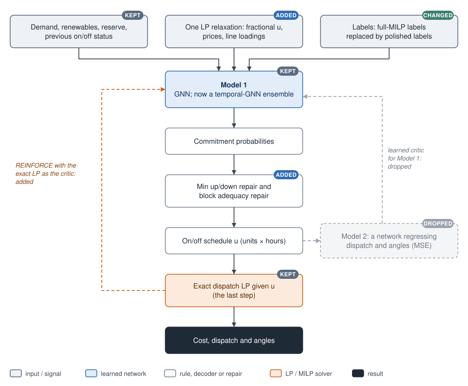
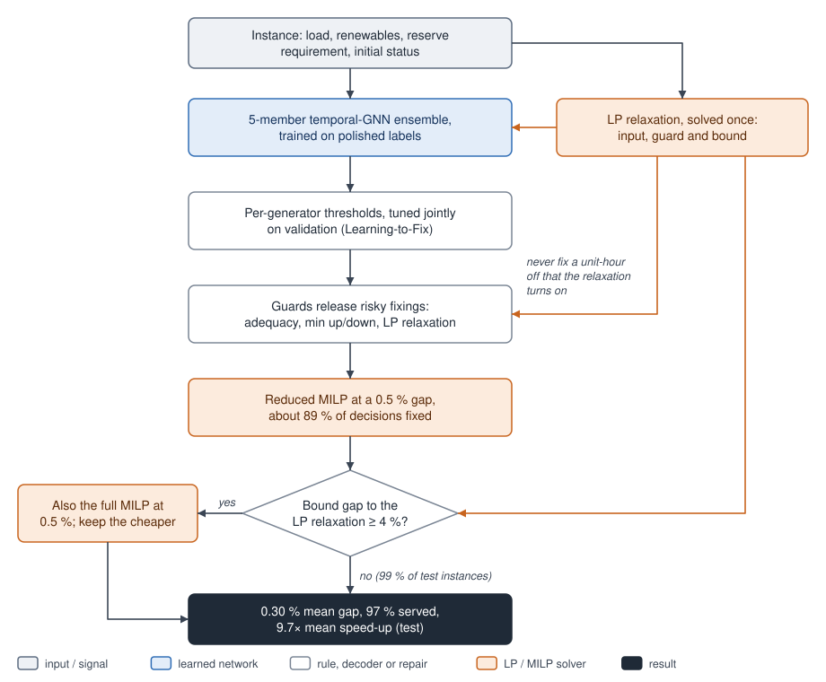
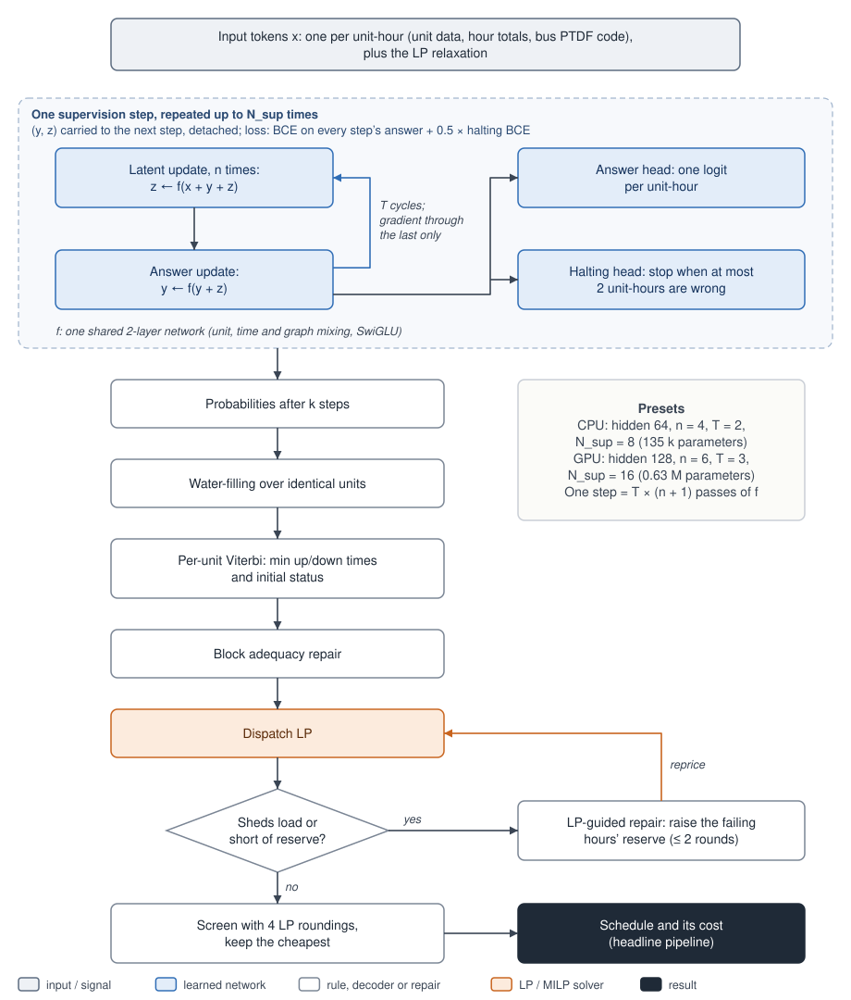
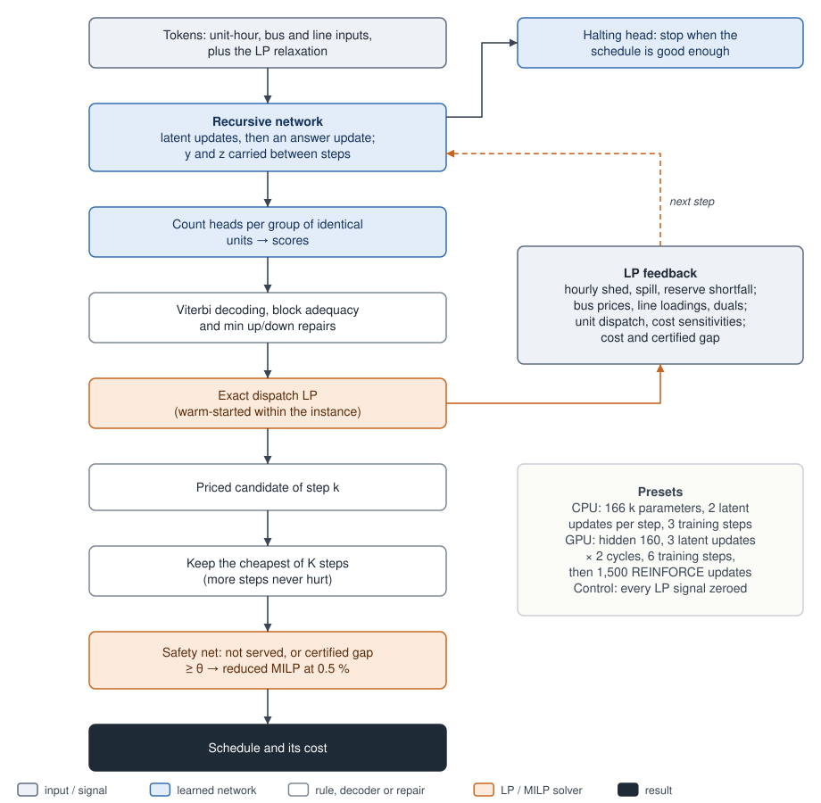
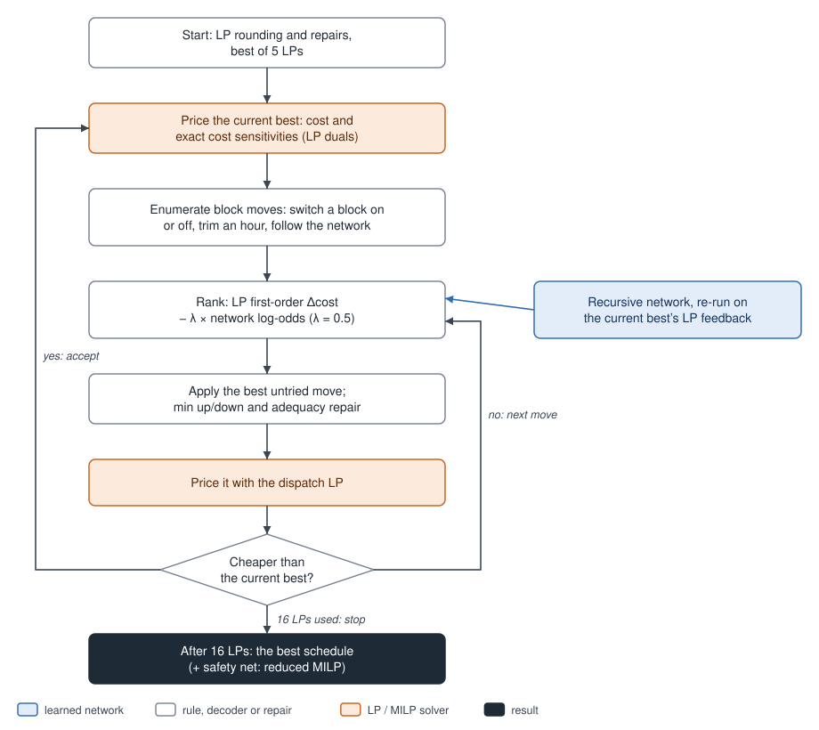
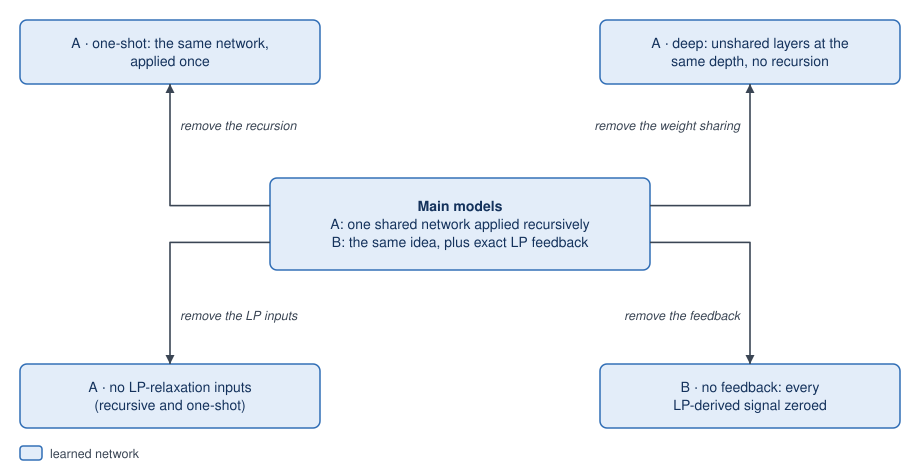
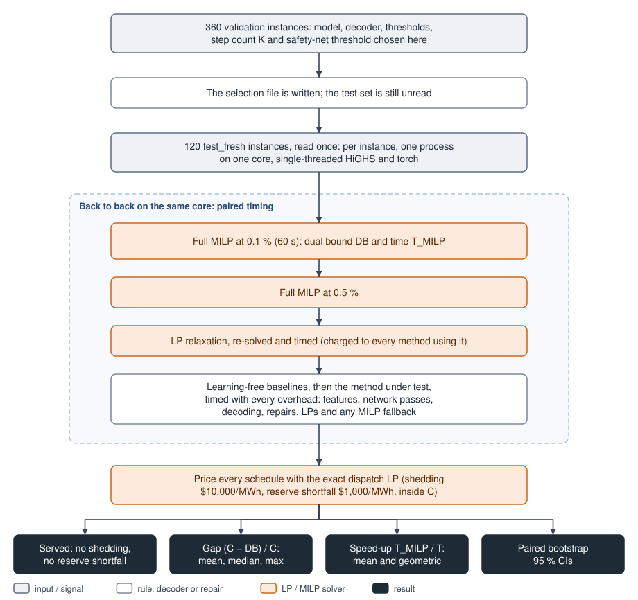

# Framework diagrams

*Diagrams of every framework in this study, drawn to match the code (SVG, generated by
[`scripts/draw_frameworks.py`](../../scripts/draw_frameworks.py); one colour per role in every figure: grey inputs and
signals, blue learned networks, white rules, decoders and repairs, orange LP / MILP solves, dark results). Sources: the original two-stage framework and the
MILP-based pipeline in [`../RESEARCH.md`](../RESEARCH.md) §1, §7–§9; the two recursive arms in
[`PLAN.md`](PLAN.md), [`trm.md`](trm.md) and [`rloop.md`](rloop.md); the CPU-round verdicts in
[`SUMMARY.md`](SUMMARY.md). Code: [`otsl/trm.py`](../../otsl/trm.py) (arm A) and
[`otsl/rloop.py`](../../otsl/rloop.py) (arm B). Every number below is quoted from those documents with its instance
count; the GPU round (50,000 labels, PACE ICE) is in [`gpu_round.md`](gpu_round.md). Unless stated otherwise the system is RTS-GMLC, 73 thermal units, 73 buses, 120 lines, DC network, 12-hour
windows with min up/down, ramping, start-ups and a 3 % spinning reserve; selection on 360 validation instances and one
pass over the 120 `test_fresh` instances.*

## 1. The original two-stage framework

The starting point is the published two-stage framework: demand goes into Model 1, a GNN that predicts every
generator's on/off decision in one pass and is trained by BCE against full-MILP labels; the dispatch LP then solves for
power and angles given those commitments; Model 2 is a second network that regresses dispatch from demand and
commitments, and its output feeds Model 1's loss through the dashed arrow. Measured on the 12-hour benchmark, that
one-shot pipeline under-commits badly: 8–17 % of instances are served without shedding or reserve shortfall against
the MILP's 92.5 % (§1 and §4 V2). The dashed arrow hurts — every Model 1 trained through a frozen learned Model 2 was
worse than plain imitation, and the framework's direct dispatch-and-angle Model 2 drove it to commit 18–27 units
instead of 15 (§3 U6). What §9 keeps is the skeleton with better inputs and a different critic: the previous on/off
status, renewables, the reserve requirement and one LP-relaxation solve as features, imitation followed by REINFORCE
with the exact dispatch LP as critic, the min up/down and block adequacy repairs on every prediction, and the LP as
the last step. What it discards is the learned Model 2 as critic or screener, and the requirement of full-MILP labels.

## 2. The current best method: the MILP-based pipeline

The best method in the repository is not end to end: it is the MILP pipeline of §7 Y6 and §8 Z1. A 5-member
temporal-GNN ensemble trained on polished labels produces the probabilities; Learning-to-Fix's joint threshold tuning,
run on validation only, decides which decisions to fix; the adequacy, min up/down and LP-relaxation guards release
fixings that would starve the problem; a reduced MILP at a 0.5 % gap solves what is left; and a free post-solve check
compares the reduced cost with the LP relaxation already solved as model input and, if the bound gap is at least 4 %,
also solves the full MILP at 0.5 % and keeps the cheaper schedule. On the 120 `test_fresh` instances this gives a
0.30 % mean gap, max 2.71 %, 97 % served and a 9.7× mean speed-up with 89 % of decisions fixed, level with the full
MILP at 0.5 % and 2.85× faster; with the bound check re-run in the same process, 0.30 % at 10.1×, the check firing on
1 % of instances. The LP-relaxation guard is what removes the line-outage catastrophe that breaks every tuned rule
without it, 0.24 % against 15.9–26.0 %, and the bound check is what closes the low-load and high-renewables failures,
1.59 % and 1.36 % down to 0.40 % and 0.43 %.

## 3. Arm A: the TRM-style recursive model

Arm A asks whether a tiny network applied recursively can replace the MILP. One token per unit-hour carries the unit's
parameters, the hour's totals, its bus's PTDF encoding and the LP-relaxation values; a shared 2-layer network with
unit, time, graph and SwiGLU sub-blocks updates a latent state `z` n = 4 times from `x`, `y` and `z`, then updates the
answer `y` from `y` and `z`; that cycle runs T = 2 times per supervision step, the first without gradients, so one step
costs 10 network calls. Deep supervision keeps each instance for up to N_sup = 8 steps with `y` and `z` carried
forward detached, BCE on every step's answer plus half a BCE on a halting head that predicts "at most 2 wrong
unit-hours". The CPU preset is hidden 64, 2 layers, batch 16, 3,000 training steps, EMA 0.999, 135 k parameters,
73 min on one core. On the 120 test instances the model's own schedule with one LP is 4.96 % mean gap at 87.5 % served,
2.55 % with the LP-guided repair, and the validation-chosen headline pipeline — the model's schedule screened together
with 4 LP roundings — is 1.48 % [1.10, 1.98] at 99.2 % served and 19.1× mean speed-up, against 1.71 % for learning-free
LP rounding and 1.30 % for the same network used one-shot.

**GPU round.** On 50,000 polished labels with the `gpu_small` preset (hidden 128, n = 6, T = 3, N_sup = 16, attention
mixers, 0.63 M parameters, so one supervision step is 21 passes of f), the validation-chosen headline pipeline — the
model's schedule screened with 4 LP roundings, then the LP-guided repair — scores 1.374 % at 99.2 % served and 2.6×
mean speed-up on the 120 test instances. The same pipeline gives 1.240 % with the one-shot control and 1.021 % with the
deep control, both at their final checkpoints. On one CPU core the 16 steps alone take 8.1 s per instance.

## 4. Arm B: recursion with the exact dispatch LP in the loop

Arm B puts the exact dispatch LP inside the recursion. One outer step is one pass of a 166 k-parameter recurrent
network over unit-hour tokens, bus tokens and line tokens — 2 latent updates and one answer update per step, the input
re-injected at every latent update, count heads for the 24 groups of identical units — followed by Viterbi decoding,
the repairs and one exact dispatch LP, whose signals are the next step's input: hourly energy shed, spill and reserve
shortfall, bus prices, line loadings and flow duals, per-unit dispatch, reserve and the exact sensitivity of cost to
each commitment, plus the cost and the certified gap to the LP relaxation. Every step's schedule is therefore a priced
candidate and the cheapest is kept, so more steps never hurt; because the recursion often re-proposes a schedule it has
already priced, 16 steps cost 3.5 distinct LPs on average and 32 steps 4.5. The feedback is what makes the extra steps
pay: with it, going from 1 to 16 steps lowers the validation mean gap by 1.88 pp, without it by 0.68 pp, and at 16
steps feedback is worth 0.78 pp [0.07, 1.54] after imitation and 1.26 pp [0.62, 2.05] after REINFORCE. On the 120 test
instances the selected whole-schedule model reaches 1.77 % [1.33, 2.30] at 95.8 % served and 33.3× mean speed-up —
level with learning-free LP rounding at 1.75 % and half as fast.

**GPU round.** On 50,000 instances (hidden 160, 3 latent updates × 2 cycles per step, 6 training steps, 60 supervised
epochs, then 1,500 REINFORCE updates; K = 24 at test), the loop scores 0.763 % at 99.2 % served and 5.4× mean speed-up
on the 120 test instances, against 1.316 % at 94.2 % for the same model without feedback. On the 112 instances both
serve, the two are level (−0.05 pp [−0.22, +0.12]): the feedback buys feasibility, not cost. With the safety net
(a reduced MILP when the schedule is not served or its certified gap is at least 1 %), 0.342 % at 100 % served and
3.9×.

Arm B's best result uses the same network differently: the LP prices every move and the network only ranks the moves.
The search starts from the learning-free LP-rounding schedule, best of 5 LPs; at each iteration it enumerates block
moves — switch an off unit on for a block of its minimum up time, switch a whole on-block off, trim one hour from
either end, or follow the network wherever its rounding disagrees with the current schedule — and ranks them by the
LP's first-order cost prediction from the exact bound duals minus lambda times the network's mean log-odds supporting
the new values, with lambda = 0.5 chosen on validation. The best untried move is made min up/down-feasible and
adequate, priced by the LP, and kept only if it is cheaper; the network is re-run on the LP feedback of the current
best schedule after every accepted move and every few rejected ones. With 16 LPs after the start this gives 1.14 %
[0.93, 1.39] at 99.2 % served and 20.6× on the 120 test instances: 0.61 pp better than LP rounding, 0.15 pp better than
the same search with no learning at all, and indistinguishable from the same search ranked by the static one-shot
ensemble, so most of the gain is the LP-in-the-loop search rather than the recursion. Adding the safety net — a reduced
MILP at 0.5 % when the schedule is not served or its certified gap to the LP relaxation exceeds 2 %, firing on 25 % of
instances — gives 0.64 % [0.55, 0.74] at 100 % served and 13.1× mean.

The network-ranked search was not rerun in the GPU round; its learning-free version scored 1.222 % at 99.2 % served
and 16.6× there.

## 5. The controls

Each control changes exactly one thing against its arm's main model and keeps the data, the training steps and the
pipeline identical, so the comparison isolates one design choice. Removing the recursion from arm A leaves the
one-shot network, which is better on probabilities after a sixth of the training time, so recursion does not pay at
equal size. Removing the weight sharing instead, at the same compute per step, is level with the TRM, so the
recursion's advantage over plain depth is also absent. Removing the LP-relaxation inputs from either arm-A model costs
about 2.4 pp, which is the largest single effect in the study and says the relaxation carries most of the answer.
Zeroing every LP-derived feedback signal in arm B, while keeping the priced schedule and what the repairs changed, is
the one ablation with a clear gain for recursion. At 50,000 labels (last column) both arm-A controls pull ahead of the
TRM at their final checkpoints, and the arm-B gain turns out to be one of feasibility: on the instances both models
serve, the feedback is worth nothing.

| control | the single change | CPU round (2,000 labels) | GPU round (50,000 labels) |
|---|---|---|---|
| arm A one-shot | the same network applied once to the initial state, equal parameters, plain BCE | better probabilities, validation BCE 0.0414 vs 0.0463, and a better best pipeline on test, 1.30 % vs the TRM's 1.48 % | better again at its final checkpoint: on test the TRM is −0.36 pp [−0.65, −0.08] (1 LP + repair) and −0.26 pp [−0.40, −0.12] (5 thresholds + repair) behind it |
| arm A deep non-recursive | unshared networks at one supervision step's compute (1.32 M parameters on CPU, 13.1 M on GPU) | level with the TRM, Δ gap +0.03 pp [−0.06, +0.14] on test; 5 thresholds + repair 1.34 % | better than the TRM on test: −0.35 pp [−0.71, −0.05] (mixed + repair), −0.59 pp [−0.95, −0.22] (1 LP + repair) |
| arm A no-LP-features pair | the LP-relaxation inputs removed from the TRM and from the one-shot control | validation 1-LP + repair 6.29 % and 6.30 % against 4.42 % and 3.87 %; with no LP anywhere, 7.96 % and 7.24 % | validation, mixed + repair: TRM 1.913 % against 1.731 % (the LP inputs worth +0.18 pp [+0.05, +0.35]); one-shot 1.963 % against 1.488 % |
| arm B feedback-off | every LP-derived signal zeroed, the priced schedule and the repair changes kept | validation K = 16: 6.95 % vs 6.17 %, i.e. feedback −0.78 pp [−1.54, −0.07]; after REINFORCE −1.26 pp [−2.05, −0.62] | test K = 24: feedback +0.55 pp [+0.01, +1.28] overall (99.2 % vs 94.2 % served), −0.05 pp [−0.22, +0.12] on the instances both serve |

## 6. The evaluation protocol

Every method is scored per instance in one single-threaded process pinned to one core, with HiGHS and torch limited to
one thread, and everything solved back to back so the timings are paired. The full MILP at a 0.1 % gap runs first with
a 60-second limit, 300 s on 24-hour windows and 600 s on the congested benchmark; it supplies the dual bound DB and the
denominator of every speed-up. Then come the full MILP at 0.5 %, the LP relaxation — re-solved and timed, because its
time is charged to every method that uses it — the learning-free LP-rounding baseline with repairs and the best of 5
LPs, and finally the method under test, whose time includes featurisation, every network pass, decoding, repairs, LPs
and any MILP fallback. Every schedule is priced by the same exact dispatch LP, with shedding at $10,000/MWh and
reserve shortfall at $1,000/MWh, so the cost C already contains those penalties. Reported are the served share, the
gap to the dual bound as mean, median and max, the speed-up as mean, median and geometric mean, and paired
instance-bootstrap 95 % confidence intervals for differences in gap and in log speed-up (2,000 resamples in the CPU
round, 10,000 in the GPU round, where DB is also the tightest bound over every full-MILP solve of the instance). All
model, decoder, threshold, step-count and safety-net choices are made on the 360 validation instances; the 120
`test_fresh` instances are read once, after the selection file is written.

## Where each arm stands

CPU round, uc12 `test_fresh`, 120 instances, one seed per configuration. Both arms re-ran the shared baselines on
their own cores, so their numbers differ slightly: arm A added an LP-guided adequacy repair to every pipeline, arm B
used the existing repairs. Neither arm meets the success criterion of [`PLAN.md`](PLAN.md), namely at least 95 %
served at a mean gap of 0.5 % or less in well under a second, and no end-to-end pipeline beats the MILP pipeline of
§7–§8.

| pipeline | served | mean gap, 95 % CI | speed-up vs the full MILP, mean |
|---|---|---|---|
| full MILP at 0.5 % | 96.7 % | 0.23 % [0.18, 0.29] | 3.9× |
| *MILP pipeline of §7–§8, quoted* | *97 %* | *0.30 %* | *~10×* |
| LP rounding + repair, 5 LPs, no learning | 98.3–99.2 % | 1.71–1.75 % | 43–62× |
| one-shot temporal-GNN ensemble + repairs, 5 LPs | 95.0–99.2 % | 1.45–2.00 % | 34–55× |
| **A**: TRM schedule + 4 LP roundings + repair | 99.2 % | 1.48 % [1.10, 1.98] | 19× |
| A: one-shot, same net, + REINFORCE + reduced-MILP safety net | 100 % | 1.17 % [0.98, 1.37] | 48× |
| **B**: whole-schedule recursion with LP feedback, 16 steps | 95.8 % | 1.77 % [1.33, 2.30] | 33× |
| B: local search from LP rounding, no learning, 16 LPs | 99.2 % | 1.29 % [1.03, 1.57] | 28× |
| **B**: same search, moves ranked by the recursive network | 99.2 % | **1.14 % [0.93, 1.39]** | 21× |
| B: … + reduced-MILP safety net, 25 % fall back | 100 % | 0.64 % [0.55, 0.74] | 13× |
| B: … with a stricter safety net, 52 % fall back | 99.2 % | 0.46 % [0.38, 0.56] | 8.5× |

The CPU round could not separate "recursion does not help here" from "recursion was not given enough data or epochs":
the TRM saw 3 epochs of 2,000 instances against the one-shot's 24. The GPU round settled it on 50,000 polished labels
([`gpu_round.md`](gpu_round.md)): arm A's go/no-go failed (the TRM had to beat the one-shot by about 0.2 pp and is
behind it instead), and arm B's LP feedback again bought feasibility rather than cost.

GPU round, uc12 `test_fresh`, 120 instances, gap to the tightest proven bound, one seed per model. Arm A ran on one
CPU type, arm B's tasks on three, so speed-ups across the arms are rough (LP rounding, identical in both, is 41× in arm
A's records and 52× in arm B's).

| pipeline | served | mean gap | speed-up vs the full MILP, mean |
|---|---|---|---|
| full MILP at 0.5 % | 96.7 % | 0.261 % | 3.6× |
| **B**: feedback loop, 24 steps + safety net | 100 % | 0.342 % | 3.9× |
| A: deep control + safety net | 99.2 % | 0.753 % | 20.5× |
| **B**: feedback loop, 24 steps | 99.2 % | 0.763 % | 5.4× |
| A: one-shot control + safety net | 100 % | 0.892 % | 44.6× |
| A: deep control, model + 4 LP roundings + repair | 99.2 % | 1.021 % | 19.7× |
| B: local search from LP rounding, no learning, 16 LPs | 99.2 % | 1.222 % | 16.6× |
| A: one-shot control, model + 4 LP roundings + repair | 100 % | 1.240 % | 33.8× |
| B: no-feedback loop, 24 steps | 94.2 % | 1.316 % | 5.4× |
| **A**: TRM, model + 4 LP roundings + repair (headline) | 99.2 % | 1.374 % | 2.6× |
| LP rounding + repair, 5 LPs, no learning | 99.2 % | 1.707 % | 40.8× |
