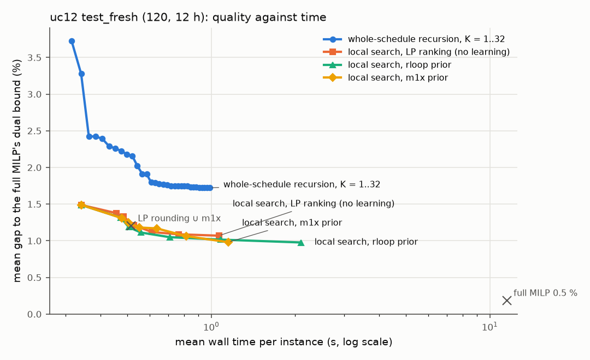

# rloop: recursion with the dispatch LP in the loop (arm B)

*Code: [`otsl/rloop.py`](../../otsl/rloop.py), `scripts/rec_rloop_{common,train,val,eval,report}.py`, Slurm jobs
`scripts/pace/rloop_*.sbatch`. Results: [`results/recursive/rloop_results.md`](../../results/recursive/rloop_results.md)
(+ `.json`), raw records `results/recursive/rloop_eval_<bench>_s<shard>.jsonl`, validation
`results/recursive/rloop_val_*.npz` and `rloop_val_summary.json`, training histories `results/recursive/rloop_train_<tag>.json`.
Checkpoints and logs (git-ignored): `data/generated/recursive/rloop/`.*

## Status

*Kept current for resuming after a container restart. Every step resumes: rerun the same command.*

- 23:45 smoke tests passed (training one epoch, RL, worker pool with in-flight batches, test evaluation on one
  instance each of uc12 and line_out).
- 23:51 validation baselines done (`scripts/rec_rloop_val.py --baselines --report`).
- 23:52 `main` (core 2) and 23:54 `nofb` (core 3) supervised training started, 10 epochs each (~5.3 min/epoch):
  `OTSL_THREADS=1 taskset -c 2 python3 scripts/rec_rloop_train.py --tag main --preset cpu`,
  `... -c 3 ... --tag nofb --preset cpu --no_feedback`; logs `data/generated/recursive/rloop/<tag>.{log,out}`.
- 00:15 diagnosis: under imitation the per-step training errors are identical (≈ 9.6 wrong decisions per instance at
  steps 0, 1, 2, with and without feedback); the model alone is worse than LP rounding on validation (epoch 4, 60
  instances: 3.43 % vs 1.86 %), seeded with the LP-rounding schedule it improves it slightly (1.75 %). Added: seeded
  refinement (inference `--start lpround`, RL `--p_seed`), an anchor skip from the priced schedule to the logits
  (`--anchor`), a sampling temperature for RL (`--rl_temp`), cost-weighted deep supervision (`--w_wrong`, `--w_grad`).
- 00:30 queues (scratchpad `rloop_q2b.sh`, `rloop_q3.sh`; each job resumes or no-ops if done):
  core 2: main → `main_rl` (RL) → `main_rls` (RL with seeded batches, anchor 2, temperature 0.5) → `norecall`;
  core 3: nofb → `nods` → `nofb_rl`. Commands: `python3 scripts/rec_rloop_train.py --tag main_rl --stage rl --init main`;
  `... --tag main_rls --stage rl --init main --anchor --anchor_init 2.0 --rl_temp 0.5 --p_seed 0.5`;
  `... --tag norecall --preset cpu --no_recall`; `... --tag nods --preset cpu --no_deep_sup`;
  `... --tag nofb_rl --stage rl --init nofb`.
- 00:55 `nods` (back-propagation through all 3 outer steps) reached 5.0 GB at batch 32: restarted from its epoch-2
  checkpoint with batch 16 × gradient accumulation 2 (same effective batch; `--accum`), ~2.8 GB. Core-2 queue had
  stalled (its wait pattern matched its own parent shell) and was restarted; `main_rl` ran 01:00–01:23.
- 01:10 full validation (360): whole-schedule recursion, supervised: `main` 8.05 % (K = 1) → 6.17 % (K = 16), `nofb`
  7.63 % → 6.95 %; seeded with LP rounding (2.14 %): `main` 1.87 %, `nofb` 1.88 %. Learning-free LP-gradient local
  search from LP rounding: 1.64 % with 16 LPs. Added: model-guided LP-verified search (`rloop.guided_search`,
  `rec_rloop_val.py --guide none|m1x|net --lam`), selection script `scripts/rec_rloop_select.py`.
- 01:30 λ sweep of the guided search on validation 0–119 (scratchpad `rloop_sweep1.sh`), whole-schedule validation
  of `main_rl`, `main_rls` and decoding biases (scratchpad `rloop_valq2.sh`).
- 02:00 **container restart** killed every job; checkpoints and results survived. 02:04 restarted with one process per
  core: core 2 = selection validations (`rloop_A.sh`: guided full validation for priors m1x, main, main_rl, nofb,
  run-once control, union seeds, main_rl with bias 1; each step skipped if its npz exists); core 3 = remaining
  trainings and their validation (`rloop_B.sh`: nods from epoch 7, nofb_rl, norecall from epoch 2, nocount, then
  whole-schedule and guided validation of each). Both scripts in the scratchpad `rloop/` folder; rerun to resume
  (training resumes from its checkpoint, finished validations are skipped).
- 02:29 selection done (`results/recursive/rloop_select.json`, validation only): main learned pipeline = LP rounding
  (5 LPs) + LP-verified local search guided by the recursive network `main_rl` (λ = 0.5, 16 LPs); best whole-schedule
  recursion = `main_rl` with decoding bias +1, K = 16 (32 on 24 h); safety-net θ = 2 % (validation fallback 27 %;
  at 1 %: 53 %). Added before the test: union-seeded variants (best of LP rounding and m1x as the start), 12 h only.
- 02:30 test started: scratchpad `rloop_test_worker.sh <core> [pid]` pulls (bench, shard) jobs (uc12, line_out, hard,
  uc24; 4 shards each) with lock dirs in `data/generated/recursive/rloop/test_locks/` (`.done` marker per finished
  job); log `data/generated/recursive/rloop/test.log`, per-job logs `test_<bench>_s<i>.log`, records
  `results/recursive/rloop_eval_<bench>_s<i>.jsonl`. Core 2 now; core 3 after `rloop_B.sh`. **Resume after a
  restart:** delete lock dirs without `.done`, rerun both workers (one per core; the evaluation skips finished
  instances), and rerun `rloop_B.sh` if it had not finished.
- 04:03 uc12 test done (120); 04:20 line_out done (30); 04:33 `rloop_B.sh` done (ablation trainings `nods`, `nofb_rl`,
  `norecall`, `nocount` and their validation), core 3 joined the test (hard, then uc24). Results and Ablations
  sections written from the finished parts; `python3 scripts/rec_rloop_report.py` rebuilds every table.
- 05:14 congested benchmark done (60); 06:04 uc24 done (40). **Study complete**: 250 test instances, report
  `results/recursive/rloop_results.{md,json}` (+ `rloop_quality_time_<bench>.png`). Nothing runs.

## Summary

**Question.** Can a small recursive network that refines a unit-commitment schedule with the exact dispatch LP in the
loop (arm B of [`PLAN.md`](PLAN.md)) produce good schedules end to end, without a MILP?

**Model.** A 166k-parameter recurrent network over (unit, hour) tokens and the bus graph (TRM answer / latent state,
input re-injected at every step, count heads for the 24 groups of identical units, Viterbi decoding feasible for
min up/down by construction, PTDF bus encodings). After every outer step its schedule is repaired and priced by the
exact dispatch LP, whose prices, shortfalls, line loadings and exact sensitivities d cost / d u are the next step's
input; every step is a priced candidate and the best is kept. Trained on 2,000 instances (500 MILP + 1,500 polished
labels) with deep supervision on its own LP feedback, then REINFORCE on each step's LP-priced improvement. CPU only,
~1 core-hour per training run.

**Findings (uc12 test_fresh, 120 instances, paired timing; validation-selected).**

1. **The solver feedback is what makes the recursion work, but whole-schedule recursion is not better than LP
   rounding.** On validation, 16 steps with feedback improve on 1 step by 1.88 pp, without feedback by 0.68 pp
   (feedback − no feedback at K = 16: −0.78 pp [−1.54, −0.07]; after REINFORCE −1.26 pp [−2.05, −0.62]). On test the
   selected whole-schedule model (REINFORCE + decoding bias, K = 16, 3.5 distinct LPs) reaches 1.77 % mean gap
   (95.8 % served) at 33× — level with learning-free LP rounding + repair + 5 LPs (1.75 %; Δ +0.02 pp [−0.30, +0.34])
   and half as fast. Its failure mode is the imitation model's under-commitment (shedding / reserve shortfall).
   Recall, deep supervision and count heads made no significant difference.
2. **Used as the move prior of an LP-verified local search started from LP rounding, it beats LP rounding, the
   one-shot ensemble and the same search without learning**: LP rounding + 16 guided LPs gives **1.14 % [0.93, 1.39]**, 99.2 % served, 1.09 s, 20.6× mean speed-up;
   −0.61 pp [−0.95, −0.33] against LP rounding, −0.87 pp against the one-shot m1x ensemble with the same repairs and
   5 LPs, −0.15 pp [−0.28, −0.03] against the same search without learning. But a **static** prior from the one-shot
   ensemble is as good (−0.02 pp [−0.06, +0.02]); re-running the network on the LP feedback beats running it once
   (validation −0.05 pp [−0.08, −0.02]), a small effect. Most of the gain is the LP-in-the-loop search itself.
3. **Best end-to-end result without a MILP**: start from the best of LP rounding and m1x (10 LPs), then 16–32 guided
   LPs: 0.90 % with 16 (rloop prior, 1.26 s, 17×), 0.83–0.84 % with 32 (rloop or m1x prior, 1.3–2.3 s); the same
   search without learning from that start gives 1.03 % / 0.96 %. **With a safety net** (reduced MILP when the
   certified gap to the LP relaxation exceeds θ = 2 %, 25 % of instances): **0.64 % [0.55, 0.74], 100 % served, 13.1× mean /
   8.5× geometric** — 0.41 pp [0.32, 0.51] less accurate than the full MILP at 0.5 % and 3.8× faster.
4. **Success criterion of the plan (≥ 95 % served at ≤ 0.5 % mean gap in well under a second) is not met.** The minimum
   bar (beat LP rounding and the one-shot model) is met by the guided search (1.14 % vs 1.75 % / 2.00 %) but not by
   the whole-schedule recursion (1.77 %). Only the safety net with θ = 1 % gets under 0.5 % (0.46 %, 52 % fallback,
   8.5×), which is less accurate and no faster than the recommended MILP pipeline of the earlier study (0.30 % at
   9.7×, not re-run here).
5. **Extrapolation** (zero-shot; the recursive model is length- and topology-agnostic): on line outages and congested
   lines the whole-schedule recursion collapses like the one-shot ensemble (≈ 52 % served; LP feedback recovers part
   of it over the steps), while the guided search stays robust: 0.84 % (outages), 1.06 % (congested), 1.13 % (24 h
   with 2 × K steps) against 1.23 / 2.37 / 1.77 % for LP rounding; the recursive prior beats the learning-free search
   significantly on outages (−0.11 pp) and 24 h (−0.15 pp), not on congestion (−0.01 pp). With the safety net:
   0.47 / 0.51 / 0.67 % at 18 / 27 / 24× mean speed-up.

## Method

**Loop.** One outer step is one pass of a small recurrent network followed by one exact dispatch LP:

```
step 0:  (y, z) <- recursion(x, no feedback)              -> scores_0 -> s_0 = decode(scores_0) -> LP(s_0)
step k:  (y, z) <- recursion(x, feedback(LP(s_{k-1})))    -> scores_k -> s_k                    -> LP(s_k)
output:  the cheapest priced schedule among s_0 .. s_{K-1} (shedding and reserve shortfall priced in)
```

Every step's schedule is a priced candidate, so the output never gets worse with more steps; a step whose decoded
schedule was already priced costs no LP.

**Tokens and mixing.** One token per (unit, hour), carrying physics rather than indices: unit parameters (limits, cost
curve, start-up cost, min up/down, ramp, type), initial status, identical-group size, hourly system data (load, net
load, reserve requirement, renewables), the distance to the horizon's start and end (clipped at 12 h), and the LP
relaxation's commitment and price at the unit's bus. There are no unit-ID embeddings and no absolute hour embeddings.
One shared recursion block mixes along three axes: across hours for each unit (residual dilated 1-D convolutions,
dilations 1, 2, 4, kernel 3, length-agnostic), across units in the same hour (DeepSets mean pool), and over the bus
graph per hour (units averaged into their buses, interaction-network message passing over the 120 lines with an edge
gate that switches off lines out of service, gathered back to the units). Bus tokens carry load, renewables, capacity,
the relaxed price and a PTDF signature (the bus's column of the PTDF matrix projected on the 16 leading singular
vectors of the intact network's PTDF, recomputed when lines are out); line tokens carry susceptance, rating, relaxed
loading and an in-service flag.

**Recursion (TRM).** State per token: an answer y and a latent z (64-d). One outer step runs `n_latent = 2` latent
updates `z <- core(z + x_emb + fb_emb + W y)` and one answer update `y <- y + MLP(y, z)`. *Recall*: the input
embedding x_emb is re-injected at every latent update (Bansal et al. 2022); without recall it only initialises z.
(y, z) is carried across outer steps.

**Count heads for identical units.** 56 of the 73 units sit in 24 groups of identical copies at one bus. Per group and
hour the network outputs ordinal logits l_j = logit P(count > j), j = 0 .. m−1, from the group's mean-pooled answer
state, monotone by construction (l_j = l_{j−1} − softplus(·)). The copies are stacked in a fixed order (initially-on
units first, then by index): copy j is on iff the count exceeds j, so l_j is copy j's logit and its target is
[count* > j], with count* the label's count. This removes the exact symmetry (34–62 % of labels are arbitrary between
copies) without a rank feature; singletons are groups of size 1. Ablation: per-unit heads with a symmetry-rank input
and labels aligned to the prediction inside groups (Hungarian matching per group, as in `otsl.fixpolicy`).

**Decoding, feasible by construction for unit constraints.** Per unit, a Viterbi pass over the on/off state machine
(on for 1..U hours, off for 1..D hours; switching needs U on-hours or D off-hours; initial status without carry-over,
as in the MILP) finds the most likely schedule under the network's probabilities; it is vectorised over units with
equal (U, D) and takes 2.6 ms for 12 h. Then the block (min up/down-aware) adequacy repair of §5 W1 and the Hamming
min up/down repair as a safety net (a no-op after Viterbi unless the adequacy repair breaks a block). On 0/1 input
the Viterbi pass is the Hamming-nearest feasible schedule (checked against `otsl.uc.repair_min_updown`). Ablation:
rounding at 0.5 + repairs. An inference-time logit shift (decoding bias) is tuned on validation only.

**LP feedback.** The dispatch LP of the decoded schedule (`otsl.uc.UCModel`'s model, solved with highspy on a solver
object that is warm-started across one instance's steps; outages as in `otsl.ood.OODModel`) returns, as inputs of the
next step: per unit-hour the priced schedule, what decoding and repair changed relative to the rounding, output and
reserve relative to the limits, at-limit flags, the LMP at the unit's bus and the exact sensitivity d cost / d u from
the bound duals including the start-up and shut-down variables (the envelope-theorem gradient of
`UCModel.dispatch_gradient`, checked to match it exactly); per bus-hour LMP, shed and spill; per line-hour loading,
the flow-limit dual and a binding flag; per hour energy shed, spill, reserve shortfall, reserve price and capacity /
minimum-output margins; per instance the certified gaps of the current and best schedule to the LP relaxation, and
served / is-best flags. Prices and duals enter as signed logs. Ablation *no feedback*: every LP-derived signal is
zeroed; the priced schedule and the repair changes stay, so the recursion and inputs are otherwise identical.

**Training, stage 1: deep supervision with LP feedback of the model's own schedule.** 2,000 training instances (500 with
MILP labels, 1,500 with the polished labels of §7 Y3; no further MILP). Per batch, K_train = 3 outer steps on policy:
the network's step-k probabilities are decoded and priced by the LP, and the feedback feeds step k+1. Every step is
supervised (BCE to the stacked count targets), the optimizer steps after every outer step and (y, z) are detached in
between (TRM deep supervision). *Progressive training*: with probability 0.25 a batch starts from an arbitrary
schedule and its LP feedback instead of the model's own step 0 (the LP relaxation rounded at a random threshold, or the
label with ~3 units removed and ~3 added for random blocks), so the network learns to improve from any start.
A halting head (a probe on detached pooled answer states) is trained to predict whether the step's schedule will be
priced within 0.5 % of the best known cost (the label's LP cost). AdamW 1e-3, cosine schedule with warm-up, gradient
clipping, EMA of the weights (0.995) used for evaluation; batch 32, 10 epochs. Ablation *no deep supervision*: the loss
of the last step only, back-propagated through all three steps (no detach).

**Training, stage 2: cost-aware fine-tuning with the exact LP as critic.** REINFORCE on every outer step: the
trajectory follows the deterministic decoding (as at inference); at each step 4 Bernoulli samples of the step's
probabilities are decoded and priced; reward = log(c_best_before / c_sample), the step's improvement over the best
schedule so far, which is exactly what keep-best inference gains (clipped below at −5 %; step 0: −log(c / c_relax));
leave-one-out baseline; plus 0.5 × the supervised loss as an anchor; halting loss on the greedy schedule's cost.

**Second use of the same network: guided LP-verified search.** Added after the first validation results (see Status):
start from the LP-rounding baseline's best schedule (5 LPs), then repeat for a budget of LPs: rank block moves on the
current best schedule — switch an off unit on for a block of its minimum up time from any hour, switch off a whole
on-block, trim one hour from either end of an on-block, and set every maximal block where the network's rounding
disagrees with the schedule to the network's value — by the LP's first-order cost prediction (Σ d cost/d u × change,
from the exact bound duals, in % of the current cost) minus λ × the network's mean log-odds in favour of the new
values; apply the best untried move, make it min up/down-feasible (Hamming) and adequate (block repair), price it with
the LP, keep it if it is cheaper. The recursive network is re-run on the LP feedback of the current best schedule after
every accepted move and after every 4 rejected ones (its (y, z) state carried), so its prior follows what the LP says.
λ = 0 is a learning-free LP-gradient local search; with a fixed probability map as prior (the m1x ensemble) it is a
non-recursive learned search. λ is chosen on validation instances 0–119 (net 0.5, m1x 1).

**LP budget and parallelism.** LPs (decoding + repair + LP + feedback) run in a pool of CPU worker processes or in
process; with `inflight` > 1, several batches are kept in flight so the network trains on one while the workers price
another (the GPU configuration). On this container each training run is one single-threaded process on one core with
the LPs in process.

**Safety net.** If the selected pipeline's best schedule (after its LP budget) sheds load or misses reserve, or its
certified gap to the LP relaxation exceeds θ, a reduced MILP (0.5 % gap) around it is solved: the decisions where the
network's last prediction is confident (p ≥ 0.95 or ≤ 0.05) and agrees with the schedule and with an integral
LP-relaxation value are fixed (min up/down row release as in the hybrid pipeline), and the cheaper of the two
schedules is kept; if the reduced MILP is infeasible, the full MILP at 0.5 %. θ is chosen on validation (the smallest of 1, 2, 4 % whose validation fallback
rate is ≤ 30 %; at 1 % half of the validation instances would fall back, because the LP relaxation itself is 0.24 %
below the optimum at the median and 0.58 % on average); the fallback rate is reported.

## Setup

* **Compute.** Cores 2 and 3 of a 4-core container (cores 0–1 belong to the parallel arm A), one single-threaded
  process per core (torch 1 thread, HiGHS 1 thread), < 3.5 GB each (the no-deep-supervision run needed batch 16 × 2
  accumulation to stay under it). Training runs and evaluation shards are pinned with `taskset`. Before the 02:00
  container restart two processes shared a core during training and validation (no timing was measured then).
* **Data.** uc12 (RTS-GMLC, 73 units, 12 h, DC network). Training: `train.npz` (500, MILP labels) + `uc12_m1x`
  extra_0–5 with polish_0–5 (1,500, polished labels). Validation: val + val_extra + val_extra2 (360), gap to the stored
  MILP's dual bound. Test once: test_fresh (120).
* **Selection (validation only).** Model variant, decoding bias, number of outer steps K and the safety-net threshold θ
  are chosen on the 360 validation instances; the m1x baseline's rounding thresholds for 1, 3 and 5 LPs are chosen there
  too (greedy forward selection on the mean gap). Pre-declared rule for K: the smallest K ≤ 16 whose validation mean
  gap is within 0.02 pp of the best; for 24 h (zero-shot) 2 × that K, fixed before seeing any 24-hour result.
* **Test protocol (paired).** Per instance, in one process on one core and back to back: the full MILP at 0.1 % (60 s
  limit; 300 s on 24 h, 600 s on the congested benchmark, as in their studies) and at 0.5 %; the LP relaxation (its
  time is counted in every method); LP rounding + block repair + min up/down repair, best of 5 LPs (no learning, the
  thresholds of `otsl.base`); the m1x 5-member temporal-GNN ensemble (§7 Y3) rounded at the validation-selected
  thresholds with the same repairs, 1 / 3 / 5 LPs, and decoded with Viterbi, 1 LP; their union (10 LPs); rloop's
  whole-schedule recursion with up to 2 × K outer steps (and seeded with the LP-rounding schedule); the LP-verified
  local search from the LP-rounding schedule with 32 LPs, ranked without learning, with the m1x prior and with the
  recursive network (records per LP, so 4 / 8 / 16 / 32 are read from one run); the same three searches from the best
  of LP rounding and m1x (12 h sets); the safety net of the selected pipeline. All dispatch LPs through the same
  `FastLP` code (one solver object per method and instance). On the extrapolation sets only the full MILP at 0.1 %
  is solved (the speed-up reference). Shards of each benchmark were spread over cores 2 and 3, one process per
  core, nothing else running on that core.
* **Metrics.** Served share (no shedding, no reserve shortfall), gap (C − DB) / C to the dual bound of the full MILP
  solved in the same process (C = the schedule's dispatch-LP cost, penalties included), mean / median / max, wall time
  including every overhead, speed-up T_full(0.1 %) / T_method (mean, median, geometric mean), paired instance
  bootstrap 95 % CIs (2,000 resamples).

## Results

**uc12, test_fresh (120 instances), evaluated once**, every method back to back with the full MILP in one process on
one core (full tables with every LP budget: [`results/recursive/rloop_results.md`](../../results/recursive/rloop_results.md)).
Gap = (C − DB) / C to the dual bound of the full MILP at 0.1 % solved in the same process; C includes priced
shedding / reserve shortfall; served = no shedding and no shortfall; time includes the LP relaxation, inference,
decoding, repairs and LPs; speed-up = T_full(0.1 %) / T_method (mean / median / geometric mean).

| method | LPs | served | gap mean [95 % CI] | median | max | time | speed-up |
|---|---|---|---|---|---|---|---|
| full MILP, 0.1 % (reference) | – | 97.5 % | 0.19 % [0.12, 0.27] | 0.10 % | 3.25 % | 22.4 s | 1.0× |
| full MILP, 0.5 % | – | 96.7 % | 0.23 % [0.18, 0.29] | 0.10 % | 1.99 % | 12.1 s | 3.9× / 1.7× / 2.2× |
| *no learning*: LP rounding + repair | 5 | 98.3 % | 1.75 % [1.32, 2.25] | 0.91 % | 21.1 % | 0.35 s | 61.9× / 50.9× / 42.0× |
| one-shot m1x ensemble + repair | 1 | 92.5 % | 5.28 % [4.03, 6.80] | 2.15 % | 41.5 % | 0.32 s | 68.7× / 55.5× / 45.8× |
| one-shot m1x ensemble + repair | 5 | 95.0 % | 2.00 % [1.39, 2.76] | 0.80 % | 24.7 % | 0.40 s | 55.1× / 45.8× / 37.3× |
| LP rounding ∪ m1x (screening) | 10 | 98.3 % | 1.42 % [1.00, 1.93] | 0.56 % | 21.1 % | 0.53 s | 41.4× / 34.4× / 28.1× |
| **rloop, whole-schedule recursion**, K = 1 | 1 | 95.0 % | 3.52 % [2.37, 4.99] | 1.23 % | 64.2 % | 0.32 s | 69.0× / 56.3× / 46.1× |
| **rloop, whole-schedule recursion**, K = 16 | 3.5 | 95.8 % | 1.77 % [1.33, 2.30] | 0.79 % | 18.0 % | 0.66 s | 33.3× / 28.7× / 22.3× |
| **rloop, whole-schedule recursion**, K = 32 | 4.5 | 95.8 % | 1.63 % [1.20, 2.16] | 0.70 % | 18.0 % | 1.00 s | 22.2× / 18.5× / 14.7× |
| LP rounding + local search, LP ranking (*no learning*) | 5 + 16 | 99.2 % | 1.29 % [1.03, 1.57] | 0.83 % | 8.7 % | 0.79 s | 27.9× / 24.4× / 18.8× |
| LP rounding + local search, static m1x prior | 5 + 16 | 99.2 % | 1.15 % [0.93, 1.42] | 0.83 % | 9.7 % | 0.83 s | 26.1× / 22.1× / 17.8× |
| **rloop-guided search** (selected): LP rounding + local search, recursive prior | 5 + 16 | 99.2 % | **1.14 % [0.93, 1.39]** | 0.81 % | 9.4 % | 1.09 s | 20.6× / 17.6× / 13.6× |
| … with 32 LPs | 5 + 32 | 99.2 % | 1.05 % [0.86, 1.27] | 0.78 % | 8.5 % | 2.11 s | 11.0× / 8.8× / 7.0× |
| LP rounding ∪ m1x + local search, recursive prior | 10 + 16 | 99.2 % | 0.90 % [0.69, 1.15] | 0.41 % | 9.4 % | 1.26 s | 17.4× / 15.1× / 11.7× |
| LP rounding ∪ m1x + local search, m1x prior | 10 + 32 | 99.2 % | 0.84 % [0.64, 1.08] | 0.37 % | 8.4 % | 1.33 s | 16.4× / 13.8× / 11.1× |
| rloop-guided search + safety net, θ = 2 % (selected; fallback 25 %) | + MILP | 100 % | **0.64 % [0.55, 0.74]** | 0.53 % | 2.5 % | 2.91 s | 13.1× / 8.3× / 8.5× |
| rloop-guided search + safety net, θ = 1 % (fallback 52 %) | + MILP | 99.2 % | 0.46 % [0.38, 0.56] | 0.30 % | 2.5 % | 4.10 s | 8.5× / 6.3× / 5.9× |

Paired differences (instance bootstrap, 95 % CI; Δ log speed-up > 0 = faster):

| comparison | Δ gap, pp | Δ log speed-up |
|---|---|---|
| rloop-guided search − LP rounding (5 LPs) | **−0.61 [−0.95, −0.33]** | −1.13 [−1.16, −1.10] (3.1× slower) |
| rloop-guided search − one-shot m1x ensemble (5 LPs) | **−0.87 [−1.44, −0.39]** | −1.01 [−1.04, −0.99] |
| rloop-guided search − LP rounding ∪ m1x (10 LPs) | −0.28 [−0.62, −0.00] | −0.73 [−0.75, −0.70] |
| rloop-guided search − learning-free local search (16 LPs) | **−0.15 [−0.28, −0.03]** | −0.33 [−0.35, −0.30] |
| rloop-guided search − m1x-guided local search (16 LPs) | −0.02 [−0.06, +0.02] | −0.27 [−0.29, −0.25] |
| rloop-guided search − full MILP 0.5 % | +0.91 [+0.72, +1.12] | +1.80 [+1.59, +2.01] (6.0× faster) |
| rloop-guided search + safety net (θ = 2 %) − full MILP 0.5 % | +0.41 [+0.32, +0.51] | +1.34 [+1.16, +1.52] (3.8× faster) |
| rloop-guided search + safety net (θ = 2 %) − LP rounding (5 LPs) | **−1.11 [−1.59, −0.71]** | −1.59 [−1.75, −1.45] |
| whole-schedule recursion (K = 16) − LP rounding (5 LPs) | +0.02 [−0.30, +0.34] | −0.63 [−0.66, −0.61] |
| whole-schedule recursion (K = 16) − one-shot m1x ensemble (5 LPs) | −0.24 [−0.60, +0.09] | −0.52 [−0.53, −0.50] |
| whole-schedule recursion (K = 16) − one-shot m1x ensemble (3 LPs) | **−1.02 [−1.94, −0.34]** | −0.61 [−0.63, −0.59] |



**Quality against the number of outer steps** (whole-schedule recursion, uc12 test; each step one network pass and
at most one LP, none if the decoded schedule was already priced): K = 1: 3.52 % (median 1.23 %), 2: 3.10 %, 4: 2.58 %,
16: 1.77 % (median 0.79 %), 32: 1.63 % (median 0.70 %); time 0.32 → 0.66 → 1.00 s. Test-time compute helps
monotonically, at few LPs: the recursion often re-proposes a schedule it has already priced, so 16 steps cost 3.5
distinct LPs on average and 32 steps 4.5. Of the 1.76 pp gained from K = 1 to K = 16, 1.42 pp come from the 20
instances above 5 % at K = 1 (9 remain above 5 % at K = 16); the served share moves only from 95.0 % to 95.8 %, so
the steps mostly repair expensive rather than infeasible schedules (curve per K in `rloop_results.md`).

## Ablations

All on the 360 validation instances (gap to the stored MILP dual bound, mean %; paired instance-bootstrap 95 % CIs,
2,000 resamples; `results/recursive/rloop_val_summary.json`, `rloop_val_paired.json`). Two uses of the recursive
network are ablated: **whole-schedule recursion** (each outer step decodes a complete schedule from the network and
prices it; best of K) and **guided search** (the network, re-run on the LP feedback of the current best schedule,
ranks block moves of an LP-verified local search started from the LP-rounding schedule; 16 LPs).

**Whole-schedule recursion** (K = number of outer steps = network passes = LPs at most):

| variant | K = 1 | K = 16 | median, K = 16 |
|---|---|---|---|
| main (LP feedback, recall, deep supervision, count heads, Viterbi) | 8.05 % | 6.17 % | 0.96 % |
| no LP feedback | 7.63 % | 6.95 % | 0.98 % |
| main + REINFORCE (`main_rl`) | 6.58 % | 4.79 % | 0.97 % |
| main, decoding bias +1 | 4.66 % | 3.26 % | 1.00 % |
| `main_rl`, decoding bias +1 (selected) | 4.53 % | 2.95 % | 1.05 % |
| no recall (input only initialises z) | 7.77 % | 6.29 % | 0.98 % |
| no deep supervision (loss on the last step, back-propagated through all) | 8.66 % | 6.63 % | 1.03 % |
| per-unit heads + symmetry-aligned labels instead of count heads | 7.18 % | 6.41 % | 1.14 % |
| no LP feedback + REINFORCE (`nofb_rl`) | 6.81 % | 6.05 % | 0.95 % |
| LP rounding + repair, 5 LPs (no learning, reference) | | 2.14 % | 1.00 % |

* **LP feedback makes the extra steps useful.** With feedback, going from 1 to 16 outer steps lowers the mean gap by
  1.88 pp [1.17, 2.68]; without it by 0.68 pp [0.35, 1.09]. At K = 16 feedback is better by 0.78 pp [0.07, 1.54]; at
  K = 1 (no feedback yet) the two are level (+0.42 pp [−0.05, +0.98]). Under imitation the per-step training error
  is identical across steps (≈ 9.6 wrong decisions per instance at steps 0, 1, 2, with or without feedback); the gain
  appears only in what the later steps change on the instances whose schedule the LP shows to be bad (shedding,
  reserve shortfall, high prices).
* **After REINFORCE the feedback matters more**: `main_rl` − `nofb_rl` = −1.26 pp [−2.05, −0.62] at K = 16; the
  no-feedback model gains only 0.76 pp from its extra steps, the feedback model 1.79 pp.
* **Recall, deep supervision and count heads show no significant effect** on the whole-schedule recursion at this
  scale: against main at K = 16, no recall +0.12 pp [−0.84, +1.12], no deep supervision +0.46 pp [−0.56, +1.44],
  per-unit heads +0.24 pp [−0.14, +0.66] (per-unit heads are better at K = 1, 7.18 % vs 8.05 %, but gain less from the
  steps). The CIs are wide because the mean is driven by a few instances that shed load.
* **Cost-aware fine-tuning helps** (REINFORCE on each step's improvement, LP critic): −1.38 pp [−2.36, −0.63] at K = 16.
  Seeded RL batches with an anchor to the current schedule (`main_rls`) made the steps after the first repeat the same
  schedule (validation 4.42 % at K = 8, no gain over K = 1); not pursued.
* **The dominant error is under-commitment**: 17–20 % of validation instances end with shedding or reserve shortfall,
  while the median gap (0.96 %) is level with LP rounding. A decoding bias of +1 logit (chosen on validation) halves the
  mean gap. Even so the best whole-schedule variant (2.95 %) stays behind the learning-free LP rounding (2.14 %).
* **Number of outer steps**: the mean gap falls monotonically up to K = 16 for every variant (curves in
  `rloop_val_summary.json`); the K rule therefore selects K = 16 (32 on 24 h).
* **Halting head** (trained to predict "within 0.5 % of the best known cost"): stopping at the first step with halting
  probability > 0.5 uses 10.9 of 16 steps on average at +0.04 pp (main: 6.21 % vs 6.17 %).
* **Decoding**: Viterbi on the probabilities vs rounding at 0.5 + Hamming repair: 3.43 % vs 3.38 % at K = 8 on the
  first 60 validation instances (epoch-4 checkpoint), i.e. level; the Viterbi decoder is kept because it is feasible
  by construction and never less likely than round-then-repair (unit test).

**Guided search** (16 LPs after the 5 LPs of LP rounding; λ chosen on validation 0–119):

| move ranking | 4 LPs | 16 LPs | median |
|---|---|---|---|
| LP first-order prediction only (no learning) | 1.84 % | 1.64 % | 0.86 % |
| + static m1x ensemble prior (λ = 1) | 1.79 % | 1.56 % | 0.82 % |
| + recursive network `main` (λ = 0.5) | 1.81 % | 1.57 % | 0.84 % |
| + recursive network `main_rl` (λ = 0.5, selected) | 1.81 % | 1.56 % | 0.82 % |
| + network without LP feedback (`nofb`) | 1.80 % | 1.59 % | 0.85 % |
| + `main`, run once on the start (no recursion) | 1.81 % | 1.63 % | 0.84 % |
| + network without recall / without deep supervision / with per-unit heads | 1.81 / 1.82 / 1.80 % | 1.60 / 1.61 / 1.59 % | 0.88 / 0.84 / 0.84 % |
| + network without LP feedback after REINFORCE (`nofb_rl`) | 1.80 % | 1.59 % | 0.85 % |
| starting schedule only (LP rounding, 5 LPs) | | 2.14 % | 1.00 % |

* **The LP-in-the-loop search does most of the work**: learning-free, it lowers LP rounding's gap by 0.50 pp [0.35,
  0.66] with 16 LPs; a learned prior adds 0.08 pp [0.04, 0.12] (recursive network) or 0.08 pp [0.03, 0.14] (static
  m1x ensemble).
* **As priors the variants are within 0.03 pp of each other**: against `main`, no recall +0.02 pp [+0.01, +0.04], no
  deep supervision +0.03 pp [+0.01, +0.06], per-unit heads +0.02 pp [−0.01, +0.04], no feedback +0.01 pp
  [−0.01, +0.03], `main_rl` −0.01 pp [−0.04, −0.00].
* **Recursion helps inside the search, the feedback signal less so**: re-running the network on the LP feedback of the
  current best schedule beats running it once on the start, −0.05 pp [−0.08, −0.02]; but a network trained without
  LP feedback is about as good a prior (−0.01 pp [−0.03, +0.01]), and the recursive network is level with the
  one-shot ensemble (+0.00 pp [−0.03, +0.04]).
* **A better start matters more than the prior**: seeding the search with the best of LP rounding and m1x (10 LPs)
  instead of LP rounding alone gives 1.31 % (no learning), 1.25 % (recursive prior) and 1.23 % (m1x prior) on
  validation 0–119, against 1.59 % / 1.51 % / 1.50 % with the LP-rounding start (same instances).

**PLAN risk items, status in this arm.** (1) Group counts for identical units: implemented (count heads + stacked
assignment), tested — no significant effect vs per-unit heads with aligned labels. (2) Feasible-by-construction
decoding: implemented (per-unit Viterbi + block adequacy + LP), tested — level with round-then-repair. (3) Lagrangian
price updates: not implemented. (4) PTDF bus encodings, no unit-ID embeddings: implemented in every model, not
ablated; the models transfer in shape to 24 h and to outaged topologies, but not in quality. (5) Rewards for
improvement: implemented (REINFORCE on each step's improvement over the best so far) — −1.38 pp; halting head on
"within 0.5 % of the best known cost": trained, ~30 % fewer steps at +0.04 pp. (6) Safety net with reported fallback
rate: implemented, results above (fallback 20–33 % at θ = 2 %).

**Not tested** (design choices kept fixed for lack of compute): PTDF encodings vs none, carrying z across outer steps
vs re-initialising it, number of latent updates, the Lagrangian price-update variant (network predicts price
corrections, unit DPs respond), set-valued targets and cost-weighted deep supervision (implemented, `--w_wrong`,
`--w_grad`, not trained).

## Extrapolation

Zero-shot: no retraining, no re-tuning (the validation-selected configuration; 24 h uses 2 × K = 32 outer steps, fixed
before any 24-hour run). Full MILP at 0.1 % re-solved in the same process (60 s limit; 600 s congested; 300 s 24 h).
Full tables: [`results/recursive/rloop_results.md`](../../results/recursive/rloop_results.md).

| benchmark (zero-shot) | LP rounding, 5 LPs | one-shot m1x, 5 LPs | whole-schedule rloop, K = 16 | rloop-guided search, 16 LPs | learning-free search, 16 LPs | guided + safety net θ = 2 % (fallback) |
|---|---|---|---|---|---|---|
| uc12 test (in distribution, reference) | 1.75 %, 62× | 2.00 %, 55× | 1.77 %, 33× | 1.14 %, 21× | 1.29 %, 28× | 0.64 %, 13× (25 %) |
| line outages (30) | 1.23 %, 63× | 9.70 %, 59× | 6.87 %, 34× (53 % served) | 0.84 %, 21× | 0.95 %, 29× | 0.47 %, 18× (20 %) |
| congested lines × 0.6 (60) | 2.37 %, 118× | 10.08 %, 109× (53 % served) | 8.24 %, 76× (52 % served) | 1.06 %, 48× | 1.08 %, 59× | 0.51 %, 27× (33 %) |
| uc24, 24 h (40) | 1.77 %, 105× | – (12 h model) | 3.18 % at K = 32, 48× (90 % served) | 1.13 %, 44× | 1.28 %, 56× | 0.67 %, 24× (25 %) |

(mean gap to the full MILP's dual bound, mean speed-up.)

* **Line outages.** Both learned models collapse when 1–2 critical lines are out: they were trained on the intact
  grid and under-commit behind the outage (whole-schedule recursion 53 % served at K = 16; m1x 53 %). The LP feedback
  repairs part of it over the steps (10.60 % at K = 1 → 6.87 % at K = 16) but not enough. The guided search, which
  starts from the outage-aware LP rounding and lets the LP verify every move, is robust: 0.84 % [0.46, 1.33], −0.39 pp
  [−0.65, −0.17] against LP rounding and −0.11 pp [−0.23, −0.03] against the learning-free search.
* **Congested benchmark** (line ratings × 0.6, where learned fixing paid in accuracy in §8 Z3): the same picture. The
  learned models shed load on half the instances (whole-schedule 8.24 %, K curve 13.41 → 9.17 → 8.24 % at K = 1, 4,
  16; m1x 10.08 %); the guided search gives 1.06 % [0.79, 1.38], −1.31 pp [−1.68, −0.97] against LP rounding, but
  the learned prior adds nothing over the learning-free search (−0.01 pp [−0.11, +0.10]) or the m1x prior. With the
  safety net (θ = 2 %, 33 % fallback) 0.51 % [0.41, 0.64] at 27× mean / 15× geometric; θ = 1 %: 0.39 % at 18× / 8.5×
  (62 % fallback); for scale, the MILP-based learned pipeline of §8 Z3 gave 0.32 % at 11.0× and the full MILP at 0.5 %
  0.20 % at 3.2× (different runs).
* **24 hours** (trained on 12 h; the length-agnostic temporal convolutions and horizon-edge features carry over).
  Whole-schedule recursion with 2 × K = 32 steps: 3.18 % (90 % served), K curve 4.76 → 3.95 → 3.54 → 3.27 → 3.18 →
  3.14 % at K = 1, 4, 8, 16, 32, 64 (8 distinct LPs at K = 32): more steps keep helping on the longer horizon, but the
  model stays behind LP rounding (+1.41 pp [−0.34, +4.10]). The guided search gives 1.13 % [0.83, 1.50] at 44× mean,
  −0.64 pp [−1.14, −0.26] against LP rounding and **−0.15 pp [−0.25, −0.06] against the learning-free search**, the
  largest gain from the recursive prior among the shifts (no m1x prior exists for 24 h). With the
  safety net (θ = 2 %, 25 % fallback) 0.67 % [0.53, 0.82] at 24× mean / 15× geometric; full MILP 122 s on average.
* **Summary across shifts.** What transfers is the LP in the loop: the LP-verified search improves the LP-rounding start
  by 0.4–1.3 pp on every set, and the safety net brings every set to 0.47–0.67 % at 13–27× mean speed-up. What does
  not transfer is the learned schedule itself: on line outages and congestion both the recursive and the one-shot
  model shed load on about half the instances, and the LP feedback recovers only part of it over the steps.

## Verdict

* **Solver feedback helps the recursion, measurably and significantly** — it is the one design choice in this arm with
  a clear effect (−0.78 pp after imitation, −1.26 pp after REINFORCE at K = 16 on validation; without it the extra
  steps are worth a third as much). Recall, deep supervision and the count heads did not matter at this scale.
* **But the recursion does not turn a one-shot imitation model into a competitive end-to-end solver.** Whole-schedule
  recursion lands level with learning-free LP rounding on the test (1.77 % vs 1.75 %) and collapses under line outages
  like the one-shot model; its errors are under-commitments that a 166k model trained on 2,000 labels keeps making.
* **The LP-in-the-loop search is the useful part; learning adds a modest prior.** Guided by the network, a 16-LP local
  search started from LP rounding is the best end-to-end method without a MILP from a single start (1.14 %,
  significantly better than LP rounding, the one-shot ensemble with equal repairs, and the learning-free search), and
  it holds up under line outages (0.84 %). The recursive network is not a better prior than the one-shot ensemble.
* **Against the plan's bar**: minimum bar met by the guided search, not by the whole-schedule recursion; the success
  criterion (≤ 0.5 % at ≥ 95 % served in well under a second) is not met. The fastest way to sub-0.5 % here is still a
  MILP (the safety net at θ = 1 %: 0.46 % at 8.5×; the earlier recommended MILP pipeline: 0.30 % at 9.7×).
* **What would be worth scaling on GPU**: the feedback effect grew with RL, so a larger model trained longer with
  REINFORCE on many more instances is the experiment that could change the whole-schedule verdict (PACE plan below);
  a set-valued or cost-weighted target and a Lagrangian price-update variant are untested.

## Caveats

* **One training seed per variant**; ablation CIs are over instances, not seeds. The whole-schedule means are driven
  by a few instances that shed load, so their CIs are wide.
* **Selection after a first look at validation**: the guided-search use of the network, the seeded and union-seeded
  variants, the decoding bias and the safety-net threshold were added or chosen after the first validation results;
  every choice used validation only, and the test set was read once, after `rloop_select.json` was written. The
  union-seeded variants were added to the test before it started, without being part of the selection rule. Partial
  test records were looked at while the run was in progress (to check the report code); nothing was changed after.
* **λ of the guided search was swept for the `main` network only** and reused for `main_rl` and the ablation models.
* **The full MILP at 0.1 % hits its 60 s limit on some instances** (its own mean gap to the dual bound is 0.19 %, max
  3.25 %), so gaps are to the time-limited run's dual bound.
* **LP code**: every method's dispatch LPs go through the same highspy path, warm-started within one method's
  sequence on one instance; the LP rounding baseline is therefore faster here than in `docs/methods/base.md`
  (61.9× vs 27.6×), which uses scipy's LP and cold starts.
* **CPU-scale study**: 166k parameters, 2,000 training instances, ~1 core-hour per run; TRM's results are at
  GPU-days scale. The halting head was trained but only evaluated offline (it saves ~30 % of steps at +0.04 pp).
* The REINFORCE end-to-end pipeline of §6 and the recommended MILP pipeline (0.30 % at 9.7×) were not re-run here;
  they are quoted from their studies for scale only.
* The m1x baseline, like rloop, was trained on the original ratings and the intact network and is applied zero-shot
  on the congested and line-outage sets (its inputs carry the derated ratings and the LP relaxation of the outaged
  network, its message passing does not see the outage); it is not available for 24 h (its heads are 12-hour
  specific).

## Running on PACE ICE

Everything that is cluster-specific is a marked placeholder in `scripts/pace/rloop_*.sbatch` (partition, QOS,
account, GPU type, module and environment names); check the PACE ICE documentation and fill them in, or pass them to
`sbatch` on the command line. Nothing about PACE ICE was verified from this container.

1. **Data.** The datasets are git-ignored and are regenerated on the cluster by the shared jobs of the recursive study:
   `scripts/pace/trm_gen_base.sbatch` (uc12 splits with full MILPs), `trm_teachers.sbatch` (uc12_m1x extra scenarios,
   polished labels and the m1x ensemble), `trm_gen_data_array.sbatch` (more polished chunks in
   `data/generated/recursive/pace`, same format), plus `scripts/pace/rloop_data_extrap.sbatch` for the zero-shot test
   sets (uc24, congested, line outages; the original studies' commands). All use the shared environment script
   `scripts/pace/trm_env.sh` (module and venv names there are placeholders). rloop needs `data/generated/uc12` (train, val,
   val_extra, val_extra2, test_fresh), `data/generated/uc12_m1x` (extra_0–5 + polish_0–5) and, for the extrapolation
   tests, `data/generated/{uc24,hard,uc12_ood}`. More training data: polished-label chunks in the uc12_m1x format
   (`extra_<k>.npz` with the LP-relaxation fields, `polish_<k>.npz` with the label `y`) in any directory, passed with
   `--data_dir DIR` (repeatable) and `--n_train N`.
2. **Training** (`scripts/pace/rloop_train.sbatch`): one GPU for the network and the job's other CPU cores as LP
   workers. Stage 1 (deep supervision with LP feedback, preset `gpu`: hidden 160, 3 latent updates × 2 cycles per outer
   step, 2 message-passing layers, dilations 1–8, K_train = 6, batch 64, 60 epochs), then stage 2 (REINFORCE, 1,500
   updates, 8 samples, 6 steps), then validation. Knobs: `TAG`, `LP_WORKERS` (default: CPUs − 4), `INFLIGHT` (batches in
   flight, default 4), `N_TRAIN`, `EXTRA` (any `rec_rloop_train.py` flags, e.g. `--no_feedback`, `--data_dir ...`).
   The LP workers never touch the GPU; with `INFLIGHT` ≥ 2 the trainer runs the network on one batch while the workers
   decode and price another, so the GPU does not wait for the LPs as long as `LP_WORKERS` keeps up (rule of thumb:
   one worker solves ~30–40 12-hour LPs per second including decoding; one outer step of a 64-instance batch needs
   64 LPs).
3. **Evaluation** (`scripts/pace/rloop_eval.sbatch`, CPU only): an array of single-core tasks, each solving the full
   MILPs, baselines and the model back to back per instance (paired timing). `BENCH=uc12|uc24|hard|line_out`; model and
   K from `results/recursive/rloop_select.json` or `MODEL=… K_SEL=…`. Then `python3 scripts/rec_rloop_report.py`.
4. **Resume.** Training checkpoints every epoch (stage 1) and every 25 updates (stage 2); resubmitting the same job
   resumes. Evaluation skips finished instances.

**What is worth scaling, and the cost (estimates, not measured on PACE).** On CPU one supervised epoch of the CPU
preset (2,000 instances, 3 outer steps, batch 32) takes ~280 s on one core, of which ~75 s are LPs; one REINFORCE
update (16 instances, 4 samples, 3 steps, 240 LPs) ~7 s. The GPU preset is ~6× the FLOPs per token pass (hidden 160
vs 64), 3 passes per outer step instead of 2 (2 cycles, gradient through the last) and 6 outer steps instead of 3.

| job | configuration | GPU-h | CPU core-h (LP workers) | memory |
|---|---|---|---|---|
| data (shared jobs) | 50k–100k polished labels (`trm_gen_data_array`) | – | 70–150 | 3 GB per task |
| train A | preset `gpu`, 2,000 instances, 60 epochs + 1,500 RL updates | ~6 | ~120 (20 workers × 6 h) | GPU ~8 GB; host ~24 GB |
| train B | as A on 50k instances, 20 epochs | ~25 | ~500 | GPU ~8 GB; host ~32 GB |
| train C | as A without LP feedback (`EXTRA=--no_feedback`), the key ablation | ~6 | ~120 | as A |
| evaluation | 4 benchmarks, paired, single-core tasks | – | ~6 per model | 4 GB per task |

Per epoch the LPs (2,000 × 5 per epoch for K_train = 6, ~40 ms each with decoding) take ~400 core-s, i.e. ~20 s with
20 workers, below the estimated ~150–250 s of GPU compute, so `LP_WORKERS` = 16–24 keeps the GPU busy; REINFORCE is
LP-bound (32 × 9 × 6 = 1,728 LPs per update, ~3.5 s with 20 workers).
