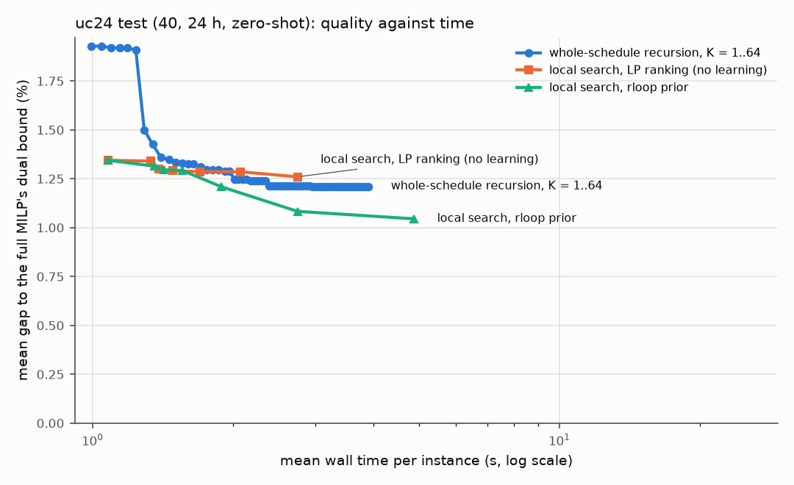
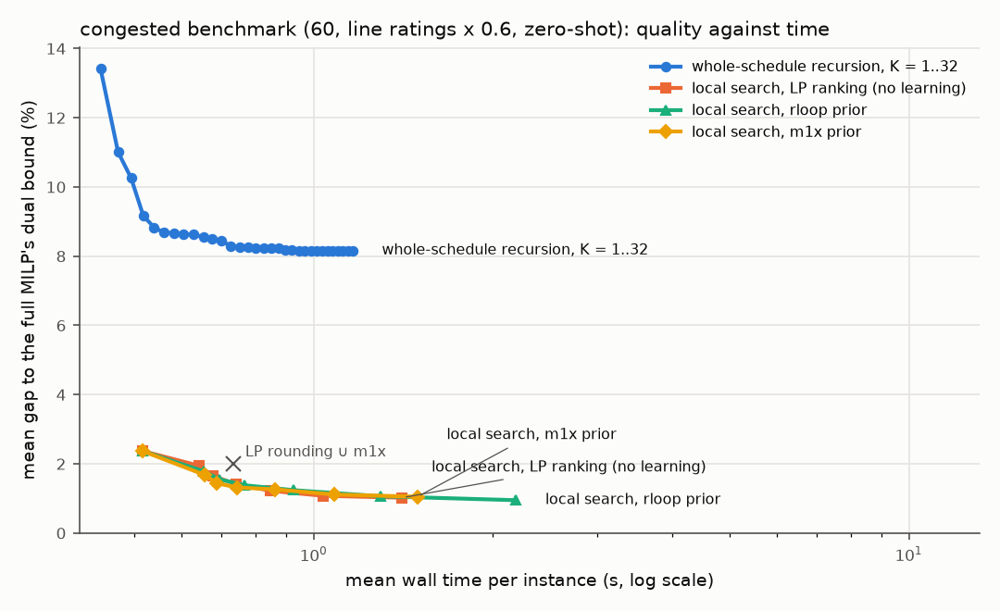
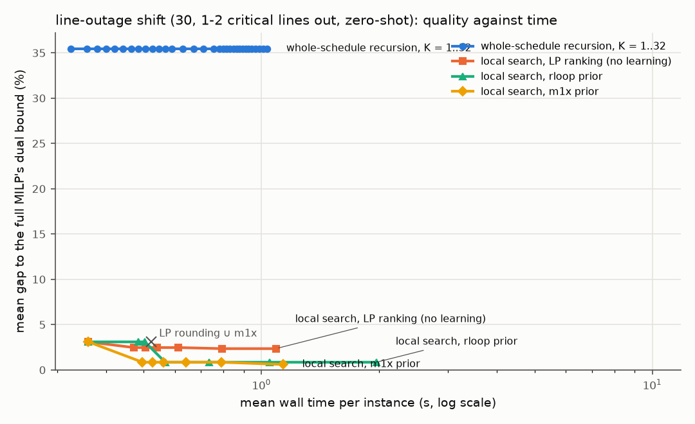

# rloop (arm B) results: recursion with the dispatch LP in the loop

*Generated by `scripts/rec_rloop_report.py`; method and discussion in [`docs/recursive/rloop.md`](../../docs/recursive/rloop.md).*

## uc12 test_fresh (120, 12 h)

120 instances; full MILP at 0.1 %: mean 22.4 s (re-solved in the same process). K = 16 chosen on validation.

| method | served | gap mean [95 % CI] | median | max | time (s) | speed-up mean / median / geo |
|---|---|---|---|---|---|---|
| full MILP 0.1 % | 97.5 % | 0.19 % [0.12, 0.27] | 0.10 % | 3.25 % | 22.40 | 1.0× / 1.0× / 1.0× |
| full MILP 0.5 % | 96.7 % | 0.23 % [0.18, 0.29] | 0.10 % | 1.99 % | 12.08 | 3.9× / 1.7× / 2.2× |
| LP rounding + repair, 5 LPs | 98.3 % | 1.75 % [1.32, 2.25] | 0.91 % | 21.06 % | 0.35 | 61.9× / 50.9× / 42.0× |
| m1x ensemble + repair, 1 LP | 92.5 % | 5.28 % [4.03, 6.80] | 2.15 % | 41.47 % | 0.32 | 68.7× / 55.5× / 45.8× |
| m1x ensemble + repair, 3 LPs | 93.3 % | 2.79 % [1.83, 3.90] | 0.95 % | 40.36 % | 0.36 | 60.8× / 49.6× / 41.0× |
| m1x ensemble + repair, 5 LPs | 95.0 % | 2.00 % [1.39, 2.76] | 0.80 % | 24.74 % | 0.40 | 55.1× / 45.8× / 37.3× |
| LP rounding (5) + m1x (5), 10 LPs | 98.3 % | 1.42 % [1.00, 1.93] | 0.56 % | 21.06 % | 0.53 | 41.4× / 34.4× / 28.1× |
| m1x ensemble, Viterbi + repair, 1 LP | 88.3 % | 5.43 % [3.32, 8.04] | 1.20 % | 86.13 % | 0.32 | 68.2× / 55.0× / 45.7× |
| rloop K=1 | 95.0 % | 3.52 % [2.37, 4.99] | 1.23 % | 64.21 % | 0.32 | 69.0× / 56.3× / 46.1× |
| rloop K=2 | 95.0 % | 3.10 % [2.22, 4.21] | 1.19 % | 40.21 % | 0.35 | 63.8× / 53.1× / 42.6× |
| rloop K=4 | 95.8 % | 2.58 % [2.04, 3.22] | 1.16 % | 18.03 % | 0.39 | 56.9× / 47.4× / 37.9× |
| rloop K=16 | 95.8 % | 1.77 % [1.33, 2.30] | 0.79 % | 18.03 % | 0.66 | 33.3× / 28.7× / 22.3× |
| rloop K=32 | 95.8 % | 1.63 % [1.20, 2.16] | 0.70 % | 18.03 % | 1.00 | 22.2× / 18.5× / 14.7× |
| LP rounding + local search, LP-gradient ranking (no learning), +4 LPs | 99.2 % | 1.52 % [1.20, 1.91] | 0.86 % | 12.35 % | 0.54 | 40.2× / 35.0× / 27.2× |
| LP rounding + local search, LP-gradient ranking (no learning), +8 LPs | 99.2 % | 1.41 % [1.12, 1.75] | 0.85 % | 10.46 % | 0.63 | 34.7× / 30.5× / 23.6× |
| LP rounding + local search, LP-gradient ranking (no learning), +16 LPs | 99.2 % | 1.29 % [1.03, 1.57] | 0.83 % | 8.71 % | 0.79 | 27.9× / 24.4× / 18.8× |
| LP rounding + local search, LP-gradient ranking (no learning), +32 LPs | 99.2 % | 1.23 % [0.99, 1.50] | 0.80 % | 7.92 % | 1.09 | 20.4× / 17.6× / 13.6× |
| LP rounding + local search guided by m1x (static), +4 LPs | 99.2 % | 1.34 % [1.07, 1.65] | 0.87 % | 10.89 % | 0.57 | 38.4× / 32.0× / 26.1× |
| LP rounding + local search guided by m1x (static), +8 LPs | 99.2 % | 1.27 % [1.01, 1.56] | 0.87 % | 10.48 % | 0.65 | 33.2× / 28.3× / 22.6× |
| LP rounding + local search guided by m1x (static), +16 LPs | 99.2 % | 1.15 % [0.93, 1.42] | 0.83 % | 9.65 % | 0.83 | 26.1× / 22.1× / 17.8× |
| LP rounding + local search guided by m1x (static), +32 LPs | 99.2 % | 1.06 % [0.86, 1.29] | 0.78 % | 8.43 % | 1.17 | 18.5× / 15.6× / 12.6× |
| LP rounding + local search guided by rloop (recursive, LP feedback), +4 LPs | 99.2 % | 1.31 % [1.05, 1.63] | 0.85 % | 10.89 % | 0.57 | 38.8× / 32.9× / 26.2× |
| LP rounding + local search guided by rloop (recursive, LP feedback), +8 LPs | 99.2 % | 1.21 % [0.99, 1.49] | 0.83 % | 9.78 % | 0.72 | 30.8× / 26.2× / 20.6× |
| LP rounding + local search guided by rloop (recursive, LP feedback), +16 LPs | 99.2 % | 1.14 % [0.93, 1.39] | 0.81 % | 9.38 % | 1.09 | 20.6× / 17.6× / 13.6× |
| LP rounding + local search guided by rloop (recursive, LP feedback), +32 LPs | 99.2 % | 1.05 % [0.86, 1.27] | 0.78 % | 8.54 % | 2.11 | 11.0× / 8.8× / 7.0× |
| LP rounding ∪ m1x + local search, LP-gradient ranking, +4 LPs | 99.2 % | 1.24 % [0.93, 1.62] | 0.53 % | 12.35 % | 0.72 | 30.4× / 26.4× / 20.6× |
| LP rounding ∪ m1x + local search, LP-gradient ranking, +8 LPs | 99.2 % | 1.14 % [0.86, 1.46] | 0.53 % | 10.46 % | 0.80 | 27.2× / 24.1× / 18.5× |
| LP rounding ∪ m1x + local search, LP-gradient ranking, +16 LPs | 99.2 % | 1.03 % [0.79, 1.31] | 0.50 % | 8.71 % | 0.96 | 22.7× / 19.7× / 15.4× |
| LP rounding ∪ m1x + local search, LP-gradient ranking, +32 LPs | 99.2 % | 0.96 % [0.75, 1.23] | 0.47 % | 7.92 % | 1.27 | 17.4× / 14.6× / 11.7× |
| LP rounding ∪ m1x + local search guided by m1x, +4 LPs | 99.2 % | 1.10 % [0.84, 1.42] | 0.41 % | 10.89 % | 0.72 | 30.4× / 24.7× / 20.6× |
| LP rounding ∪ m1x + local search guided by m1x, +8 LPs | 99.2 % | 1.03 % [0.79, 1.32] | 0.41 % | 10.48 % | 0.80 | 27.1× / 22.3× / 18.4× |
| LP rounding ∪ m1x + local search guided by m1x, +16 LPs | 99.2 % | 0.93 % [0.71, 1.20] | 0.41 % | 9.65 % | 0.98 | 22.1× / 18.4× / 15.0× |
| LP rounding ∪ m1x + local search guided by m1x, +32 LPs | 99.2 % | 0.84 % [0.64, 1.08] | 0.37 % | 8.43 % | 1.33 | 16.4× / 13.8× / 11.1× |
| LP rounding ∪ m1x + local search guided by rloop, +4 LPs | 99.2 % | 1.06 % [0.80, 1.37] | 0.50 % | 10.89 % | 0.74 | 29.5× / 26.1× / 19.9× |
| LP rounding ∪ m1x + local search guided by rloop, +8 LPs | 99.2 % | 0.97 % [0.74, 1.24] | 0.41 % | 9.78 % | 0.89 | 24.4× / 22.1× / 16.6× |
| LP rounding ∪ m1x + local search guided by rloop, +16 LPs | 99.2 % | 0.90 % [0.69, 1.15] | 0.41 % | 9.38 % | 1.26 | 17.4× / 15.1× / 11.7× |
| LP rounding ∪ m1x + local search guided by rloop, +32 LPs | 99.2 % | 0.83 % [0.63, 1.05] | 0.37 % | 8.54 % | 2.30 | 10.0× / 8.3× / 6.4× |
| rloop seeded with LP rounding, K=16 | 99.2 % | 1.39 % [1.08, 1.75] | 0.83 % | 11.49 % | 0.78 | 28.1× / 24.3× / 18.9× |
| rloop, learned halting | 95.8 % | 1.71 % [1.28, 2.23] | 0.87 % | 18.03 % | 0.75 | 29.9× / 25.4× / 22.5× |
| rloop-guided search (+16 LPs) + safety net (theta 1 %) (fallback 52 %) | 99.2 % | 0.46 % [0.38, 0.56] | 0.30 % | 2.48 % | 4.10 | 8.5× / 6.3× / 5.9× |
| rloop-guided search (+16 LPs) + safety net (theta 2 %) (fallback 25 %) | 100.0 % | 0.64 % [0.55, 0.74] | 0.53 % | 2.48 % | 2.91 | 13.1× / 8.3× / 8.5× |
| rloop-guided search (+16 LPs) + safety net (theta 4 %) (fallback 8 %) | 100.0 % | 0.93 % [0.79, 1.07] | 0.77 % | 3.24 % | 1.81 | 17.6× / 13.2× / 11.4× |

Paired differences, **LP rounding + local search guided by rloop (recursive, LP feedback), +16 LPs** minus each reference (Δ gap < 0: LP rounding + local search guided by rloop (recursive, LP feedback), +16 LPs more accurate; Δ log speed-up > 0: LP rounding + local search guided by rloop (recursive, LP feedback), +16 LPs faster):

| reference | Δ gap, pp [95 % CI] | Δ log speed-up [CI] | Δ served, pp [CI] |
|---|---|---|---|
| full MILP 0.5 % | +0.91 [+0.72, +1.12] | +1.80 [+1.59, +2.01] | +2.5 [-0.83, +5.83] |
| LP rounding + repair, 5 LPs | -0.61 [-0.95, -0.33] | -1.13 [-1.16, -1.10] | +0.8 [+0.00, +2.50] |
| m1x ensemble + repair, 1 LP | -4.14 [-5.53, -3.03] | -1.22 [-1.25, -1.19] | +6.7 [+1.67, +11.67] |
| m1x ensemble + repair, 3 LPs | -1.65 [-2.67, -0.82] | -1.11 [-1.14, -1.08] | +5.8 [+1.65, +10.83] |
| m1x ensemble + repair, 5 LPs | -0.87 [-1.44, -0.39] | -1.01 [-1.04, -0.99] | +4.2 [+0.00, +8.33] |
| LP rounding (5) + m1x (5), 10 LPs | -0.28 [-0.62, -0.00] | -0.73 [-0.75, -0.70] | +0.8 [-1.67, +3.33] |
| m1x ensemble, Viterbi + repair, 1 LP | -4.30 [-6.84, -2.21] | -1.22 [-1.24, -1.19] | +10.8 [+5.00, +16.67] |
| LP rounding + local search, LP-gradient ranking (no learning), +4 LPs | -0.38 [-0.63, -0.19] | -0.70 [-0.72, -0.67] | +0.0 [+0.00, +0.00] |
| LP rounding + local search, LP-gradient ranking (no learning), +8 LPs | -0.28 [-0.48, -0.12] | -0.55 [-0.57, -0.53] | +0.0 [+0.00, +0.00] |
| LP rounding + local search, LP-gradient ranking (no learning), +16 LPs | -0.15 [-0.28, -0.03] | -0.33 [-0.35, -0.30] | +0.0 [+0.00, +0.00] |
| LP rounding + local search, LP-gradient ranking (no learning), +32 LPs | -0.09 [-0.20, +0.01] | -0.00 [-0.03, +0.03] | +0.0 [+0.00, +0.00] |
| LP rounding + local search guided by m1x (static), +4 LPs | -0.20 [-0.33, -0.10] | -0.66 [-0.68, -0.63] | +0.0 [+0.00, +0.00] |
| LP rounding + local search guided by m1x (static), +8 LPs | -0.13 [-0.22, -0.06] | -0.51 [-0.53, -0.49] | +0.0 [+0.00, +0.00] |
| LP rounding + local search guided by m1x (static), +16 LPs | -0.02 [-0.06, +0.02] | -0.27 [-0.29, -0.25] | +0.0 [+0.00, +0.00] |
| LP rounding + local search guided by m1x (static), +32 LPs | +0.07 [+0.02, +0.12] | +0.07 [+0.05, +0.09] | +0.0 [+0.00, +0.00] |
| LP rounding + local search guided by rloop (recursive, LP feedback), +4 LPs | -0.18 [-0.32, -0.08] | -0.66 [-0.67, -0.64] | +0.0 [+0.00, +0.00] |
| LP rounding + local search guided by rloop (recursive, LP feedback), +8 LPs | -0.08 [-0.14, -0.03] | -0.42 [-0.43, -0.41] | +0.0 [+0.00, +0.00] |
| LP rounding + local search guided by rloop (recursive, LP feedback), +32 LPs | +0.09 [+0.04, +0.15] | +0.66 [+0.64, +0.68] | +0.0 [+0.00, +0.00] |
| LP rounding ∪ m1x + local search, LP-gradient ranking, +4 LPs | -0.11 [-0.36, +0.10] | -0.42 [-0.44, -0.40] | +0.0 [-2.50, +2.50] |
| LP rounding ∪ m1x + local search, LP-gradient ranking, +8 LPs | -0.00 [-0.21, +0.17] | -0.31 [-0.33, -0.29] | +0.0 [-2.50, +2.50] |
| LP rounding ∪ m1x + local search, LP-gradient ranking, +16 LPs | +0.11 [-0.03, +0.23] | -0.13 [-0.15, -0.11] | +0.0 [-2.50, +2.50] |
| LP rounding ∪ m1x + local search, LP-gradient ranking, +32 LPs | +0.17 [+0.04, +0.30] | +0.15 [+0.12, +0.18] | +0.0 [-2.50, +2.50] |
| LP rounding ∪ m1x + local search guided by m1x, +4 LPs | +0.03 [-0.14, +0.18] | -0.42 [-0.44, -0.40] | +0.0 [-2.50, +2.50] |
| LP rounding ∪ m1x + local search guided by m1x, +8 LPs | +0.10 [-0.04, +0.23] | -0.30 [-0.32, -0.28] | +0.0 [-2.50, +2.50] |
| LP rounding ∪ m1x + local search guided by m1x, +16 LPs | +0.21 [+0.11, +0.32] | -0.10 [-0.12, -0.08] | +0.0 [-2.50, +2.50] |
| LP rounding ∪ m1x + local search guided by m1x, +32 LPs | +0.29 [+0.19, +0.41] | +0.20 [+0.18, +0.22] | +0.0 [-2.50, +2.50] |
| LP rounding ∪ m1x + local search guided by rloop, +4 LPs | +0.08 [-0.09, +0.22] | -0.39 [-0.41, -0.37] | +0.0 [-2.50, +2.50] |
| LP rounding ∪ m1x + local search guided by rloop, +8 LPs | +0.16 [+0.05, +0.28] | -0.20 [-0.22, -0.18] | +0.0 [-2.50, +2.50] |
| LP rounding ∪ m1x + local search guided by rloop, +16 LPs | +0.23 [+0.13, +0.34] | +0.15 [+0.13, +0.16] | +0.0 [-2.50, +2.50] |
| LP rounding ∪ m1x + local search guided by rloop, +32 LPs | +0.31 [+0.20, +0.42] | +0.75 [+0.72, +0.77] | +0.0 [-2.50, +2.50] |

Paired differences, **rloop-guided search (+16 LPs) + safety net (theta 2 %)** minus each reference (Δ gap < 0: rloop-guided search (+16 LPs) + safety net (theta 2 %) more accurate; Δ log speed-up > 0: rloop-guided search (+16 LPs) + safety net (theta 2 %) faster):

| reference | Δ gap, pp [95 % CI] | Δ log speed-up [CI] | Δ served, pp [CI] |
|---|---|---|---|
| full MILP 0.5 % | +0.41 [+0.32, +0.51] | +1.34 [+1.16, +1.52] | +3.3 [+0.83, +6.67] |
| LP rounding + repair, 5 LPs | -1.11 [-1.59, -0.71] | -1.59 [-1.75, -1.45] | +1.7 [+0.00, +4.17] |
| m1x ensemble + repair, 1 LP | -4.63 [-6.12, -3.42] | -1.68 [-1.85, -1.53] | +7.5 [+3.33, +12.50] |
| m1x ensemble + repair, 3 LPs | -2.15 [-3.25, -1.21] | -1.57 [-1.73, -1.42] | +6.7 [+2.50, +11.67] |
| m1x ensemble + repair, 5 LPs | -1.36 [-2.06, -0.79] | -1.47 [-1.64, -1.33] | +5.0 [+1.67, +9.17] |
| LP rounding (5) + m1x (5), 10 LPs | -0.78 [-1.25, -0.39] | -1.19 [-1.35, -1.04] | +1.7 [+0.00, +4.17] |
| m1x ensemble, Viterbi + repair, 1 LP | -4.79 [-7.43, -2.69] | -1.68 [-1.84, -1.52] | +11.7 [+6.67, +17.50] |
| LP rounding + local search, LP-gradient ranking (no learning), +4 LPs | -0.88 [-1.24, -0.58] | -1.16 [-1.32, -1.01] | +0.8 [+0.00, +2.50] |
| LP rounding + local search, LP-gradient ranking (no learning), +8 LPs | -0.77 [-1.09, -0.51] | -1.01 [-1.18, -0.87] | +0.8 [+0.00, +2.50] |
| LP rounding + local search, LP-gradient ranking (no learning), +16 LPs | -0.64 [-0.90, -0.41] | -0.79 [-0.95, -0.64] | +0.8 [+0.00, +2.50] |
| LP rounding + local search, LP-gradient ranking (no learning), +32 LPs | -0.58 [-0.81, -0.37] | -0.47 [-0.63, -0.32] | +0.8 [+0.00, +2.50] |
| LP rounding + local search guided by m1x (static), +4 LPs | -0.70 [-0.97, -0.46] | -1.12 [-1.28, -0.97] | +0.8 [+0.00, +2.50] |
| LP rounding + local search guided by m1x (static), +8 LPs | -0.63 [-0.87, -0.40] | -0.97 [-1.13, -0.83] | +0.8 [+0.00, +2.50] |
| LP rounding + local search guided by m1x (static), +16 LPs | -0.51 [-0.73, -0.31] | -0.74 [-0.89, -0.59] | +0.8 [+0.00, +2.50] |
| LP rounding + local search guided by m1x (static), +32 LPs | -0.42 [-0.62, -0.25] | -0.39 [-0.55, -0.24] | +0.8 [+0.00, +2.50] |
| LP rounding + local search guided by rloop (recursive, LP feedback), +4 LPs | -0.67 [-0.95, -0.43] | -1.12 [-1.28, -0.97] | +0.8 [+0.00, +2.50] |
| LP rounding + local search guided by rloop (recursive, LP feedback), +8 LPs | -0.57 [-0.80, -0.36] | -0.88 [-1.04, -0.73] | +0.8 [+0.00, +2.50] |
| LP rounding + local search guided by rloop (recursive, LP feedback), +32 LPs | -0.41 [-0.60, -0.24] | +0.20 [+0.03, +0.36] | +0.8 [+0.00, +2.50] |
| LP rounding ∪ m1x + local search, LP-gradient ranking, +4 LPs | -0.60 [-0.95, -0.31] | -0.88 [-1.04, -0.73] | +0.8 [+0.00, +2.50] |
| LP rounding ∪ m1x + local search, LP-gradient ranking, +8 LPs | -0.50 [-0.80, -0.24] | -0.77 [-0.93, -0.62] | +0.8 [+0.00, +2.50] |
| LP rounding ∪ m1x + local search, LP-gradient ranking, +16 LPs | -0.39 [-0.63, -0.17] | -0.59 [-0.75, -0.44] | +0.8 [+0.00, +2.50] |
| LP rounding ∪ m1x + local search, LP-gradient ranking, +32 LPs | -0.32 [-0.55, -0.12] | -0.31 [-0.47, -0.16] | +0.8 [+0.00, +2.50] |
| LP rounding ∪ m1x + local search guided by m1x, +4 LPs | -0.46 [-0.74, -0.23] | -0.88 [-1.04, -0.73] | +0.8 [+0.00, +2.50] |
| LP rounding ∪ m1x + local search guided by m1x, +8 LPs | -0.39 [-0.64, -0.17] | -0.77 [-0.93, -0.62] | +0.8 [+0.00, +2.50] |
| LP rounding ∪ m1x + local search guided by m1x, +16 LPs | -0.29 [-0.51, -0.09] | -0.56 [-0.72, -0.42] | +0.8 [+0.00, +2.50] |
| LP rounding ∪ m1x + local search guided by m1x, +32 LPs | -0.20 [-0.40, -0.02] | -0.26 [-0.42, -0.11] | +0.8 [+0.00, +2.50] |
| LP rounding ∪ m1x + local search guided by rloop, +4 LPs | -0.42 [-0.70, -0.18] | -0.85 [-1.01, -0.70] | +0.8 [+0.00, +2.50] |
| LP rounding ∪ m1x + local search guided by rloop, +8 LPs | -0.33 [-0.57, -0.13] | -0.66 [-0.82, -0.51] | +0.8 [+0.00, +2.50] |
| LP rounding ∪ m1x + local search guided by rloop, +16 LPs | -0.26 [-0.47, -0.07] | -0.31 [-0.48, -0.16] | +0.8 [+0.00, +2.50] |
| LP rounding ∪ m1x + local search guided by rloop, +32 LPs | -0.19 [-0.37, -0.02] | +0.28 [+0.11, +0.44] | +0.8 [+0.00, +2.50] |

Paired differences, **rloop K=16** minus each reference (Δ gap < 0: rloop K=16 more accurate; Δ log speed-up > 0: rloop K=16 faster):

| reference | Δ gap, pp [95 % CI] | Δ log speed-up [CI] | Δ served, pp [CI] |
|---|---|---|---|
| full MILP 0.5 % | +1.54 [+1.13, +2.04] | +2.30 [+2.10, +2.50] | -0.8 [-5.83, +3.33] |
| LP rounding + repair, 5 LPs | +0.02 [-0.30, +0.34] | -0.63 [-0.66, -0.61] | -2.5 [-5.83, +0.83] |
| m1x ensemble + repair, 1 LP | -3.51 [-4.81, -2.53] | -0.72 [-0.74, -0.70] | +3.3 [+0.83, +6.67] |
| m1x ensemble + repair, 3 LPs | -1.02 [-1.94, -0.34] | -0.61 [-0.63, -0.59] | +2.5 [+0.00, +5.83] |
| m1x ensemble + repair, 5 LPs | -0.24 [-0.60, +0.09] | -0.52 [-0.53, -0.50] | +0.8 [-1.67, +3.33] |
| LP rounding (5) + m1x (5), 10 LPs | +0.35 [+0.05, +0.65] | -0.23 [-0.25, -0.21] | -2.5 [-6.67, +0.83] |
| m1x ensemble, Viterbi + repair, 1 LP | -3.67 [-6.20, -1.69] | -0.72 [-0.74, -0.70] | +7.5 [+3.33, +12.50] |
| LP rounding + local search, LP-gradient ranking (no learning), +4 LPs | +0.25 [-0.11, +0.63] | -0.20 [-0.22, -0.18] | -3.3 [-7.50, +0.00] |
| LP rounding + local search, LP-gradient ranking (no learning), +8 LPs | +0.35 [-0.00, +0.74] | -0.06 [-0.08, -0.03] | -3.3 [-7.50, +0.00] |
| LP rounding + local search, LP-gradient ranking (no learning), +16 LPs | +0.48 [+0.14, +0.86] | +0.17 [+0.15, +0.19] | -3.3 [-7.50, +0.00] |
| LP rounding + local search, LP-gradient ranking (no learning), +32 LPs | +0.54 [+0.20, +0.92] | +0.49 [+0.47, +0.52] | -3.3 [-7.50, +0.00] |
| LP rounding + local search guided by m1x (static), +4 LPs | +0.43 [+0.13, +0.77] | -0.16 [-0.18, -0.14] | -3.3 [-7.50, +0.00] |
| LP rounding + local search guided by m1x (static), +8 LPs | +0.50 [+0.20, +0.84] | -0.01 [-0.04, +0.01] | -3.3 [-7.50, +0.00] |
| LP rounding + local search guided by m1x (static), +16 LPs | +0.61 [+0.29, +0.97] | +0.22 [+0.20, +0.25] | -3.3 [-7.50, +0.00] |
| LP rounding + local search guided by m1x (static), +32 LPs | +0.70 [+0.38, +1.07] | +0.57 [+0.55, +0.59] | -3.3 [-7.50, +0.00] |
| LP rounding + local search guided by rloop (recursive, LP feedback), +4 LPs | +0.45 [+0.13, +0.81] | -0.16 [-0.18, -0.14] | -3.3 [-7.50, +0.00] |
| LP rounding + local search guided by rloop (recursive, LP feedback), +8 LPs | +0.55 [+0.24, +0.92] | +0.08 [+0.06, +0.10] | -3.3 [-7.50, +0.00] |
| LP rounding + local search guided by rloop (recursive, LP feedback), +32 LPs | +0.72 [+0.37, +1.10] | +1.16 [+1.13, +1.19] | -3.3 [-7.50, +0.00] |
| LP rounding ∪ m1x + local search, LP-gradient ranking, +4 LPs | +0.52 [+0.20, +0.88] | +0.08 [+0.06, +0.10] | -3.3 [-7.50, +0.00] |
| LP rounding ∪ m1x + local search, LP-gradient ranking, +8 LPs | +0.63 [+0.32, +0.97] | +0.19 [+0.17, +0.20] | -3.3 [-7.50, +0.00] |
| LP rounding ∪ m1x + local search, LP-gradient ranking, +16 LPs | +0.74 [+0.45, +1.09] | +0.37 [+0.35, +0.39] | -3.3 [-7.50, +0.00] |
| LP rounding ∪ m1x + local search, LP-gradient ranking, +32 LPs | +0.80 [+0.50, +1.16] | +0.65 [+0.62, +0.67] | -3.3 [-7.50, +0.00] |
| LP rounding ∪ m1x + local search guided by m1x, +4 LPs | +0.66 [+0.40, +0.98] | +0.08 [+0.06, +0.10] | -3.3 [-7.50, +0.00] |
| LP rounding ∪ m1x + local search guided by m1x, +8 LPs | +0.73 [+0.47, +1.05] | +0.19 [+0.18, +0.21] | -3.3 [-7.50, +0.00] |
| LP rounding ∪ m1x + local search guided by m1x, +16 LPs | +0.84 [+0.56, +1.16] | +0.39 [+0.38, +0.41] | -3.3 [-7.50, +0.00] |
| LP rounding ∪ m1x + local search guided by m1x, +32 LPs | +0.92 [+0.64, +1.27] | +0.70 [+0.68, +0.72] | -3.3 [-7.50, +0.00] |
| LP rounding ∪ m1x + local search guided by rloop, +4 LPs | +0.71 [+0.41, +1.04] | +0.11 [+0.09, +0.13] | -3.3 [-7.50, +0.00] |
| LP rounding ∪ m1x + local search guided by rloop, +8 LPs | +0.79 [+0.51, +1.15] | +0.30 [+0.28, +0.32] | -3.3 [-7.50, +0.00] |
| LP rounding ∪ m1x + local search guided by rloop, +16 LPs | +0.86 [+0.58, +1.21] | +0.65 [+0.63, +0.67] | -3.3 [-7.50, +0.00] |
| LP rounding ∪ m1x + local search guided by rloop, +32 LPs | +0.94 [+0.63, +1.30] | +1.24 [+1.21, +1.27] | -3.3 [-7.50, +0.00] |
| LP rounding + local search guided by rloop (recursive, LP feedback), +16 LPs | +0.63 [+0.30, +1.00] | +0.50 [+0.47, +0.52] | -3.3 [-7.50, +0.00] |

Quality against the number of outer steps K (best schedule so far; each step one network pass and at most one LP):

| K | gap mean | median | served | LPs | time (s) | speed-up mean |
|---|---|---|---|---|---|---|
| 1 | 3.521 % | 1.231 % | 95.0 % | 1.0 | 0.32 | 69.0× |
| 2 | 3.098 % | 1.193 % | 95.0 % | 1.3 | 0.35 | 63.8× |
| 3 | 2.612 % | 1.155 % | 95.8 % | 1.4 | 0.37 | 60.1× |
| 4 | 2.578 % | 1.155 % | 95.8 % | 1.4 | 0.39 | 56.9× |
| 5 | 2.555 % | 1.138 % | 95.8 % | 1.5 | 0.41 | 53.8× |
| 6 | 2.386 % | 1.116 % | 95.8 % | 1.7 | 0.44 | 50.8× |
| 7 | 2.284 % | 1.046 % | 95.8 % | 2.0 | 0.46 | 48.2× |
| 8 | 2.151 % | 1.042 % | 95.8 % | 2.3 | 0.48 | 45.7× |
| 9 | 2.101 % | 1.042 % | 95.8 % | 2.5 | 0.51 | 43.6× |
| 10 | 2.012 % | 0.927 % | 95.8 % | 2.7 | 0.53 | 41.6× |
| 11 | 1.911 % | 0.905 % | 95.8 % | 2.9 | 0.55 | 39.9× |
| 12 | 1.842 % | 0.810 % | 95.8 % | 3.1 | 0.58 | 38.2× |
| 13 | 1.832 % | 0.810 % | 95.8 % | 3.2 | 0.60 | 36.7× |
| 14 | 1.787 % | 0.810 % | 95.8 % | 3.3 | 0.62 | 35.5× |
| 15 | 1.781 % | 0.810 % | 95.8 % | 3.4 | 0.64 | 34.4× |
| 16 | 1.766 % | 0.793 % | 95.8 % | 3.5 | 0.66 | 33.3× |
| 17 | 1.761 % | 0.793 % | 95.8 % | 3.6 | 0.68 | 32.2× |
| 18 | 1.711 % | 0.714 % | 95.8 % | 3.7 | 0.71 | 31.2× |
| 19 | 1.663 % | 0.714 % | 95.8 % | 3.9 | 0.73 | 30.2× |
| 20 | 1.658 % | 0.714 % | 95.8 % | 4.0 | 0.75 | 29.3× |
| 21 | 1.652 % | 0.703 % | 95.8 % | 4.0 | 0.77 | 28.5× |
| 22 | 1.650 % | 0.703 % | 95.8 % | 4.0 | 0.79 | 27.8× |
| 23 | 1.643 % | 0.703 % | 95.8 % | 4.1 | 0.81 | 27.1× |
| 24 | 1.643 % | 0.703 % | 95.8 % | 4.1 | 0.83 | 26.4× |
| 25 | 1.639 % | 0.703 % | 95.8 % | 4.2 | 0.86 | 25.8× |
| 26 | 1.638 % | 0.703 % | 95.8 % | 4.3 | 0.88 | 25.2× |
| 27 | 1.638 % | 0.703 % | 95.8 % | 4.3 | 0.90 | 24.6× |
| 28 | 1.636 % | 0.703 % | 95.8 % | 4.4 | 0.92 | 24.1× |
| 29 | 1.634 % | 0.703 % | 95.8 % | 4.4 | 0.94 | 23.5× |
| 30 | 1.634 % | 0.703 % | 95.8 % | 4.5 | 0.96 | 23.1× |
| 31 | 1.634 % | 0.703 % | 95.8 % | 4.5 | 0.98 | 22.6× |
| 32 | 1.634 % | 0.703 % | 95.8 % | 4.5 | 1.00 | 22.2× |

## uc24 test (40, 24 h, zero-shot)

11 instances; full MILP at 0.1 %: mean 74.8 s (re-solved in the same process). K = 32 chosen on validation.

| method | served | gap mean [95 % CI] | median | max | time (s) | speed-up mean / median / geo |
|---|---|---|---|---|---|---|
| full MILP 0.1 % | 100.0 % | 0.08 % [0.06, 0.09] | 0.09 % | 0.10 % | 74.81 | 1.0× / 1.0× / 1.0× |
| LP rounding + repair, 5 LPs | 100.0 % | 1.34 % [0.78, 1.97] | 0.90 % | 3.23 % | 1.08 | 66.1× / 42.9× / 37.3× |
| rloop K=1 | 100.0 % | 1.93 % [0.86, 3.10] | 1.12 % | 6.29 % | 0.99 | 71.8× / 48.2× / 40.8× |
| rloop K=2 | 100.0 % | 1.93 % [0.86, 3.10] | 1.12 % | 6.29 % | 1.05 | 68.5× / 46.3× / 38.6× |
| rloop K=4 | 100.0 % | 1.92 % [0.86, 3.09] | 1.12 % | 6.29 % | 1.14 | 62.8× / 43.0× / 35.3× |
| rloop K=32 | 100.0 % | 1.21 % [0.66, 1.81] | 1.03 % | 3.11 % | 2.47 | 29.1× / 19.6× / 16.1× |
| rloop K=64 | 100.0 % | 1.21 % [0.65, 1.80] | 1.03 % | 3.11 % | 3.89 | 18.6× / 12.6× / 10.2× |
| LP rounding + local search, LP-gradient ranking (no learning), +4 LPs | 100.0 % | 1.29 % [0.74, 1.91] | 0.82 % | 3.23 % | 1.49 | 48.2× / 31.8× / 27.0× |
| LP rounding + local search, LP-gradient ranking (no learning), +8 LPs | 100.0 % | 1.29 % [0.73, 1.90] | 0.82 % | 3.23 % | 1.70 | 41.9× / 27.1× / 23.6× |
| LP rounding + local search, LP-gradient ranking (no learning), +16 LPs | 100.0 % | 1.29 % [0.73, 1.90] | 0.82 % | 3.23 % | 2.07 | 34.3× / 23.1× / 19.2× |
| LP rounding + local search, LP-gradient ranking (no learning), +32 LPs | 100.0 % | 1.26 % [0.70, 1.89] | 0.71 % | 3.23 % | 2.75 | 26.0× / 17.7× / 14.5× |
| LP rounding + local search guided by rloop (recursive, LP feedback), +4 LPs | 100.0 % | 1.29 % [0.73, 1.94] | 0.82 % | 3.21 % | 1.55 | 46.4× / 28.5× / 25.8× |
| LP rounding + local search guided by rloop (recursive, LP feedback), +8 LPs | 100.0 % | 1.21 % [0.66, 1.82] | 0.81 % | 3.21 % | 1.89 | 38.8× / 23.2× / 21.2× |
| LP rounding + local search guided by rloop (recursive, LP feedback), +16 LPs | 100.0 % | 1.08 % [0.61, 1.61] | 0.81 % | 2.83 % | 2.75 | 26.8× / 16.8× / 14.5× |
| LP rounding + local search guided by rloop (recursive, LP feedback), +32 LPs | 100.0 % | 1.04 % [0.57, 1.57] | 0.77 % | 2.83 % | 4.89 | 16.4× / 8.7× / 8.2× |
| rloop seeded with LP rounding, K=32 | 100.0 % | 1.07 % [0.55, 1.63] | 0.83 % | 2.84 % | 2.83 | 26.3× / 17.5× / 14.1× |
| rloop, learned halting | 100.0 % | 1.22 % [0.66, 1.80] | 1.03 % | 3.11 % | 2.87 | 24.0× / 16.1× / 17.3× |
| rloop-guided search (+16 LPs) + safety net (theta 1 %) (fallback 45 %) | 100.0 % | 0.49 % [0.24, 0.82] | 0.36 % | 1.83 % | 8.15 | 10.9× / 5.8× / 7.5× |
| rloop-guided search (+16 LPs) + safety net (theta 2 %) (fallback 27 %) | 100.0 % | 0.64 % [0.36, 0.95] | 0.66 % | 1.83 % | 7.10 | 14.0× / 8.9× / 9.0× |
| rloop-guided search (+16 LPs) + safety net (theta 4 %) (fallback 0 %) | 100.0 % | 1.08 % [0.61, 1.61] | 0.81 % | 2.83 % | 2.75 | 26.8× / 16.8× / 14.5× |

Paired differences, **LP rounding + local search guided by rloop (recursive, LP feedback), +16 LPs** minus each reference (Δ gap < 0: LP rounding + local search guided by rloop (recursive, LP feedback), +16 LPs more accurate; Δ log speed-up > 0: LP rounding + local search guided by rloop (recursive, LP feedback), +16 LPs faster):

| reference | Δ gap, pp [95 % CI] | Δ log speed-up [CI] | Δ served, pp [CI] |
|---|---|---|---|
| LP rounding + repair, 5 LPs | -0.26 [-0.52, -0.06] | -0.95 [-1.00, -0.89] | +0.0 [+0.00, +0.00] |
| LP rounding + local search, LP-gradient ranking (no learning), +4 LPs | -0.21 [-0.41, -0.05] | -0.62 [-0.66, -0.58] | +0.0 [+0.00, +0.00] |
| LP rounding + local search, LP-gradient ranking (no learning), +8 LPs | -0.20 [-0.41, -0.04] | -0.49 [-0.53, -0.44] | +0.0 [+0.00, +0.00] |
| LP rounding + local search, LP-gradient ranking (no learning), +16 LPs | -0.20 [-0.41, -0.04] | -0.28 [-0.33, -0.23] | +0.0 [+0.00, +0.00] |
| LP rounding + local search, LP-gradient ranking (no learning), +32 LPs | -0.18 [-0.39, -0.00] | +0.00 [-0.04, +0.04] | +0.0 [+0.00, +0.00] |
| LP rounding + local search guided by rloop (recursive, LP feedback), +4 LPs | -0.21 [-0.47, -0.02] | -0.58 [-0.61, -0.54] | +0.0 [+0.00, +0.00] |
| LP rounding + local search guided by rloop (recursive, LP feedback), +8 LPs | -0.13 [-0.31, -0.00] | -0.38 [-0.40, -0.36] | +0.0 [+0.00, +0.00] |
| LP rounding + local search guided by rloop (recursive, LP feedback), +32 LPs | +0.04 [+0.01, +0.09] | +0.57 [+0.50, +0.64] | +0.0 [+0.00, +0.00] |

Paired differences, **rloop-guided search (+16 LPs) + safety net (theta 2 %)** minus each reference (Δ gap < 0: rloop-guided search (+16 LPs) + safety net (theta 2 %) more accurate; Δ log speed-up > 0: rloop-guided search (+16 LPs) + safety net (theta 2 %) faster):

| reference | Δ gap, pp [95 % CI] | Δ log speed-up [CI] | Δ served, pp [CI] |
|---|---|---|---|
| LP rounding + repair, 5 LPs | -0.70 [-1.29, -0.23] | -1.42 [-1.95, -0.98] | +0.0 [+0.00, +0.00] |
| LP rounding + local search, LP-gradient ranking (no learning), +4 LPs | -0.65 [-1.24, -0.18] | -1.09 [-1.65, -0.64] | +0.0 [+0.00, +0.00] |
| LP rounding + local search, LP-gradient ranking (no learning), +8 LPs | -0.65 [-1.23, -0.17] | -0.96 [-1.50, -0.52] | +0.0 [+0.00, +0.00] |
| LP rounding + local search, LP-gradient ranking (no learning), +16 LPs | -0.65 [-1.23, -0.17] | -0.76 [-1.30, -0.31] | +0.0 [+0.00, +0.00] |
| LP rounding + local search, LP-gradient ranking (no learning), +32 LPs | -0.62 [-1.21, -0.12] | -0.47 [-1.02, -0.02] | +0.0 [+0.00, +0.00] |
| LP rounding + local search guided by rloop (recursive, LP feedback), +4 LPs | -0.65 [-1.26, -0.15] | -1.05 [-1.60, -0.60] | +0.0 [+0.00, +0.00] |
| LP rounding + local search guided by rloop (recursive, LP feedback), +8 LPs | -0.57 [-1.16, -0.08] | -0.85 [-1.41, -0.39] | +0.0 [+0.00, +0.00] |
| LP rounding + local search guided by rloop (recursive, LP feedback), +32 LPs | -0.41 [-0.87, +0.03] | +0.10 [-0.47, +0.57] | +0.0 [+0.00, +0.00] |

Paired differences, **rloop K=32** minus each reference (Δ gap < 0: rloop K=32 more accurate; Δ log speed-up > 0: rloop K=32 faster):

| reference | Δ gap, pp [95 % CI] | Δ log speed-up [CI] | Δ served, pp [CI] |
|---|---|---|---|
| LP rounding + repair, 5 LPs | -0.13 [-0.50, +0.19] | -0.84 [-0.89, -0.79] | +0.0 [+0.00, +0.00] |
| LP rounding + local search, LP-gradient ranking (no learning), +4 LPs | -0.08 [-0.42, +0.22] | -0.51 [-0.55, -0.48] | +0.0 [+0.00, +0.00] |
| LP rounding + local search, LP-gradient ranking (no learning), +8 LPs | -0.07 [-0.42, +0.23] | -0.38 [-0.42, -0.34] | +0.0 [+0.00, +0.00] |
| LP rounding + local search, LP-gradient ranking (no learning), +16 LPs | -0.07 [-0.42, +0.23] | -0.18 [-0.22, -0.13] | +0.0 [+0.00, +0.00] |
| LP rounding + local search, LP-gradient ranking (no learning), +32 LPs | -0.05 [-0.40, +0.27] | +0.11 [+0.07, +0.15] | +0.0 [+0.00, +0.00] |
| LP rounding + local search guided by rloop (recursive, LP feedback), +4 LPs | -0.08 [-0.46, +0.25] | -0.47 [-0.50, -0.43] | +0.0 [+0.00, +0.00] |
| LP rounding + local search guided by rloop (recursive, LP feedback), +8 LPs | +0.00 [-0.34, +0.29] | -0.27 [-0.30, -0.24] | +0.0 [+0.00, +0.00] |
| LP rounding + local search guided by rloop (recursive, LP feedback), +32 LPs | +0.17 [-0.05, +0.37] | +0.68 [+0.59, +0.77] | +0.0 [+0.00, +0.00] |
| LP rounding + local search guided by rloop (recursive, LP feedback), +16 LPs | +0.13 [-0.10, +0.34] | +0.11 [+0.08, +0.14] | +0.0 [+0.00, +0.00] |

Quality against the number of outer steps K (best schedule so far; each step one network pass and at most one LP):

| K | gap mean | median | served | LPs | time (s) | speed-up mean |
|---|---|---|---|---|---|---|
| 1 | 1.928 % | 1.122 % | 100.0 % | 1.0 | 0.99 | 71.8× |
| 2 | 1.928 % | 1.122 % | 100.0 % | 1.2 | 1.05 | 68.5× |
| 3 | 1.920 % | 1.122 % | 100.0 % | 1.4 | 1.10 | 65.2× |
| 4 | 1.919 % | 1.122 % | 100.0 % | 1.5 | 1.14 | 62.8× |
| 5 | 1.919 % | 1.122 % | 100.0 % | 1.5 | 1.19 | 60.6× |
| 6 | 1.909 % | 1.122 % | 100.0 % | 1.7 | 1.24 | 57.7× |
| 7 | 1.499 % | 1.122 % | 100.0 % | 2.0 | 1.29 | 55.1× |
| 8 | 1.427 % | 1.122 % | 100.0 % | 2.5 | 1.34 | 52.7× |
| 9 | 1.360 % | 1.122 % | 100.0 % | 2.9 | 1.40 | 50.7× |
| 10 | 1.348 % | 1.122 % | 100.0 % | 3.4 | 1.46 | 48.9× |
| 11 | 1.333 % | 1.122 % | 100.0 % | 3.7 | 1.51 | 47.2× |
| 12 | 1.328 % | 1.122 % | 100.0 % | 4.0 | 1.56 | 45.7× |
| 13 | 1.327 % | 1.122 % | 100.0 % | 4.1 | 1.60 | 44.6× |
| 14 | 1.327 % | 1.122 % | 100.0 % | 4.3 | 1.65 | 43.2× |
| 15 | 1.313 % | 1.122 % | 100.0 % | 4.6 | 1.70 | 41.6× |
| 16 | 1.296 % | 1.065 % | 100.0 % | 5.1 | 1.76 | 40.3× |
| 17 | 1.296 % | 1.065 % | 100.0 % | 5.5 | 1.81 | 39.2× |
| 18 | 1.294 % | 1.065 % | 100.0 % | 5.9 | 1.86 | 38.1× |
| 19 | 1.289 % | 1.065 % | 100.0 % | 6.4 | 1.92 | 37.1× |
| 20 | 1.287 % | 1.051 % | 100.0 % | 6.5 | 1.96 | 36.3× |
| 21 | 1.249 % | 1.051 % | 100.0 % | 6.8 | 2.01 | 35.4× |
| 22 | 1.249 % | 1.051 % | 100.0 % | 6.8 | 2.05 | 34.8× |
| 23 | 1.249 % | 1.051 % | 100.0 % | 6.8 | 2.09 | 34.1× |
| 24 | 1.249 % | 1.051 % | 100.0 % | 6.8 | 2.13 | 33.5× |
| 25 | 1.239 % | 1.051 % | 100.0 % | 7.1 | 2.18 | 32.8× |
| 26 | 1.239 % | 1.051 % | 100.0 % | 7.1 | 2.22 | 32.3× |
| 27 | 1.239 % | 1.051 % | 100.0 % | 7.2 | 2.26 | 31.7× |
| 28 | 1.239 % | 1.051 % | 100.0 % | 7.2 | 2.30 | 31.2× |
| 29 | 1.239 % | 1.051 % | 100.0 % | 7.3 | 2.34 | 30.7× |
| 30 | 1.215 % | 1.031 % | 100.0 % | 7.5 | 2.38 | 30.2× |
| 31 | 1.214 % | 1.031 % | 100.0 % | 7.6 | 2.43 | 29.7× |
| 32 | 1.214 % | 1.031 % | 100.0 % | 7.8 | 2.47 | 29.1× |
| 33 | 1.214 % | 1.031 % | 100.0 % | 7.8 | 2.51 | 28.7× |
| 34 | 1.214 % | 1.031 % | 100.0 % | 7.8 | 2.55 | 28.2× |
| 35 | 1.214 % | 1.031 % | 100.0 % | 7.9 | 2.60 | 27.8× |
| 36 | 1.214 % | 1.031 % | 100.0 % | 8.0 | 2.64 | 27.2× |
| 37 | 1.214 % | 1.031 % | 100.0 % | 8.0 | 2.69 | 26.8× |
| 38 | 1.214 % | 1.031 % | 100.0 % | 8.1 | 2.73 | 26.4× |
| 39 | 1.214 % | 1.031 % | 100.0 % | 8.2 | 2.78 | 25.9× |
| 40 | 1.213 % | 1.031 % | 100.0 % | 8.3 | 2.82 | 25.5× |
| 41 | 1.213 % | 1.031 % | 100.0 % | 8.3 | 2.86 | 25.1× |
| 42 | 1.213 % | 1.031 % | 100.0 % | 8.4 | 2.91 | 24.7× |
| 43 | 1.211 % | 1.031 % | 100.0 % | 8.5 | 2.96 | 24.4× |
| 44 | 1.211 % | 1.031 % | 100.0 % | 8.5 | 3.00 | 24.0× |
| 45 | 1.211 % | 1.031 % | 100.0 % | 8.7 | 3.05 | 23.6× |
| 46 | 1.211 % | 1.031 % | 100.0 % | 8.8 | 3.10 | 23.3× |
| 47 | 1.211 % | 1.031 % | 100.0 % | 8.8 | 3.14 | 23.0× |
| 48 | 1.211 % | 1.031 % | 100.0 % | 8.9 | 3.18 | 22.7× |
| 49 | 1.211 % | 1.031 % | 100.0 % | 9.0 | 3.23 | 22.3× |
| 50 | 1.211 % | 1.031 % | 100.0 % | 9.0 | 3.28 | 22.1× |
| 51 | 1.211 % | 1.031 % | 100.0 % | 9.0 | 3.32 | 21.8× |
| 52 | 1.211 % | 1.031 % | 100.0 % | 9.0 | 3.36 | 21.5× |
| 53 | 1.211 % | 1.031 % | 100.0 % | 9.1 | 3.41 | 21.2× |
| 54 | 1.211 % | 1.031 % | 100.0 % | 9.1 | 3.45 | 21.0× |
| 55 | 1.211 % | 1.031 % | 100.0 % | 9.1 | 3.49 | 20.7× |
| 56 | 1.211 % | 1.031 % | 100.0 % | 9.2 | 3.54 | 20.5× |
| 57 | 1.211 % | 1.031 % | 100.0 % | 9.2 | 3.58 | 20.2× |
| 58 | 1.211 % | 1.031 % | 100.0 % | 9.3 | 3.62 | 20.0× |
| 59 | 1.211 % | 1.031 % | 100.0 % | 9.4 | 3.67 | 19.7× |
| 60 | 1.211 % | 1.031 % | 100.0 % | 9.4 | 3.72 | 19.5× |
| 61 | 1.211 % | 1.031 % | 100.0 % | 9.5 | 3.76 | 19.2× |
| 62 | 1.211 % | 1.031 % | 100.0 % | 9.5 | 3.81 | 19.0× |
| 63 | 1.211 % | 1.031 % | 100.0 % | 9.5 | 3.85 | 18.8× |
| 64 | 1.211 % | 1.031 % | 100.0 % | 9.5 | 3.89 | 18.6× |

## congested benchmark (60, line ratings x 0.6, zero-shot)

60 instances; full MILP at 0.1 %: mean 62.1 s (re-solved in the same process). K = 16 chosen on validation.

| method | served | gap mean [95 % CI] | median | max | time (s) | speed-up mean / median / geo |
|---|---|---|---|---|---|---|
| full MILP 0.1 % | 100.0 % | 0.10 % [0.09, 0.10] | 0.10 % | 0.27 % | 62.15 | 1.0× / 1.0× / 1.0× |
| LP rounding + repair, 5 LPs | 96.7 % | 2.37 % [1.90, 2.88] | 2.26 % | 7.08 % | 0.52 | 117.5× / 69.6× / 75.5× |
| m1x ensemble + repair, 1 LP | 45.0 % | 16.01 % [11.75, 20.88] | 8.69 % | 72.97 % | 0.44 | 137.0× / 83.3× / 88.2× |
| m1x ensemble + repair, 3 LPs | 43.3 % | 15.03 % [10.44, 20.06] | 6.68 % | 72.87 % | 0.50 | 121.5× / 71.9× / 78.2× |
| m1x ensemble + repair, 5 LPs | 53.3 % | 10.08 % [6.63, 14.16] | 4.10 % | 70.22 % | 0.55 | 109.3× / 62.3× / 70.3× |
| LP rounding (5) + m1x (5), 10 LPs | 96.7 % | 1.99 % [1.61, 2.41] | 1.75 % | 6.62 % | 0.73 | 82.7× / 45.5× / 53.0× |
| m1x ensemble, Viterbi + repair, 1 LP | 25.0 % | 40.78 % [32.65, 48.64] | 48.25 % | 91.83 % | 0.44 | 136.3× / 82.7× / 87.7× |
| rloop K=1 | 48.3 % | 13.41 % [9.13, 17.90] | 4.85 % | 73.04 % | 0.44 | 137.8× / 84.9× / 88.9× |
| rloop K=2 | 51.7 % | 11.01 % [7.35, 14.93] | 4.45 % | 61.19 % | 0.47 | 128.9× / 78.1× / 83.0× |
| rloop K=4 | 51.7 % | 9.17 % [6.09, 12.69] | 4.10 % | 61.19 % | 0.52 | 117.5× / 68.2× / 75.2× |
| rloop K=16 | 51.7 % | 8.24 % [5.21, 11.74] | 3.02 % | 60.87 % | 0.80 | 75.8× / 41.3× / 48.4× |
| rloop K=32 | 51.7 % | 8.16 % [5.12, 11.68] | 2.95 % | 60.87 % | 1.16 | 52.7× / 28.1× / 33.2× |
| LP rounding + local search, LP-gradient ranking (no learning), +4 LPs | 96.7 % | 1.41 % [1.07, 1.80] | 0.95 % | 7.04 % | 0.74 | 81.6× / 45.7× / 52.4× |
| LP rounding + local search, LP-gradient ranking (no learning), +8 LPs | 96.7 % | 1.22 % [0.94, 1.54] | 0.90 % | 5.31 % | 0.85 | 71.6× / 39.5× / 45.8× |
| LP rounding + local search, LP-gradient ranking (no learning), +16 LPs | 98.3 % | 1.08 % [0.83, 1.36] | 0.88 % | 5.31 % | 1.04 | 58.9× / 33.3× / 37.4× |
| LP rounding + local search, LP-gradient ranking (no learning), +32 LPs | 98.3 % | 1.02 % [0.79, 1.29] | 0.88 % | 5.31 % | 1.41 | 43.7× / 25.3× / 27.5× |
| LP rounding + local search guided by m1x (static), +4 LPs | 98.3 % | 1.32 % [0.99, 1.67] | 0.89 % | 6.16 % | 0.74 | 81.1× / 45.0× / 52.0× |
| LP rounding + local search guided by m1x (static), +8 LPs | 98.3 % | 1.26 % [0.94, 1.62] | 0.76 % | 6.16 % | 0.86 | 69.7× / 37.8× / 44.9× |
| LP rounding + local search guided by m1x (static), +16 LPs | 98.3 % | 1.11 % [0.81, 1.45] | 0.63 % | 5.85 % | 1.08 | 55.6× / 29.5× / 35.7× |
| LP rounding + local search guided by m1x (static), +32 LPs | 98.3 % | 1.05 % [0.76, 1.36] | 0.63 % | 5.54 % | 1.49 | 40.5× / 20.9× / 25.8× |
| LP rounding + local search guided by rloop (recursive, LP feedback), +4 LPs | 98.3 % | 1.38 % [1.02, 1.79] | 0.91 % | 7.04 % | 0.76 | 79.3× / 46.6× / 50.6× |
| LP rounding + local search guided by rloop (recursive, LP feedback), +8 LPs | 98.3 % | 1.24 % [0.92, 1.59] | 0.90 % | 6.09 % | 0.93 | 65.2× / 37.9× / 41.7× |
| LP rounding + local search guided by rloop (recursive, LP feedback), +16 LPs | 98.3 % | 1.06 % [0.79, 1.38] | 0.73 % | 5.10 % | 1.30 | 47.7× / 26.6× / 29.8× |
| LP rounding + local search guided by rloop (recursive, LP feedback), +32 LPs | 98.3 % | 0.95 % [0.69, 1.24] | 0.49 % | 4.18 % | 2.19 | 29.8× / 15.6× / 17.7× |
| LP rounding ∪ m1x + local search, LP-gradient ranking, +4 LPs | 98.3 % | 1.33 % [1.03, 1.66] | 0.95 % | 6.12 % | 0.95 | 64.6× / 35.4× / 40.9× |
| LP rounding ∪ m1x + local search, LP-gradient ranking, +8 LPs | 98.3 % | 1.20 % [0.92, 1.51] | 0.90 % | 5.31 % | 1.05 | 58.0× / 31.9× / 36.8× |
| LP rounding ∪ m1x + local search, LP-gradient ranking, +16 LPs | 100.0 % | 1.12 % [0.87, 1.42] | 0.90 % | 5.31 % | 1.24 | 49.7× / 27.1× / 31.3× |
| LP rounding ∪ m1x + local search, LP-gradient ranking, +32 LPs | 100.0 % | 1.05 % [0.81, 1.32] | 0.90 % | 5.31 % | 1.61 | 38.8× / 21.3× / 24.0× |
| LP rounding ∪ m1x + local search guided by m1x, +4 LPs | 98.3 % | 1.34 % [1.03, 1.69] | 0.96 % | 6.16 % | 0.95 | 64.6× / 34.2× / 41.0× |
| LP rounding ∪ m1x + local search guided by m1x, +8 LPs | 98.3 % | 1.28 % [0.96, 1.62] | 0.82 % | 6.16 % | 1.06 | 57.3× / 30.1× / 36.5× |
| LP rounding ∪ m1x + local search guided by m1x, +16 LPs | 98.3 % | 1.12 % [0.82, 1.44] | 0.65 % | 5.85 % | 1.28 | 47.5× / 25.2× / 30.2× |
| LP rounding ∪ m1x + local search guided by m1x, +32 LPs | 98.3 % | 1.05 % [0.77, 1.36] | 0.65 % | 5.54 % | 1.69 | 36.2× / 19.2× / 22.8× |
| LP rounding ∪ m1x + local search guided by rloop, +4 LPs | 98.3 % | 1.26 % [0.95, 1.62] | 0.91 % | 6.62 % | 0.98 | 62.8× / 34.7× / 39.4× |
| LP rounding ∪ m1x + local search guided by rloop, +8 LPs | 98.3 % | 1.20 % [0.90, 1.53] | 0.90 % | 6.09 % | 1.14 | 53.8× / 30.2× / 33.8× |
| LP rounding ∪ m1x + local search guided by rloop, +16 LPs | 98.3 % | 1.07 % [0.81, 1.37] | 0.78 % | 5.10 % | 1.50 | 41.6× / 22.5× / 25.6× |
| LP rounding ∪ m1x + local search guided by rloop, +32 LPs | 98.3 % | 0.94 % [0.70, 1.20] | 0.60 % | 4.18 % | 2.38 | 27.5× / 13.6× / 16.2× |
| rloop seeded with LP rounding, K=16 | 93.3 % | 1.80 % [1.41, 2.24] | 1.39 % | 7.04 % | 0.99 | 61.6× / 34.1× / 38.8× |
| rloop, learned halting | 51.7 % | 10.46 % [6.93, 14.49] | 3.19 % | 62.42 % | 0.93 | 76.1× / 47.9× / 45.3× |
| rloop-guided search (+16 LPs) + safety net (theta 1 %) (fallback 62 %) | 96.7 % | 0.39 % [0.29, 0.51] | 0.24 % | 2.81 % | 7.39 | 17.9× / 8.3× / 8.5× |
| rloop-guided search (+16 LPs) + safety net (theta 2 %) (fallback 33 %) | 98.3 % | 0.51 % [0.41, 0.64] | 0.40 % | 2.81 % | 4.90 | 27.3× / 14.9× / 14.8× |
| rloop-guided search (+16 LPs) + safety net (theta 4 %) (fallback 10 %) | 98.3 % | 0.79 % [0.63, 0.98] | 0.52 % | 2.81 % | 2.61 | 35.7× / 21.3× / 23.6× |

Paired differences, **LP rounding + local search guided by rloop (recursive, LP feedback), +16 LPs** minus each reference (Δ gap < 0: LP rounding + local search guided by rloop (recursive, LP feedback), +16 LPs more accurate; Δ log speed-up > 0: LP rounding + local search guided by rloop (recursive, LP feedback), +16 LPs faster):

| reference | Δ gap, pp [95 % CI] | Δ log speed-up [CI] | Δ served, pp [CI] |
|---|---|---|---|
| LP rounding + repair, 5 LPs | -1.31 [-1.68, -0.97] | -0.93 [-0.97, -0.90] | +1.7 [+0.00, +5.00] |
| m1x ensemble + repair, 1 LP | -14.95 [-19.81, -10.62] | -1.09 [-1.12, -1.05] | +53.3 [+40.00, +66.67] |
| m1x ensemble + repair, 3 LPs | -13.97 [-18.97, -9.37] | -0.97 [-1.00, -0.93] | +55.0 [+41.67, +68.33] |
| m1x ensemble + repair, 5 LPs | -9.02 [-13.11, -5.60] | -0.86 [-0.89, -0.83] | +45.0 [+31.67, +56.71] |
| LP rounding (5) + m1x (5), 10 LPs | -0.93 [-1.21, -0.65] | -0.58 [-0.61, -0.55] | +1.7 [+0.00, +5.00] |
| m1x ensemble, Viterbi + repair, 1 LP | -39.71 [-47.49, -31.62] | -1.08 [-1.11, -1.05] | +73.3 [+61.67, +85.00] |
| LP rounding + local search, LP-gradient ranking (no learning), +4 LPs | -0.35 [-0.65, -0.11] | -0.57 [-0.59, -0.54] | +1.7 [+0.00, +5.00] |
| LP rounding + local search, LP-gradient ranking (no learning), +8 LPs | -0.16 [-0.33, -0.01] | -0.43 [-0.46, -0.40] | +1.7 [+0.00, +5.00] |
| LP rounding + local search, LP-gradient ranking (no learning), +16 LPs | -0.01 [-0.11, +0.10] | -0.23 [-0.26, -0.20] | +0.0 [-5.00, +5.00] |
| LP rounding + local search, LP-gradient ranking (no learning), +32 LPs | +0.04 [-0.06, +0.15] | +0.08 [+0.05, +0.11] | +0.0 [-5.00, +5.00] |
| LP rounding + local search guided by m1x (static), +4 LPs | -0.25 [-0.39, -0.13] | -0.56 [-0.58, -0.53] | +0.0 [+0.00, +0.00] |
| LP rounding + local search guided by m1x (static), +8 LPs | -0.20 [-0.34, -0.08] | -0.41 [-0.43, -0.39] | +0.0 [+0.00, +0.00] |
| LP rounding + local search guided by m1x (static), +16 LPs | -0.05 [-0.15, +0.03] | -0.18 [-0.20, -0.16] | +0.0 [+0.00, +0.00] |
| LP rounding + local search guided by m1x (static), +32 LPs | +0.01 [-0.07, +0.09] | +0.14 [+0.12, +0.17] | +0.0 [+0.00, +0.00] |
| LP rounding + local search guided by rloop (recursive, LP feedback), +4 LPs | -0.32 [-0.58, -0.15] | -0.53 [-0.55, -0.51] | +0.0 [+0.00, +0.00] |
| LP rounding + local search guided by rloop (recursive, LP feedback), +8 LPs | -0.18 [-0.32, -0.08] | -0.34 [-0.35, -0.32] | +0.0 [+0.00, +0.00] |
| LP rounding + local search guided by rloop (recursive, LP feedback), +32 LPs | +0.11 [+0.06, +0.17] | +0.52 [+0.49, +0.55] | +0.0 [+0.00, +0.00] |
| LP rounding ∪ m1x + local search, LP-gradient ranking, +4 LPs | -0.26 [-0.48, -0.07] | -0.32 [-0.34, -0.29] | +0.0 [+0.00, +0.00] |
| LP rounding ∪ m1x + local search, LP-gradient ranking, +8 LPs | -0.13 [-0.31, +0.02] | -0.21 [-0.24, -0.19] | +0.0 [+0.00, +0.00] |
| LP rounding ∪ m1x + local search, LP-gradient ranking, +16 LPs | -0.06 [-0.22, +0.08] | -0.05 [-0.08, -0.03] | -1.7 [-5.00, +0.00] |
| LP rounding ∪ m1x + local search, LP-gradient ranking, +32 LPs | +0.02 [-0.12, +0.15] | +0.21 [+0.19, +0.24] | -1.7 [-5.00, +0.00] |
| LP rounding ∪ m1x + local search guided by m1x, +4 LPs | -0.28 [-0.45, -0.11] | -0.32 [-0.35, -0.29] | +0.0 [+0.00, +0.00] |
| LP rounding ∪ m1x + local search guided by m1x, +8 LPs | -0.21 [-0.37, -0.06] | -0.21 [-0.23, -0.18] | +0.0 [+0.00, +0.00] |
| LP rounding ∪ m1x + local search guided by m1x, +16 LPs | -0.05 [-0.19, +0.09] | -0.01 [-0.04, +0.01] | +0.0 [+0.00, +0.00] |
| LP rounding ∪ m1x + local search guided by m1x, +32 LPs | +0.01 [-0.12, +0.15] | +0.27 [+0.24, +0.29] | +0.0 [+0.00, +0.00] |
| LP rounding ∪ m1x + local search guided by rloop, +4 LPs | -0.20 [-0.35, -0.05] | -0.28 [-0.30, -0.26] | +0.0 [+0.00, +0.00] |
| LP rounding ∪ m1x + local search guided by rloop, +8 LPs | -0.13 [-0.28, -0.00] | -0.13 [-0.15, -0.11] | +0.0 [+0.00, +0.00] |
| LP rounding ∪ m1x + local search guided by rloop, +16 LPs | -0.01 [-0.12, +0.10] | +0.15 [+0.13, +0.17] | +0.0 [+0.00, +0.00] |
| LP rounding ∪ m1x + local search guided by rloop, +32 LPs | +0.12 [+0.03, +0.24] | +0.61 [+0.58, +0.64] | +0.0 [+0.00, +0.00] |

Paired differences, **rloop-guided search (+16 LPs) + safety net (theta 2 %)** minus each reference (Δ gap < 0: rloop-guided search (+16 LPs) + safety net (theta 2 %) more accurate; Δ log speed-up > 0: rloop-guided search (+16 LPs) + safety net (theta 2 %) faster):

| reference | Δ gap, pp [95 % CI] | Δ log speed-up [CI] | Δ served, pp [CI] |
|---|---|---|---|
| LP rounding + repair, 5 LPs | -1.86 [-2.34, -1.42] | -1.63 [-1.93, -1.38] | +1.7 [-3.33, +8.33] |
| m1x ensemble + repair, 1 LP | -15.50 [-20.37, -11.22] | -1.79 [-2.08, -1.53] | +53.3 [+38.33, +66.67] |
| m1x ensemble + repair, 3 LPs | -14.51 [-19.52, -9.94] | -1.67 [-1.95, -1.41] | +55.0 [+41.67, +68.33] |
| m1x ensemble + repair, 5 LPs | -9.57 [-13.62, -6.13] | -1.56 [-1.85, -1.30] | +45.0 [+30.00, +58.33] |
| LP rounding (5) + m1x (5), 10 LPs | -1.48 [-1.84, -1.15] | -1.28 [-1.57, -1.02] | +1.7 [-3.33, +8.33] |
| m1x ensemble, Viterbi + repair, 1 LP | -40.26 [-48.08, -32.17] | -1.78 [-2.07, -1.53] | +73.3 [+61.67, +85.00] |
| LP rounding + local search, LP-gradient ranking (no learning), +4 LPs | -0.90 [-1.25, -0.59] | -1.27 [-1.55, -1.02] | +1.7 [+0.00, +5.00] |
| LP rounding + local search, LP-gradient ranking (no learning), +8 LPs | -0.71 [-0.98, -0.46] | -1.13 [-1.41, -0.88] | +1.7 [+0.00, +5.00] |
| LP rounding + local search, LP-gradient ranking (no learning), +16 LPs | -0.56 [-0.79, -0.36] | -0.93 [-1.21, -0.68] | +0.0 [+0.00, +0.00] |
| LP rounding + local search, LP-gradient ranking (no learning), +32 LPs | -0.51 [-0.74, -0.31] | -0.62 [-0.91, -0.37] | +0.0 [+0.00, +0.00] |
| LP rounding + local search guided by m1x (static), +4 LPs | -0.80 [-1.11, -0.52] | -1.26 [-1.55, -1.01] | +0.0 [-5.00, +5.00] |
| LP rounding + local search guided by m1x (static), +8 LPs | -0.75 [-1.06, -0.47] | -1.11 [-1.40, -0.86] | +0.0 [-5.00, +5.00] |
| LP rounding + local search guided by m1x (static), +16 LPs | -0.60 [-0.89, -0.34] | -0.88 [-1.17, -0.63] | +0.0 [-5.00, +5.00] |
| LP rounding + local search guided by m1x (static), +32 LPs | -0.53 [-0.81, -0.29] | -0.56 [-0.85, -0.31] | +0.0 [-5.00, +5.00] |
| LP rounding + local search guided by rloop (recursive, LP feedback), +4 LPs | -0.87 [-1.24, -0.55] | -1.23 [-1.52, -0.98] | +0.0 [-5.00, +5.00] |
| LP rounding + local search guided by rloop (recursive, LP feedback), +8 LPs | -0.72 [-1.03, -0.45] | -1.04 [-1.32, -0.79] | +0.0 [-5.00, +5.00] |
| LP rounding + local search guided by rloop (recursive, LP feedback), +32 LPs | -0.44 [-0.69, -0.21] | -0.18 [-0.47, +0.07] | +0.0 [-5.00, +5.00] |
| LP rounding ∪ m1x + local search, LP-gradient ranking, +4 LPs | -0.81 [-1.10, -0.55] | -1.02 [-1.30, -0.77] | +0.0 [-5.00, +5.00] |
| LP rounding ∪ m1x + local search, LP-gradient ranking, +8 LPs | -0.68 [-0.95, -0.45] | -0.91 [-1.20, -0.66] | +0.0 [-5.00, +5.00] |
| LP rounding ∪ m1x + local search, LP-gradient ranking, +16 LPs | -0.61 [-0.86, -0.39] | -0.75 [-1.04, -0.50] | -1.7 [-5.00, +0.00] |
| LP rounding ∪ m1x + local search, LP-gradient ranking, +32 LPs | -0.53 [-0.78, -0.33] | -0.49 [-0.78, -0.23] | -1.7 [-5.00, +0.00] |
| LP rounding ∪ m1x + local search guided by m1x, +4 LPs | -0.83 [-1.13, -0.55] | -1.02 [-1.31, -0.77] | +0.0 [-5.00, +5.00] |
| LP rounding ∪ m1x + local search guided by m1x, +8 LPs | -0.76 [-1.06, -0.50] | -0.91 [-1.19, -0.65] | +0.0 [-5.00, +5.00] |
| LP rounding ∪ m1x + local search guided by m1x, +16 LPs | -0.60 [-0.87, -0.36] | -0.71 [-1.00, -0.46] | +0.0 [-5.00, +5.00] |
| LP rounding ∪ m1x + local search guided by m1x, +32 LPs | -0.54 [-0.80, -0.31] | -0.43 [-0.72, -0.18] | +0.0 [-5.00, +5.00] |
| LP rounding ∪ m1x + local search guided by rloop, +4 LPs | -0.75 [-1.05, -0.48] | -0.98 [-1.27, -0.73] | +0.0 [-5.00, +5.00] |
| LP rounding ∪ m1x + local search guided by rloop, +8 LPs | -0.68 [-0.96, -0.43] | -0.83 [-1.11, -0.58] | +0.0 [-5.00, +5.00] |
| LP rounding ∪ m1x + local search guided by rloop, +16 LPs | -0.56 [-0.80, -0.34] | -0.55 [-0.84, -0.30] | +0.0 [-5.00, +5.00] |
| LP rounding ∪ m1x + local search guided by rloop, +32 LPs | -0.42 [-0.65, -0.23] | -0.09 [-0.39, +0.17] | +0.0 [-5.00, +5.00] |

Paired differences, **rloop K=16** minus each reference (Δ gap < 0: rloop K=16 more accurate; Δ log speed-up > 0: rloop K=16 faster):

| reference | Δ gap, pp [95 % CI] | Δ log speed-up [CI] | Δ served, pp [CI] |
|---|---|---|---|
| LP rounding + repair, 5 LPs | +5.87 [+2.94, +9.39] | -0.44 [-0.47, -0.42] | -45.0 [-58.33, -31.67] |
| m1x ensemble + repair, 1 LP | -7.77 [-11.83, -4.06] | -0.60 [-0.62, -0.58] | +6.7 [-5.00, +18.33] |
| m1x ensemble + repair, 3 LPs | -6.79 [-11.00, -3.00] | -0.48 [-0.50, -0.46] | +8.3 [+0.00, +18.33] |
| m1x ensemble + repair, 5 LPs | -1.84 [-5.26, +1.19] | -0.37 [-0.40, -0.35] | -1.7 [-13.33, +10.00] |
| LP rounding (5) + m1x (5), 10 LPs | +6.25 [+3.33, +9.68] | -0.09 [-0.11, -0.07] | -45.0 [-58.33, -31.67] |
| m1x ensemble, Viterbi + repair, 1 LP | -32.54 [-40.20, -25.14] | -0.59 [-0.61, -0.57] | +26.7 [+16.67, +38.33] |
| LP rounding + local search, LP-gradient ranking (no learning), +4 LPs | +6.83 [+3.86, +10.30] | -0.08 [-0.10, -0.06] | -45.0 [-58.33, -31.67] |
| LP rounding + local search, LP-gradient ranking (no learning), +8 LPs | +7.02 [+4.05, +10.48] | +0.06 [+0.03, +0.08] | -45.0 [-58.33, -31.67] |
| LP rounding + local search, LP-gradient ranking (no learning), +16 LPs | +7.16 [+4.18, +10.61] | +0.26 [+0.23, +0.29] | -46.7 [-60.00, -33.33] |
| LP rounding + local search, LP-gradient ranking (no learning), +32 LPs | +7.22 [+4.22, +10.70] | +0.57 [+0.54, +0.60] | -46.7 [-60.00, -33.33] |
| LP rounding + local search guided by m1x (static), +4 LPs | +6.92 [+3.94, +10.36] | -0.07 [-0.09, -0.05] | -46.7 [-60.00, -33.33] |
| LP rounding + local search guided by m1x (static), +8 LPs | +6.98 [+3.99, +10.40] | +0.08 [+0.06, +0.09] | -46.7 [-60.00, -33.33] |
| LP rounding + local search guided by m1x (static), +16 LPs | +7.13 [+4.16, +10.54] | +0.31 [+0.28, +0.33] | -46.7 [-60.00, -33.33] |
| LP rounding + local search guided by m1x (static), +32 LPs | +7.19 [+4.23, +10.63] | +0.63 [+0.60, +0.66] | -46.7 [-60.00, -33.33] |
| LP rounding + local search guided by rloop (recursive, LP feedback), +4 LPs | +6.86 [+3.94, +10.34] | -0.04 [-0.06, -0.03] | -46.7 [-60.00, -33.33] |
| LP rounding + local search guided by rloop (recursive, LP feedback), +8 LPs | +7.00 [+4.08, +10.44] | +0.15 [+0.13, +0.17] | -46.7 [-60.00, -33.33] |
| LP rounding + local search guided by rloop (recursive, LP feedback), +32 LPs | +7.29 [+4.31, +10.78] | +1.01 [+0.97, +1.05] | -46.7 [-60.00, -33.33] |
| LP rounding ∪ m1x + local search, LP-gradient ranking, +4 LPs | +6.91 [+3.96, +10.38] | +0.17 [+0.15, +0.19] | -46.7 [-60.00, -33.33] |
| LP rounding ∪ m1x + local search, LP-gradient ranking, +8 LPs | +7.04 [+4.05, +10.54] | +0.27 [+0.25, +0.30] | -46.7 [-60.00, -33.33] |
| LP rounding ∪ m1x + local search, LP-gradient ranking, +16 LPs | +7.12 [+4.12, +10.62] | +0.44 [+0.41, +0.46] | -48.3 [-61.67, -35.00] |
| LP rounding ∪ m1x + local search, LP-gradient ranking, +32 LPs | +7.19 [+4.20, +10.71] | +0.70 [+0.67, +0.73] | -48.3 [-61.67, -35.00] |
| LP rounding ∪ m1x + local search guided by m1x, +4 LPs | +6.90 [+3.91, +10.34] | +0.17 [+0.15, +0.19] | -46.7 [-60.00, -33.33] |
| LP rounding ∪ m1x + local search guided by m1x, +8 LPs | +6.96 [+3.97, +10.39] | +0.28 [+0.26, +0.30] | -46.7 [-60.00, -33.33] |
| LP rounding ∪ m1x + local search guided by m1x, +16 LPs | +7.12 [+4.17, +10.56] | +0.47 [+0.45, +0.50] | -46.7 [-60.00, -33.33] |
| LP rounding ∪ m1x + local search guided by m1x, +32 LPs | +7.19 [+4.24, +10.64] | +0.75 [+0.73, +0.78] | -46.7 [-60.00, -33.33] |
| LP rounding ∪ m1x + local search guided by rloop, +4 LPs | +6.98 [+4.05, +10.42] | +0.20 [+0.18, +0.22] | -46.7 [-60.00, -33.33] |
| LP rounding ∪ m1x + local search guided by rloop, +8 LPs | +7.04 [+4.11, +10.50] | +0.36 [+0.33, +0.38] | -46.7 [-60.00, -33.33] |
| LP rounding ∪ m1x + local search guided by rloop, +16 LPs | +7.17 [+4.23, +10.65] | +0.64 [+0.61, +0.67] | -46.7 [-60.00, -33.33] |
| LP rounding ∪ m1x + local search guided by rloop, +32 LPs | +7.30 [+4.32, +10.81] | +1.09 [+1.05, +1.14] | -46.7 [-60.00, -33.33] |
| LP rounding + local search guided by rloop (recursive, LP feedback), +16 LPs | +7.18 [+4.22, +10.63] | +0.49 [+0.46, +0.51] | -46.7 [-60.00, -33.33] |

Quality against the number of outer steps K (best schedule so far; each step one network pass and at most one LP):

| K | gap mean | median | served | LPs | time (s) | speed-up mean |
|---|---|---|---|---|---|---|
| 1 | 13.414 % | 4.851 % | 48.3 % | 1.0 | 0.44 | 137.8× |
| 2 | 11.008 % | 4.448 % | 51.7 % | 1.5 | 0.47 | 128.9× |
| 3 | 10.260 % | 4.104 % | 51.7 % | 1.7 | 0.49 | 122.9× |
| 4 | 9.167 % | 4.104 % | 51.7 % | 1.9 | 0.52 | 117.5× |
| 5 | 8.834 % | 4.104 % | 51.7 % | 2.0 | 0.54 | 112.9× |
| 6 | 8.675 % | 3.522 % | 51.7 % | 2.1 | 0.56 | 108.6× |
| 7 | 8.673 % | 3.522 % | 51.7 % | 2.2 | 0.58 | 104.4× |
| 8 | 8.628 % | 3.522 % | 51.7 % | 2.4 | 0.60 | 100.3× |
| 9 | 8.622 % | 3.522 % | 51.7 % | 2.6 | 0.63 | 96.2× |
| 10 | 8.555 % | 3.522 % | 51.7 % | 2.9 | 0.65 | 92.7× |
| 11 | 8.494 % | 3.185 % | 51.7 % | 3.0 | 0.68 | 89.6× |
| 12 | 8.455 % | 3.185 % | 51.7 % | 3.3 | 0.70 | 86.6× |
| 13 | 8.287 % | 3.185 % | 51.7 % | 3.6 | 0.73 | 83.8× |
| 14 | 8.268 % | 3.185 % | 51.7 % | 3.9 | 0.75 | 81.0× |
| 15 | 8.262 % | 3.185 % | 51.7 % | 4.2 | 0.78 | 78.3× |
| 16 | 8.240 % | 3.015 % | 51.7 % | 4.4 | 0.80 | 75.8× |
| 17 | 8.223 % | 3.015 % | 51.7 % | 4.7 | 0.82 | 73.5× |
| 18 | 8.223 % | 3.015 % | 51.7 % | 5.0 | 0.85 | 71.5× |
| 19 | 8.223 % | 3.015 % | 51.7 % | 5.2 | 0.87 | 69.4× |
| 20 | 8.187 % | 2.949 % | 51.7 % | 5.3 | 0.90 | 67.7× |
| 21 | 8.184 % | 2.949 % | 51.7 % | 5.5 | 0.92 | 66.0× |
| 22 | 8.163 % | 2.949 % | 51.7 % | 5.7 | 0.94 | 64.3× |
| 23 | 8.163 % | 2.949 % | 51.7 % | 5.8 | 0.97 | 62.7× |
| 24 | 8.162 % | 2.949 % | 51.7 % | 6.0 | 0.99 | 61.4× |
| 25 | 8.162 % | 2.949 % | 51.7 % | 6.1 | 1.01 | 60.1× |
| 26 | 8.162 % | 2.949 % | 51.7 % | 6.1 | 1.03 | 59.0× |
| 27 | 8.162 % | 2.949 % | 51.7 % | 6.2 | 1.06 | 57.8× |
| 28 | 8.162 % | 2.949 % | 51.7 % | 6.2 | 1.08 | 56.7× |
| 29 | 8.162 % | 2.949 % | 51.7 % | 6.3 | 1.10 | 55.7× |
| 30 | 8.162 % | 2.949 % | 51.7 % | 6.4 | 1.12 | 54.6× |
| 31 | 8.162 % | 2.949 % | 51.7 % | 6.5 | 1.14 | 53.6× |
| 32 | 8.162 % | 2.949 % | 51.7 % | 6.5 | 1.16 | 52.7× |

## line-outage shift (30, 1-2 critical lines out, zero-shot)

30 instances; full MILP at 0.1 %: mean 23.6 s (re-solved in the same process). K = 16 chosen on validation.

| method | served | gap mean [95 % CI] | median | max | time (s) | speed-up mean / median / geo |
|---|---|---|---|---|---|---|
| full MILP 0.1 % | 93.3 % | 0.10 % [0.08, 0.13] | 0.10 % | 0.37 % | 23.57 | 1.0× / 1.0× / 1.0× |
| LP rounding + repair, 5 LPs | 86.7 % | 1.23 % [0.79, 1.74] | 0.76 % | 6.24 % | 0.37 | 62.6× / 55.6× / 49.7× |
| m1x ensemble + repair, 1 LP | 46.7 % | 18.06 % [11.30, 25.12] | 9.00 % | 77.33 % | 0.32 | 72.0× / 62.1× / 56.4× |
| m1x ensemble + repair, 3 LPs | 43.3 % | 16.65 % [9.83, 23.98] | 4.94 % | 77.33 % | 0.36 | 64.4× / 54.4× / 50.4× |
| m1x ensemble + repair, 5 LPs | 53.3 % | 9.70 % [4.98, 15.48] | 3.18 % | 58.35 % | 0.40 | 58.5× / 48.2× / 45.8× |
| LP rounding (5) + m1x (5), 10 LPs | 86.7 % | 1.10 % [0.68, 1.61] | 0.66 % | 6.23 % | 0.54 | 42.7× / 36.1× / 33.6× |
| m1x ensemble, Viterbi + repair, 1 LP | 26.7 % | 30.77 % [21.28, 40.82] | 28.70 % | 91.53 % | 0.33 | 71.5× / 58.2× / 56.1× |
| rloop K=1 | 46.7 % | 10.60 % [6.86, 14.82] | 7.76 % | 40.14 % | 0.32 | 71.7× / 60.4× / 56.6× |
| rloop K=2 | 50.0 % | 8.59 % [5.73, 11.78] | 7.56 % | 35.47 % | 0.35 | 65.7× / 56.5× / 51.8× |
| rloop K=4 | 53.3 % | 7.39 % [4.82, 10.31] | 5.66 % | 35.47 % | 0.40 | 58.3× / 50.3× / 45.7× |
| rloop K=16 | 53.3 % | 6.87 % [4.34, 9.81] | 3.78 % | 35.47 % | 0.69 | 33.8× / 27.2× / 26.4× |
| rloop K=32 | 53.3 % | 6.79 % [4.25, 9.72] | 3.78 % | 35.47 % | 1.04 | 22.5× / 17.4× / 17.5× |
| LP rounding + local search, LP-gradient ranking (no learning), +4 LPs | 90.0 % | 1.02 % [0.61, 1.53] | 0.65 % | 6.24 % | 0.57 | 41.0× / 31.8× / 32.2× |
| LP rounding + local search, LP-gradient ranking (no learning), +8 LPs | 90.0 % | 0.97 % [0.55, 1.48] | 0.54 % | 6.24 % | 0.65 | 35.8× / 28.0× / 28.0× |
| LP rounding + local search, LP-gradient ranking (no learning), +16 LPs | 90.0 % | 0.95 % [0.53, 1.46] | 0.48 % | 6.24 % | 0.82 | 28.5× / 22.2× / 22.3× |
| LP rounding + local search, LP-gradient ranking (no learning), +32 LPs | 90.0 % | 0.85 % [0.50, 1.27] | 0.48 % | 4.41 % | 1.15 | 20.5× / 15.7× / 15.9× |
| LP rounding + local search guided by m1x (static), +4 LPs | 90.0 % | 0.99 % [0.59, 1.49] | 0.64 % | 6.14 % | 0.58 | 40.1× / 34.8× / 31.6× |
| LP rounding + local search guided by m1x (static), +8 LPs | 90.0 % | 0.89 % [0.51, 1.37] | 0.59 % | 6.14 % | 0.66 | 35.1× / 29.2× / 27.6× |
| LP rounding + local search guided by m1x (static), +16 LPs | 90.0 % | 0.84 % [0.47, 1.32] | 0.43 % | 6.08 % | 0.83 | 28.1× / 22.0× / 21.9× |
| LP rounding + local search guided by m1x (static), +32 LPs | 90.0 % | 0.70 % [0.41, 1.05] | 0.39 % | 4.33 % | 1.18 | 20.0× / 14.7× / 15.5× |
| LP rounding + local search guided by rloop (recursive, LP feedback), +4 LPs | 90.0 % | 0.94 % [0.54, 1.44] | 0.63 % | 6.24 % | 0.58 | 39.5× / 32.4× / 31.3× |
| LP rounding + local search guided by rloop (recursive, LP feedback), +8 LPs | 90.0 % | 0.92 % [0.53, 1.44] | 0.63 % | 6.24 % | 0.73 | 31.5× / 26.0× / 25.0× |
| LP rounding + local search guided by rloop (recursive, LP feedback), +16 LPs | 90.0 % | 0.84 % [0.46, 1.33] | 0.46 % | 5.92 % | 1.08 | 21.1× / 16.5× / 16.8× |
| LP rounding + local search guided by rloop (recursive, LP feedback), +32 LPs | 93.3 % | 0.74 % [0.43, 1.13] | 0.39 % | 4.43 % | 1.99 | 11.5× / 10.1× / 9.2× |
| LP rounding ∪ m1x + local search, LP-gradient ranking, +4 LPs | 90.0 % | 0.88 % [0.48, 1.36] | 0.42 % | 6.23 % | 0.74 | 31.6× / 25.2× / 24.7× |
| LP rounding ∪ m1x + local search, LP-gradient ranking, +8 LPs | 90.0 % | 0.81 % [0.44, 1.30] | 0.39 % | 6.23 % | 0.83 | 28.2× / 22.7× / 22.0× |
| LP rounding ∪ m1x + local search, LP-gradient ranking, +16 LPs | 90.0 % | 0.78 % [0.42, 1.27] | 0.39 % | 6.23 % | 1.00 | 23.2× / 18.4× / 18.2× |
| LP rounding ∪ m1x + local search, LP-gradient ranking, +32 LPs | 90.0 % | 0.69 % [0.39, 1.03] | 0.39 % | 4.40 % | 1.34 | 17.5× / 13.4× / 13.5× |
| LP rounding ∪ m1x + local search guided by m1x, +4 LPs | 90.0 % | 0.90 % [0.51, 1.41] | 0.35 % | 6.23 % | 0.73 | 32.0× / 26.1× / 25.0× |
| LP rounding ∪ m1x + local search guided by m1x, +8 LPs | 90.0 % | 0.75 % [0.40, 1.22] | 0.34 % | 6.14 % | 0.82 | 28.6× / 22.6× / 22.3× |
| LP rounding ∪ m1x + local search guided by m1x, +16 LPs | 90.0 % | 0.71 % [0.38, 1.19] | 0.30 % | 6.08 % | 0.99 | 23.7× / 18.3× / 18.4× |
| LP rounding ∪ m1x + local search guided by m1x, +32 LPs | 93.3 % | 0.58 % [0.32, 0.92] | 0.29 % | 4.33 % | 1.35 | 17.3× / 12.9× / 13.5× |
| LP rounding ∪ m1x + local search guided by rloop, +4 LPs | 90.0 % | 0.80 % [0.44, 1.30] | 0.38 % | 6.23 % | 0.75 | 30.6× / 25.5× / 24.2× |
| LP rounding ∪ m1x + local search guided by rloop, +8 LPs | 90.0 % | 0.75 % [0.42, 1.22] | 0.38 % | 6.23 % | 0.90 | 25.6× / 21.2× / 20.3× |
| LP rounding ∪ m1x + local search guided by rloop, +16 LPs | 90.0 % | 0.69 % [0.38, 1.16] | 0.32 % | 6.14 % | 1.24 | 18.4× / 15.0× / 14.7× |
| LP rounding ∪ m1x + local search guided by rloop, +32 LPs | 93.3 % | 0.60 % [0.34, 0.94] | 0.32 % | 4.33 % | 2.16 | 10.6× / 8.6× / 8.5× |
| rloop seeded with LP rounding, K=16 | 86.7 % | 1.18 % [0.75, 1.68] | 0.71 % | 6.24 % | 0.81 | 28.6× / 22.3× / 22.5× |
| rloop, learned halting | 50.0 % | 8.78 % [5.38, 12.69] | 4.96 % | 40.14 % | 0.72 | 38.1× / 23.6× / 29.8× |
| rloop-guided search (+16 LPs) + safety net (theta 1 %) (fallback 43 %) | 90.0 % | 0.34 % [0.22, 0.48] | 0.15 % | 1.58 % | 2.75 | 13.0× / 8.9× / 9.8× |
| rloop-guided search (+16 LPs) + safety net (theta 2 %) (fallback 20 %) | 90.0 % | 0.47 % [0.34, 0.63] | 0.39 % | 1.58 % | 1.80 | 17.5× / 14.4× / 13.4× |
| rloop-guided search (+16 LPs) + safety net (theta 4 %) (fallback 17 %) | 90.0 % | 0.48 % [0.34, 0.64] | 0.39 % | 1.58 % | 1.75 | 17.8× / 14.5× / 13.7× |

Paired differences, **LP rounding + local search guided by rloop (recursive, LP feedback), +16 LPs** minus each reference (Δ gap < 0: LP rounding + local search guided by rloop (recursive, LP feedback), +16 LPs more accurate; Δ log speed-up > 0: LP rounding + local search guided by rloop (recursive, LP feedback), +16 LPs faster):

| reference | Δ gap, pp [95 % CI] | Δ log speed-up [CI] | Δ served, pp [CI] |
|---|---|---|---|
| LP rounding + repair, 5 LPs | -0.39 [-0.65, -0.17] | -1.08 [-1.13, -1.04] | +3.3 [+0.00, +10.00] |
| m1x ensemble + repair, 1 LP | -17.22 [-24.37, -10.50] | -1.21 [-1.25, -1.17] | +43.3 [+26.67, +60.00] |
| m1x ensemble + repair, 3 LPs | -15.81 [-23.24, -8.84] | -1.10 [-1.14, -1.06] | +46.7 [+30.00, +63.33] |
| m1x ensemble + repair, 5 LPs | -8.85 [-14.61, -4.09] | -1.00 [-1.04, -0.96] | +36.7 [+20.00, +53.33] |
| LP rounding (5) + m1x (5), 10 LPs | -0.26 [-0.55, +0.01] | -0.69 [-0.73, -0.66] | +3.3 [+0.00, +10.00] |
| m1x ensemble, Viterbi + repair, 1 LP | -29.93 [-40.15, -20.41] | -1.20 [-1.25, -1.16] | +63.3 [+46.67, +80.00] |
| LP rounding + local search, LP-gradient ranking (no learning), +4 LPs | -0.17 [-0.32, -0.07] | -0.65 [-0.68, -0.61] | +0.0 [+0.00, +0.00] |
| LP rounding + local search, LP-gradient ranking (no learning), +8 LPs | -0.13 [-0.26, -0.04] | -0.51 [-0.54, -0.48] | +0.0 [+0.00, +0.00] |
| LP rounding + local search, LP-gradient ranking (no learning), +16 LPs | -0.11 [-0.23, -0.03] | -0.28 [-0.32, -0.25] | +0.0 [+0.00, +0.00] |
| LP rounding + local search, LP-gradient ranking (no learning), +32 LPs | -0.01 [-0.16, +0.14] | +0.06 [+0.02, +0.10] | +0.0 [+0.00, +0.00] |
| LP rounding + local search guided by m1x (static), +4 LPs | -0.15 [-0.38, +0.03] | -0.63 [-0.67, -0.59] | +0.0 [+0.00, +0.00] |
| LP rounding + local search guided by m1x (static), +8 LPs | -0.04 [-0.15, +0.06] | -0.49 [-0.53, -0.46] | +0.0 [+0.00, +0.00] |
| LP rounding + local search guided by m1x (static), +16 LPs | -0.00 [-0.11, +0.11] | -0.26 [-0.30, -0.23] | +0.0 [+0.00, +0.00] |
| LP rounding + local search guided by m1x (static), +32 LPs | +0.15 [+0.02, +0.31] | +0.09 [+0.04, +0.12] | +0.0 [+0.00, +0.00] |
| LP rounding + local search guided by rloop (recursive, LP feedback), +4 LPs | -0.10 [-0.16, -0.04] | -0.62 [-0.64, -0.60] | +0.0 [+0.00, +0.00] |
| LP rounding + local search guided by rloop (recursive, LP feedback), +8 LPs | -0.08 [-0.14, -0.03] | -0.40 [-0.42, -0.37] | +0.0 [+0.00, +0.00] |
| LP rounding + local search guided by rloop (recursive, LP feedback), +32 LPs | +0.10 [+0.01, +0.23] | +0.60 [+0.57, +0.64] | -3.3 [-10.00, +0.00] |
| LP rounding ∪ m1x + local search, LP-gradient ranking, +4 LPs | -0.04 [-0.22, +0.13] | -0.38 [-0.41, -0.35] | +0.0 [+0.00, +0.00] |
| LP rounding ∪ m1x + local search, LP-gradient ranking, +8 LPs | +0.03 [-0.15, +0.21] | -0.27 [-0.30, -0.24] | +0.0 [+0.00, +0.00] |
| LP rounding ∪ m1x + local search, LP-gradient ranking, +16 LPs | +0.06 [-0.12, +0.25] | -0.08 [-0.11, -0.04] | +0.0 [+0.00, +0.00] |
| LP rounding ∪ m1x + local search, LP-gradient ranking, +32 LPs | +0.16 [-0.05, +0.37] | +0.22 [+0.18, +0.25] | +0.0 [+0.00, +0.00] |
| LP rounding ∪ m1x + local search guided by m1x, +4 LPs | -0.06 [-0.32, +0.16] | -0.39 [-0.42, -0.36] | +0.0 [+0.00, +0.00] |
| LP rounding ∪ m1x + local search guided by m1x, +8 LPs | +0.09 [-0.07, +0.29] | -0.28 [-0.31, -0.25] | +0.0 [+0.00, +0.00] |
| LP rounding ∪ m1x + local search guided by m1x, +16 LPs | +0.13 [-0.05, +0.37] | -0.09 [-0.12, -0.06] | +0.0 [+0.00, +0.00] |
| LP rounding ∪ m1x + local search guided by m1x, +32 LPs | +0.27 [+0.09, +0.49] | +0.22 [+0.19, +0.25] | -3.3 [-10.00, +0.00] |
| LP rounding ∪ m1x + local search guided by rloop, +4 LPs | +0.04 [-0.08, +0.17] | -0.36 [-0.40, -0.33] | +0.0 [+0.00, +0.00] |
| LP rounding ∪ m1x + local search guided by rloop, +8 LPs | +0.09 [-0.06, +0.29] | -0.19 [-0.22, -0.16] | +0.0 [+0.00, +0.00] |
| LP rounding ∪ m1x + local search guided by rloop, +16 LPs | +0.15 [+0.01, +0.34] | +0.14 [+0.11, +0.16] | +0.0 [+0.00, +0.00] |
| LP rounding ∪ m1x + local search guided by rloop, +32 LPs | +0.24 [+0.07, +0.44] | +0.69 [+0.65, +0.73] | -3.3 [-10.00, +0.00] |

Paired differences, **rloop-guided search (+16 LPs) + safety net (theta 2 %)** minus each reference (Δ gap < 0: rloop-guided search (+16 LPs) + safety net (theta 2 %) more accurate; Δ log speed-up > 0: rloop-guided search (+16 LPs) + safety net (theta 2 %) faster):

| reference | Δ gap, pp [95 % CI] | Δ log speed-up [CI] | Δ served, pp [CI] |
|---|---|---|---|
| LP rounding + repair, 5 LPs | -0.76 [-1.30, -0.34] | -1.31 [-1.54, -1.12] | +3.3 [+0.00, +10.00] |
| m1x ensemble + repair, 1 LP | -17.59 [-24.66, -10.75] | -1.44 [-1.67, -1.25] | +43.3 [+26.67, +60.00] |
| m1x ensemble + repair, 3 LPs | -16.18 [-23.53, -9.40] | -1.33 [-1.55, -1.14] | +46.7 [+30.00, +63.33] |
| m1x ensemble + repair, 5 LPs | -9.22 [-14.94, -4.53] | -1.23 [-1.45, -1.04] | +36.7 [+20.00, +53.33] |
| LP rounding (5) + m1x (5), 10 LPs | -0.63 [-1.18, -0.22] | -0.92 [-1.14, -0.74] | +3.3 [+0.00, +10.00] |
| m1x ensemble, Viterbi + repair, 1 LP | -30.30 [-40.36, -20.75] | -1.44 [-1.66, -1.24] | +63.3 [+46.67, +80.00] |
| LP rounding + local search, LP-gradient ranking (no learning), +4 LPs | -0.54 [-1.07, -0.16] | -0.88 [-1.10, -0.69] | +0.0 [+0.00, +0.00] |
| LP rounding + local search, LP-gradient ranking (no learning), +8 LPs | -0.50 [-1.01, -0.12] | -0.74 [-0.97, -0.56] | +0.0 [+0.00, +0.00] |
| LP rounding + local search, LP-gradient ranking (no learning), +16 LPs | -0.48 [-0.99, -0.10] | -0.51 [-0.74, -0.33] | +0.0 [+0.00, +0.00] |
| LP rounding + local search, LP-gradient ranking (no learning), +32 LPs | -0.38 [-0.78, -0.07] | -0.17 [-0.39, +0.01] | +0.0 [+0.00, +0.00] |
| LP rounding + local search guided by m1x (static), +4 LPs | -0.52 [-1.04, -0.14] | -0.86 [-1.08, -0.68] | +0.0 [+0.00, +0.00] |
| LP rounding + local search guided by m1x (static), +8 LPs | -0.41 [-0.91, -0.07] | -0.72 [-0.94, -0.55] | +0.0 [+0.00, +0.00] |
| LP rounding + local search guided by m1x (static), +16 LPs | -0.37 [-0.86, -0.03] | -0.49 [-0.71, -0.32] | +0.0 [+0.00, +0.00] |
| LP rounding + local search guided by m1x (static), +32 LPs | -0.22 [-0.58, +0.03] | -0.15 [-0.36, +0.03] | +0.0 [+0.00, +0.00] |
| LP rounding + local search guided by rloop (recursive, LP feedback), +4 LPs | -0.46 [-0.98, -0.10] | -0.85 [-1.08, -0.67] | +0.0 [+0.00, +0.00] |
| LP rounding + local search guided by rloop (recursive, LP feedback), +8 LPs | -0.45 [-0.98, -0.09] | -0.63 [-0.86, -0.44] | +0.0 [+0.00, +0.00] |
| LP rounding + local search guided by rloop (recursive, LP feedback), +32 LPs | -0.27 [-0.66, +0.02] | +0.37 [+0.16, +0.56] | -3.3 [-10.00, +0.00] |
| LP rounding ∪ m1x + local search, LP-gradient ranking, +4 LPs | -0.41 [-0.92, -0.05] | -0.61 [-0.84, -0.43] | +0.0 [+0.00, +0.00] |
| LP rounding ∪ m1x + local search, LP-gradient ranking, +8 LPs | -0.34 [-0.85, -0.01] | -0.50 [-0.72, -0.32] | +0.0 [+0.00, +0.00] |
| LP rounding ∪ m1x + local search, LP-gradient ranking, +16 LPs | -0.31 [-0.81, +0.01] | -0.31 [-0.53, -0.12] | +0.0 [+0.00, +0.00] |
| LP rounding ∪ m1x + local search, LP-gradient ranking, +32 LPs | -0.21 [-0.57, +0.05] | -0.01 [-0.23, +0.16] | +0.0 [+0.00, +0.00] |
| LP rounding ∪ m1x + local search guided by m1x, +4 LPs | -0.43 [-0.95, -0.05] | -0.63 [-0.85, -0.44] | +0.0 [+0.00, +0.00] |
| LP rounding ∪ m1x + local search guided by m1x, +8 LPs | -0.27 [-0.77, +0.04] | -0.51 [-0.73, -0.33] | +0.0 [+0.00, +0.00] |
| LP rounding ∪ m1x + local search guided by m1x, +16 LPs | -0.23 [-0.72, +0.07] | -0.32 [-0.55, -0.14] | +0.0 [+0.00, +0.00] |
| LP rounding ∪ m1x + local search guided by m1x, +32 LPs | -0.10 [-0.45, +0.12] | -0.01 [-0.23, +0.17] | -3.3 [-10.00, +0.00] |
| LP rounding ∪ m1x + local search guided by rloop, +4 LPs | -0.33 [-0.84, -0.00] | -0.60 [-0.82, -0.41] | +0.0 [+0.00, +0.00] |
| LP rounding ∪ m1x + local search guided by rloop, +8 LPs | -0.27 [-0.76, +0.02] | -0.42 [-0.64, -0.24] | +0.0 [+0.00, +0.00] |
| LP rounding ∪ m1x + local search guided by rloop, +16 LPs | -0.22 [-0.69, +0.07] | -0.09 [-0.32, +0.09] | +0.0 [+0.00, +0.00] |
| LP rounding ∪ m1x + local search guided by rloop, +32 LPs | -0.13 [-0.48, +0.10] | +0.46 [+0.23, +0.65] | -3.3 [-10.00, +0.00] |

Paired differences, **rloop K=16** minus each reference (Δ gap < 0: rloop K=16 more accurate; Δ log speed-up > 0: rloop K=16 faster):

| reference | Δ gap, pp [95 % CI] | Δ log speed-up [CI] | Δ served, pp [CI] |
|---|---|---|---|
| LP rounding + repair, 5 LPs | +5.63 [+3.11, +8.47] | -0.63 [-0.68, -0.59] | -33.3 [-50.00, -16.67] |
| m1x ensemble + repair, 1 LP | -11.20 [-18.30, -5.08] | -0.76 [-0.80, -0.72] | +6.7 [+0.00, +16.67] |
| m1x ensemble + repair, 3 LPs | -9.79 [-16.91, -3.67] | -0.65 [-0.68, -0.61] | +10.0 [+0.00, +20.00] |
| m1x ensemble + repair, 5 LPs | -2.83 [-7.63, +0.96] | -0.55 [-0.58, -0.52] | +0.0 [-10.00, +10.00] |
| LP rounding (5) + m1x (5), 10 LPs | +5.77 [+3.27, +8.59] | -0.24 [-0.27, -0.21] | -33.3 [-50.00, -16.67] |
| m1x ensemble, Viterbi + repair, 1 LP | -23.90 [-33.08, -15.60] | -0.75 [-0.79, -0.72] | +26.7 [+13.33, +43.33] |
| LP rounding + local search, LP-gradient ranking (no learning), +4 LPs | +5.85 [+3.30, +8.73] | -0.20 [-0.24, -0.15] | -36.7 [-53.33, -20.00] |
| LP rounding + local search, LP-gradient ranking (no learning), +8 LPs | +5.90 [+3.35, +8.76] | -0.06 [-0.10, -0.02] | -36.7 [-53.33, -20.00] |
| LP rounding + local search, LP-gradient ranking (no learning), +16 LPs | +5.92 [+3.37, +8.79] | +0.17 [+0.12, +0.22] | -36.7 [-53.33, -20.00] |
| LP rounding + local search, LP-gradient ranking (no learning), +32 LPs | +6.02 [+3.48, +8.84] | +0.51 [+0.46, +0.56] | -36.7 [-53.33, -20.00] |
| LP rounding + local search guided by m1x (static), +4 LPs | +5.88 [+3.28, +8.85] | -0.18 [-0.22, -0.13] | -36.7 [-53.33, -20.00] |
| LP rounding + local search guided by m1x (static), +8 LPs | +5.98 [+3.41, +8.90] | -0.04 [-0.09, +0.00] | -36.7 [-53.33, -20.00] |
| LP rounding + local search guided by m1x (static), +16 LPs | +6.02 [+3.46, +8.95] | +0.19 [+0.14, +0.24] | -36.7 [-53.33, -20.00] |
| LP rounding + local search guided by m1x (static), +32 LPs | +6.17 [+3.60, +9.07] | +0.54 [+0.49, +0.59] | -36.7 [-53.33, -20.00] |
| LP rounding + local search guided by rloop (recursive, LP feedback), +4 LPs | +5.93 [+3.35, +8.88] | -0.17 [-0.21, -0.13] | -36.7 [-53.33, -20.00] |
| LP rounding + local search guided by rloop (recursive, LP feedback), +8 LPs | +5.94 [+3.36, +8.88] | +0.06 [+0.01, +0.10] | -36.7 [-53.33, -20.00] |
| LP rounding + local search guided by rloop (recursive, LP feedback), +32 LPs | +6.13 [+3.55, +9.02] | +1.05 [+1.00, +1.11] | -40.0 [-56.67, -23.33] |
| LP rounding ∪ m1x + local search, LP-gradient ranking, +4 LPs | +5.98 [+3.47, +8.82] | +0.07 [+0.03, +0.10] | -36.7 [-53.33, -20.00] |
| LP rounding ∪ m1x + local search, LP-gradient ranking, +8 LPs | +6.06 [+3.53, +8.90] | +0.18 [+0.14, +0.22] | -36.7 [-53.33, -20.00] |
| LP rounding ∪ m1x + local search, LP-gradient ranking, +16 LPs | +6.09 [+3.56, +8.94] | +0.38 [+0.33, +0.42] | -36.7 [-53.33, -20.00] |
| LP rounding ∪ m1x + local search, LP-gradient ranking, +32 LPs | +6.18 [+3.66, +8.99] | +0.67 [+0.62, +0.71] | -36.7 [-53.33, -20.00] |
| LP rounding ∪ m1x + local search guided by m1x, +4 LPs | +5.97 [+3.39, +8.95] | +0.06 [+0.02, +0.09] | -36.7 [-53.33, -20.00] |
| LP rounding ∪ m1x + local search guided by m1x, +8 LPs | +6.12 [+3.57, +9.02] | +0.17 [+0.13, +0.20] | -36.7 [-53.33, -20.00] |
| LP rounding ∪ m1x + local search guided by m1x, +16 LPs | +6.16 [+3.60, +9.06] | +0.36 [+0.32, +0.40] | -36.7 [-53.33, -20.00] |
| LP rounding ∪ m1x + local search guided by m1x, +32 LPs | +6.29 [+3.73, +9.18] | +0.67 [+0.63, +0.71] | -40.0 [-56.67, -23.33] |
| LP rounding ∪ m1x + local search guided by rloop, +4 LPs | +6.06 [+3.49, +8.99] | +0.09 [+0.05, +0.12] | -36.7 [-53.33, -20.00] |
| LP rounding ∪ m1x + local search guided by rloop, +8 LPs | +6.12 [+3.54, +9.02] | +0.26 [+0.22, +0.30] | -36.7 [-53.33, -20.00] |
| LP rounding ∪ m1x + local search guided by rloop, +16 LPs | +6.18 [+3.59, +9.09] | +0.59 [+0.55, +0.63] | -36.7 [-53.33, -20.00] |
| LP rounding ∪ m1x + local search guided by rloop, +32 LPs | +6.27 [+3.71, +9.14] | +1.14 [+1.09, +1.19] | -40.0 [-56.67, -23.33] |
| LP rounding + local search guided by rloop (recursive, LP feedback), +16 LPs | +6.03 [+3.46, +8.94] | +0.45 [+0.41, +0.49] | -36.7 [-53.33, -20.00] |

Quality against the number of outer steps K (best schedule so far; each step one network pass and at most one LP):

| K | gap mean | median | served | LPs | time (s) | speed-up mean |
|---|---|---|---|---|---|---|
| 1 | 10.600 % | 7.756 % | 46.7 % | 1.0 | 0.32 | 71.7× |
| 2 | 8.590 % | 7.560 % | 50.0 % | 1.4 | 0.35 | 65.7× |
| 3 | 8.067 % | 7.560 % | 50.0 % | 1.6 | 0.38 | 61.8× |
| 4 | 7.388 % | 5.656 % | 53.3 % | 1.7 | 0.40 | 58.3× |
| 5 | 7.205 % | 4.253 % | 53.3 % | 1.9 | 0.42 | 55.0× |
| 6 | 7.119 % | 4.253 % | 53.3 % | 2.0 | 0.45 | 52.3× |
| 7 | 7.114 % | 4.253 % | 53.3 % | 2.2 | 0.47 | 49.4× |
| 8 | 7.111 % | 4.253 % | 53.3 % | 2.4 | 0.50 | 47.0× |
| 9 | 7.022 % | 3.787 % | 53.3 % | 2.6 | 0.52 | 44.8× |
| 10 | 6.998 % | 3.775 % | 53.3 % | 2.7 | 0.55 | 42.8× |
| 11 | 6.936 % | 3.775 % | 53.3 % | 2.9 | 0.57 | 41.0× |
| 12 | 6.871 % | 3.775 % | 53.3 % | 3.1 | 0.60 | 39.3× |
| 13 | 6.869 % | 3.775 % | 53.3 % | 3.3 | 0.62 | 37.8× |
| 14 | 6.869 % | 3.775 % | 53.3 % | 3.4 | 0.64 | 36.3× |
| 15 | 6.869 % | 3.775 % | 53.3 % | 3.6 | 0.67 | 34.9× |
| 16 | 6.869 % | 3.775 % | 53.3 % | 3.7 | 0.69 | 33.8× |
| 17 | 6.863 % | 3.775 % | 53.3 % | 3.8 | 0.71 | 32.8× |
| 18 | 6.857 % | 3.775 % | 53.3 % | 4.0 | 0.74 | 31.7× |
| 19 | 6.857 % | 3.775 % | 53.3 % | 4.1 | 0.76 | 30.8× |
| 20 | 6.856 % | 3.775 % | 53.3 % | 4.2 | 0.78 | 30.0× |
| 21 | 6.854 % | 3.775 % | 53.3 % | 4.3 | 0.80 | 29.2× |
| 22 | 6.849 % | 3.775 % | 53.3 % | 4.4 | 0.82 | 28.4× |
| 23 | 6.843 % | 3.775 % | 53.3 % | 4.5 | 0.84 | 27.7× |
| 24 | 6.843 % | 3.775 % | 53.3 % | 4.6 | 0.87 | 27.0× |
| 25 | 6.840 % | 3.775 % | 53.3 % | 4.6 | 0.89 | 26.3× |
| 26 | 6.840 % | 3.775 % | 53.3 % | 4.6 | 0.91 | 25.8× |
| 27 | 6.839 % | 3.775 % | 53.3 % | 4.7 | 0.93 | 25.2× |
| 28 | 6.839 % | 3.775 % | 53.3 % | 4.7 | 0.95 | 24.6× |
| 29 | 6.807 % | 3.775 % | 53.3 % | 4.9 | 0.97 | 24.0× |
| 30 | 6.794 % | 3.775 % | 53.3 % | 4.9 | 0.99 | 23.5× |
| 31 | 6.794 % | 3.775 % | 53.3 % | 5.0 | 1.02 | 23.0× |
| 32 | 6.794 % | 3.775 % | 53.3 % | 5.0 | 1.04 | 22.5× |

## Validation (360 instances, gap to the stored MILP dual bound)

| method | served | gap mean | median | max |
|---|---|---|---|---|
| LP rounding + repair, best of 5 LPs | 97.2 % | 2.138 % | 0.996 % | 22.75 % |
| m1x ensemble + repair, 1 LP(s) (th [0.1]) | 94.7 % | 6.107 % | 2.507 % | 69.24 % |
| m1x ensemble + repair, 2 LP(s) (th [0.1, 0.4]) | 92.2 % | 4.012 % | 1.177 % | 69.16 % |
| m1x ensemble + repair, 3 LP(s) (th [0.1, 0.4, 0.2]) | 91.4 % | 3.564 % | 1.009 % | 69.16 % |
| m1x ensemble + repair, 4 LP(s) (th [0.1, 0.4, 0.2, 0.05]) | 92.5 % | 3.237 % | 1.009 % | 58.26 % |
| m1x ensemble + repair, 5 LP(s) (th [0.1, 0.4, 0.2, 0.05, 0.6]) | 92.5 % | 2.965 % | 0.798 % | 58.26 % |
| m1x ensemble, Viterbi decoding + repair, 1 LP | 78.1 % | 8.854 % | 1.373 % | 93.09 % |
| guided_m1x_lam1 K=0 | 97.2 % | 2.138 % | 0.996 % | 22.75 % |
| guided_m1x_lam1 K=1 | 96.9 % | 1.962 % | 0.946 % | 20.02 % |
| guided_m1x_lam1 K=2 | 96.9 % | 1.876 % | 0.938 % | 19.20 % |
| guided_m1x_lam1 K=3 | 96.9 % | 1.824 % | 0.933 % | 19.20 % |
| guided_m1x_lam1 K=4 | 96.9 % | 1.792 % | 0.931 % | 19.20 % |
| guided_m1x_lam1 K=6 | 96.9 % | 1.744 % | 0.887 % | 19.20 % |
| guided_m1x_lam1 K=8 | 96.9 % | 1.712 % | 0.866 % | 19.20 % |
| guided_m1x_lam1 K=12 | 97.2 % | 1.625 % | 0.825 % | 19.20 % |
| guided_m1x_lam1 K=16 | 97.5 % | 1.555 % | 0.819 % | 16.33 % |
| guided_net-main_lam0.5 K=0 | 97.2 % | 2.138 % | 0.996 % | 22.75 % |
| guided_net-main_lam0.5 K=1 | 96.9 % | 1.971 % | 0.941 % | 20.02 % |
| guided_net-main_lam0.5 K=2 | 96.9 % | 1.887 % | 0.938 % | 19.20 % |
| guided_net-main_lam0.5 K=3 | 96.9 % | 1.862 % | 0.938 % | 19.20 % |
| guided_net-main_lam0.5 K=4 | 96.9 % | 1.810 % | 0.935 % | 19.20 % |
| guided_net-main_lam0.5 K=6 | 96.9 % | 1.740 % | 0.923 % | 19.20 % |
| guided_net-main_lam0.5 K=8 | 96.9 % | 1.708 % | 0.873 % | 19.20 % |
| guided_net-main_lam0.5 K=12 | 97.2 % | 1.636 % | 0.843 % | 19.20 % |
| guided_net-main_lam0.5 K=16 | 97.5 % | 1.573 % | 0.836 % | 16.77 % |
| guided_net-main_rl_lam0.5 K=0 | 97.2 % | 2.138 % | 0.996 % | 22.75 % |
| guided_net-main_rl_lam0.5 K=1 | 96.9 % | 1.971 % | 0.941 % | 20.02 % |
| guided_net-main_rl_lam0.5 K=2 | 96.9 % | 1.888 % | 0.941 % | 19.20 % |
| guided_net-main_rl_lam0.5 K=3 | 96.9 % | 1.855 % | 0.938 % | 19.20 % |
| guided_net-main_rl_lam0.5 K=4 | 96.9 % | 1.811 % | 0.928 % | 19.20 % |
| guided_net-main_rl_lam0.5 K=6 | 96.9 % | 1.736 % | 0.886 % | 19.20 % |
| guided_net-main_rl_lam0.5 K=8 | 96.9 % | 1.714 % | 0.862 % | 19.20 % |
| guided_net-main_rl_lam0.5 K=12 | 97.2 % | 1.615 % | 0.836 % | 19.20 % |
| guided_net-main_rl_lam0.5 K=16 | 97.5 % | 1.559 % | 0.818 % | 16.77 % |
| guided_net-nocount_lam0.5 K=0 | 97.2 % | 2.138 % | 0.996 % | 22.75 % |
| guided_net-nocount_lam0.5 K=1 | 96.9 % | 1.977 % | 0.965 % | 20.02 % |
| guided_net-nocount_lam0.5 K=2 | 96.9 % | 1.867 % | 0.954 % | 19.20 % |
| guided_net-nocount_lam0.5 K=3 | 96.9 % | 1.835 % | 0.938 % | 19.20 % |
| guided_net-nocount_lam0.5 K=4 | 96.9 % | 1.804 % | 0.938 % | 19.20 % |
| guided_net-nocount_lam0.5 K=6 | 96.9 % | 1.747 % | 0.933 % | 19.20 % |
| guided_net-nocount_lam0.5 K=8 | 96.9 % | 1.716 % | 0.922 % | 19.20 % |
| guided_net-nocount_lam0.5 K=12 | 97.2 % | 1.637 % | 0.860 % | 19.20 % |
| guided_net-nocount_lam0.5 K=16 | 97.5 % | 1.591 % | 0.843 % | 16.77 % |
| guided_net-nods_lam0.5 K=0 | 97.2 % | 2.138 % | 0.996 % | 22.75 % |
| guided_net-nods_lam0.5 K=1 | 96.9 % | 1.987 % | 0.954 % | 20.02 % |
| guided_net-nods_lam0.5 K=2 | 96.9 % | 1.886 % | 0.941 % | 19.20 % |
| guided_net-nods_lam0.5 K=3 | 96.9 % | 1.855 % | 0.938 % | 19.20 % |
| guided_net-nods_lam0.5 K=4 | 96.9 % | 1.822 % | 0.935 % | 19.20 % |
| guided_net-nods_lam0.5 K=6 | 96.9 % | 1.765 % | 0.928 % | 19.20 % |
| guided_net-nods_lam0.5 K=8 | 96.9 % | 1.729 % | 0.902 % | 19.20 % |
| guided_net-nods_lam0.5 K=12 | 97.2 % | 1.652 % | 0.843 % | 19.20 % |
| guided_net-nods_lam0.5 K=16 | 97.5 % | 1.606 % | 0.843 % | 18.47 % |
| guided_net-nofb_lam0.5 K=0 | 97.2 % | 2.138 % | 0.996 % | 22.75 % |
| guided_net-nofb_lam0.5 K=1 | 96.9 % | 1.953 % | 0.946 % | 20.02 % |
| guided_net-nofb_lam0.5 K=2 | 96.9 % | 1.870 % | 0.935 % | 19.20 % |
| guided_net-nofb_lam0.5 K=3 | 96.9 % | 1.845 % | 0.933 % | 19.20 % |
| guided_net-nofb_lam0.5 K=4 | 96.9 % | 1.800 % | 0.933 % | 19.20 % |
| guided_net-nofb_lam0.5 K=6 | 96.9 % | 1.731 % | 0.918 % | 19.20 % |
| guided_net-nofb_lam0.5 K=8 | 96.9 % | 1.712 % | 0.902 % | 19.20 % |
| guided_net-nofb_lam0.5 K=12 | 97.2 % | 1.625 % | 0.862 % | 19.20 % |
| guided_net-nofb_lam0.5 K=16 | 97.5 % | 1.585 % | 0.846 % | 16.82 % |
| guided_net-nofb_rl_lam0.5 K=0 | 97.2 % | 2.138 % | 0.996 % | 22.75 % |
| guided_net-nofb_rl_lam0.5 K=1 | 96.9 % | 1.951 % | 0.946 % | 20.02 % |
| guided_net-nofb_rl_lam0.5 K=2 | 96.9 % | 1.871 % | 0.938 % | 19.20 % |
| guided_net-nofb_rl_lam0.5 K=3 | 96.9 % | 1.845 % | 0.938 % | 19.20 % |
| guided_net-nofb_rl_lam0.5 K=4 | 96.9 % | 1.803 % | 0.938 % | 19.20 % |
| guided_net-nofb_rl_lam0.5 K=6 | 96.9 % | 1.730 % | 0.918 % | 19.20 % |
| guided_net-nofb_rl_lam0.5 K=8 | 96.9 % | 1.709 % | 0.887 % | 19.20 % |
| guided_net-nofb_rl_lam0.5 K=12 | 97.2 % | 1.618 % | 0.854 % | 19.20 % |
| guided_net-nofb_rl_lam0.5 K=16 | 97.5 % | 1.585 % | 0.846 % | 16.77 % |
| guided_net-norecall_lam0.5 K=0 | 97.2 % | 2.138 % | 0.996 % | 22.75 % |
| guided_net-norecall_lam0.5 K=1 | 96.9 % | 1.964 % | 0.941 % | 20.02 % |
| guided_net-norecall_lam0.5 K=2 | 96.9 % | 1.901 % | 0.941 % | 19.20 % |
| guided_net-norecall_lam0.5 K=3 | 96.9 % | 1.850 % | 0.938 % | 19.20 % |
| guided_net-norecall_lam0.5 K=4 | 96.9 % | 1.814 % | 0.938 % | 19.20 % |
| guided_net-norecall_lam0.5 K=6 | 96.9 % | 1.749 % | 0.935 % | 19.20 % |
| guided_net-norecall_lam0.5 K=8 | 96.9 % | 1.722 % | 0.931 % | 19.20 % |
| guided_net-norecall_lam0.5 K=12 | 97.2 % | 1.629 % | 0.906 % | 19.20 % |
| guided_net-norecall_lam0.5 K=16 | 97.5 % | 1.596 % | 0.883 % | 16.77 % |
| guided_net_once-main_lam0.5 K=0 | 97.2 % | 2.138 % | 0.996 % | 22.75 % |
| guided_net_once-main_lam0.5 K=1 | 96.9 % | 1.971 % | 0.941 % | 20.02 % |
| guided_net_once-main_lam0.5 K=2 | 96.9 % | 1.887 % | 0.935 % | 19.20 % |
| guided_net_once-main_lam0.5 K=3 | 96.9 % | 1.863 % | 0.933 % | 19.20 % |
| guided_net_once-main_lam0.5 K=4 | 96.9 % | 1.811 % | 0.912 % | 19.20 % |
| guided_net_once-main_lam0.5 K=6 | 96.9 % | 1.762 % | 0.868 % | 19.20 % |
| guided_net_once-main_lam0.5 K=8 | 96.9 % | 1.733 % | 0.862 % | 19.20 % |
| guided_net_once-main_lam0.5 K=12 | 97.2 % | 1.659 % | 0.844 % | 19.20 % |
| guided_net_once-main_lam0.5 K=16 | 97.5 % | 1.626 % | 0.844 % | 16.82 % |
| guided_none_lam0 K=0 | 97.2 % | 2.138 % | 0.996 % | 22.75 % |
| guided_none_lam0 K=1 | 96.9 % | 2.034 % | 0.965 % | 20.02 % |
| guided_none_lam0 K=2 | 96.9 % | 1.892 % | 0.961 % | 19.20 % |
| guided_none_lam0 K=3 | 96.9 % | 1.866 % | 0.951 % | 19.20 % |
| guided_none_lam0 K=4 | 96.9 % | 1.843 % | 0.933 % | 19.20 % |
| guided_none_lam0 K=6 | 96.9 % | 1.794 % | 0.924 % | 19.20 % |
| guided_none_lam0 K=8 | 96.9 % | 1.748 % | 0.885 % | 19.20 % |
| guided_none_lam0 K=12 | 97.2 % | 1.669 % | 0.867 % | 19.20 % |
| guided_none_lam0 K=16 | 97.5 % | 1.637 % | 0.860 % | 16.82 % |
| main K=1 | 80.3 % | 8.052 % | 1.232 % | 93.15 % |
| main K=2 | 81.7 % | 7.293 % | 1.193 % | 92.63 % |
| main K=3 | 81.9 % | 7.185 % | 1.193 % | 92.63 % |
| main K=4 | 81.9 % | 7.174 % | 1.193 % | 92.63 % |
| main K=6 | 81.9 % | 7.111 % | 1.146 % | 92.63 % |
| main K=8 | 82.5 % | 6.664 % | 1.015 % | 92.63 % |
| main K=12 | 83.3 % | 6.249 % | 0.967 % | 92.63 % |
| main K=16 | 83.3 % | 6.169 % | 0.957 % | 92.63 % |
| main_b1 K=1 | 92.5 % | 4.665 % | 1.663 % | 82.13 % |
| main_b1 K=2 | 94.2 % | 4.357 % | 1.555 % | 82.13 % |
| main_b1 K=3 | 94.2 % | 4.320 % | 1.533 % | 73.49 % |
| main_b1 K=4 | 94.2 % | 4.301 % | 1.533 % | 71.80 % |
| main_b1 K=6 | 94.4 % | 4.172 % | 1.346 % | 71.75 % |
| main_b1 K=8 | 94.2 % | 3.914 % | 1.245 % | 71.75 % |
| main_b1 K=12 | 93.9 % | 3.476 % | 1.063 % | 71.75 % |
| main_b1 K=16 | 93.3 % | 3.258 % | 1.003 % | 71.75 % |
| main_rl K=1 | 82.8 % | 6.582 % | 1.207 % | 91.23 % |
| main_rl K=2 | 84.4 % | 5.748 % | 1.207 % | 85.41 % |
| main_rl K=3 | 84.4 % | 5.656 % | 1.202 % | 85.41 % |
| main_rl K=4 | 84.7 % | 5.437 % | 1.179 % | 85.41 % |
| main_rl K=6 | 85.0 % | 5.344 % | 1.121 % | 85.37 % |
| main_rl K=8 | 85.0 % | 5.263 % | 1.019 % | 85.37 % |
| main_rl K=12 | 85.6 % | 4.909 % | 0.971 % | 85.37 % |
| main_rl K=16 | 85.8 % | 4.788 % | 0.971 % | 85.37 % |
| main_rl_b1 K=1 | 93.1 % | 4.528 % | 1.590 % | 80.17 % |
| main_rl_b1 K=2 | 95.3 % | 4.097 % | 1.404 % | 71.80 % |
| main_rl_b1 K=3 | 95.3 % | 4.045 % | 1.372 % | 71.80 % |
| main_rl_b1 K=4 | 95.3 % | 4.008 % | 1.372 % | 66.67 % |
| main_rl_b1 K=6 | 95.3 % | 3.777 % | 1.247 % | 66.60 % |
| main_rl_b1 K=8 | 95.0 % | 3.528 % | 1.170 % | 66.60 % |
| main_rl_b1 K=12 | 94.4 % | 3.101 % | 1.081 % | 66.60 % |
| main_rl_b1 K=16 | 93.9 % | 2.954 % | 1.054 % | 66.60 % |
| main_start-lpround K=0 | 97.2 % | 2.138 % | 0.996 % | 22.75 % |
| main_start-lpround K=1 | 96.9 % | 2.025 % | 0.968 % | 22.75 % |
| main_start-lpround K=2 | 96.9 % | 2.020 % | 0.968 % | 22.75 % |
| main_start-lpround K=3 | 96.9 % | 1.999 % | 0.965 % | 22.75 % |
| main_start-lpround K=4 | 96.9 % | 1.992 % | 0.965 % | 22.75 % |
| main_start-lpround K=6 | 96.9 % | 1.954 % | 0.961 % | 22.75 % |
| main_start-lpround K=8 | 96.9 % | 1.935 % | 0.946 % | 22.75 % |
| main_start-lpround K=12 | 96.9 % | 1.904 % | 0.930 % | 22.75 % |
| main_start-lpround K=16 | 96.9 % | 1.866 % | 0.928 % | 22.75 % |
| nocount K=1 | 81.9 % | 7.180 % | 1.208 % | 93.01 % |
| nocount K=2 | 82.5 % | 6.931 % | 1.208 % | 93.01 % |
| nocount K=3 | 82.8 % | 6.825 % | 1.203 % | 93.01 % |
| nocount K=4 | 83.1 % | 6.634 % | 1.203 % | 93.01 % |
| nocount K=6 | 83.3 % | 6.612 % | 1.200 % | 93.01 % |
| nocount K=8 | 83.6 % | 6.606 % | 1.191 % | 93.01 % |
| nocount K=12 | 84.4 % | 6.444 % | 1.145 % | 93.01 % |
| nocount K=16 | 84.4 % | 6.405 % | 1.136 % | 93.01 % |
| nods K=1 | 80.6 % | 8.659 % | 1.261 % | 93.47 % |
| nods K=2 | 81.7 % | 7.921 % | 1.200 % | 92.68 % |
| nods K=3 | 81.9 % | 7.358 % | 1.173 % | 90.44 % |
| nods K=4 | 82.2 % | 7.027 % | 1.162 % | 90.44 % |
| nods K=6 | 82.2 % | 6.884 % | 1.149 % | 90.44 % |
| nods K=8 | 83.3 % | 6.739 % | 1.136 % | 90.44 % |
| nods K=12 | 83.3 % | 6.650 % | 1.046 % | 90.44 % |
| nods K=16 | 83.3 % | 6.627 % | 1.029 % | 90.44 % |
| nofb K=1 | 80.6 % | 7.627 % | 1.249 % | 93.15 % |
| nofb K=2 | 80.8 % | 7.459 % | 1.216 % | 93.15 % |
| nofb K=3 | 81.1 % | 7.407 % | 1.207 % | 93.15 % |
| nofb K=4 | 81.1 % | 7.401 % | 1.207 % | 93.15 % |
| nofb K=6 | 81.1 % | 7.340 % | 1.162 % | 93.15 % |
| nofb K=8 | 81.1 % | 7.288 % | 1.088 % | 93.15 % |
| nofb K=12 | 81.1 % | 7.229 % | 1.034 % | 93.15 % |
| nofb K=16 | 81.4 % | 6.945 % | 0.980 % | 93.15 % |
| nofb_rl K=1 | 83.1 % | 6.808 % | 1.224 % | 89.95 % |
| nofb_rl K=2 | 83.1 % | 6.761 % | 1.198 % | 89.95 % |
| nofb_rl K=3 | 83.3 % | 6.706 % | 1.179 % | 89.95 % |
| nofb_rl K=4 | 83.3 % | 6.667 % | 1.179 % | 89.95 % |
| nofb_rl K=6 | 83.3 % | 6.570 % | 1.144 % | 89.95 % |
| nofb_rl K=8 | 83.3 % | 6.502 % | 1.065 % | 89.95 % |
| nofb_rl K=12 | 83.6 % | 6.157 % | 0.967 % | 89.95 % |
| nofb_rl K=16 | 83.6 % | 6.053 % | 0.946 % | 89.95 % |
| nofb_start-lpround K=0 | 97.2 % | 2.138 % | 0.996 % | 22.75 % |
| nofb_start-lpround K=1 | 96.9 % | 2.033 % | 0.965 % | 22.75 % |
| nofb_start-lpround K=2 | 96.9 % | 2.015 % | 0.938 % | 22.75 % |
| nofb_start-lpround K=3 | 96.9 % | 2.012 % | 0.933 % | 22.75 % |
| nofb_start-lpround K=4 | 96.9 % | 2.009 % | 0.933 % | 22.75 % |
| nofb_start-lpround K=6 | 96.9 % | 1.967 % | 0.933 % | 22.75 % |
| nofb_start-lpround K=8 | 96.9 % | 1.946 % | 0.933 % | 22.75 % |
| nofb_start-lpround K=12 | 96.9 % | 1.909 % | 0.921 % | 22.75 % |
| nofb_start-lpround K=16 | 96.9 % | 1.875 % | 0.921 % | 22.75 % |
| norecall K=1 | 81.7 % | 7.769 % | 1.203 % | 91.61 % |
| norecall K=2 | 82.5 % | 7.218 % | 1.181 % | 88.86 % |
| norecall K=3 | 82.8 % | 6.813 % | 1.146 % | 88.86 % |
| norecall K=4 | 82.8 % | 6.686 % | 1.146 % | 88.86 % |
| norecall K=6 | 82.8 % | 6.522 % | 1.121 % | 84.78 % |
| norecall K=8 | 83.3 % | 6.420 % | 0.996 % | 84.78 % |
| norecall K=12 | 83.3 % | 6.334 % | 0.978 % | 84.78 % |
| norecall K=16 | 83.3 % | 6.291 % | 0.978 % | 84.78 % |

